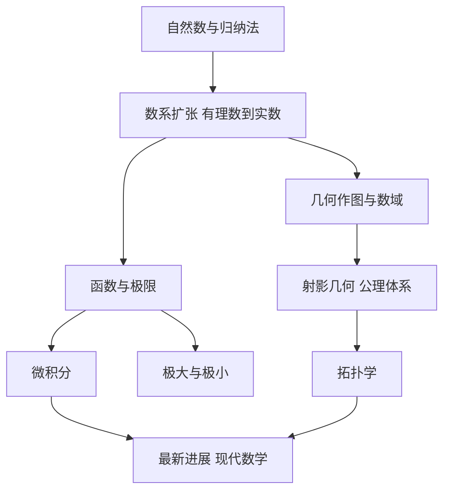

# 《什么是数学》点化学习系统

## 这本书在讲什么

柯朗和罗宾斯要回答的是"数学是什么"，处理办法不是下定义，而是把数学的主要部分走一遍：数系怎么扩张、几何怎么分类、极限怎么定义、极值怎么找、微积分怎么统一。全书的主线是一句话——数学的每一步发展都是被一个"算不下去"逼出来的，而每一次扩张都保住了旧有的规则。

这本书写于 1941 年，第四版由斯图尔特补写了"最新进展"一章。它的特点是几乎不用形式化语言，所有概念都从具体问题引入，这正是它适合零基础读者的原因。

## 全书心智模型

看图说明：左列是"结构"路线，从计数走到空间形式；右列是"分析"路线，从数走到极限再走到微积分。两条线在最后一章汇合，接上 20 世纪的数学。

## 学习路径（推荐顺序）

| 步骤 | 章节 | 主题 | 前置 | 检查点 |
|---|---|---|---|---|
| 01 | ch01 | 自然数与数学归纳法 | 无 | 通过 ch01 自测，能独立写出一个归纳证明 |
| 02 | ch02 | 数学中的数系 | ch01 | 通过 ch02 自测，能复述 √2 的反证 |
| 03 | ch03 | 几何作图与数域 | ch02 | 通过 ch03 自测，能说出三个难题各卡在哪 |
| 04 | ch04 | 射影几何、公理体系、非欧几何 | ch03 | 通过 ch04 自测，能写出一个对偶命题 |
| 05 | ch05 | 拓扑学 | ch04 | 通过 ch05 自测，能算出一个多面体的 χ |
| 06 | ch06 | 函数与极限 | ch02、ch05 | 通过 ch06 自测，能写出 ε-δ 定义 |
| 07 | ch07 | 极大与极小 | ch06 | 通过 ch07 自测，能区分驻点与极值点 |
| 08 | ch08 | 微积分 | ch06、ch07 | 通过 ch08 自测，能用定义算一个定积分 |

## 章节索引

- 第 1 章 自然数与数学归纳法（难度 ★☆☆）→ `chapters/ch01-自然数与归纳法.md`
- 第 2 章 数学中的数系（难度 ★★☆）→ `chapters/ch02-数学中的数系.md`
- 第 3 章 几何作图与数域的代数（难度 ★★☆）→ `chapters/ch03-几何作图与数域.md`
- 第 4 章 射影几何、公理体系与非欧几何（难度 ★★☆）→ `chapters/ch04-射影几何与公理体系.md`
- 第 5 章 拓扑学（难度 ★★☆）→ `chapters/ch05-拓扑学.md`
- 第 6 章 函数与极限（难度 ★★☆）→ `chapters/ch06-函数与极限.md`
- 第 7 章 极大与极小（难度 ★★☆）→ `chapters/ch07-极大与极小.md`
- 第 8 章 微积分（难度 ★★★）→ `chapters/ch08-微积分.md`

## 前置知识（零基础缺口补讲）

| 缺口 | 对应补讲位置 | 学完标志 |
|---|---|---|
| 不会用字母表示一般规律 | ch01「算术的基本规律」 | 能看懂 `a(b+c)=ab+ac` 是在说什么 |
| 没接触过反证法 | ch02「不可公度与无理数」 | 能独立写出 √2 不是有理数的证明 |
| 不知道什么是域 | ch03「可作图与数域」 | 能说出"对加减乘除封闭"是什么意思 |
| 没学过极限 | ch06「数列的极限」 | 能按 ε-N 定义验证 `1/n→0` |
| 没学过导数 | ch08「导数的三种身份」 | 能用定义算 `x²` 的导数 |

## 术语表 / 模式库 / 速查表 入口

- 术语表：`glossary.md`
- 模式与框架：`patterns.md`
- 速查表：`cheatsheet.md`
- 测验：`quiz.md`
- 抽认卡：`flashcards.md`
- 学习路径：`paths/learn.md`
