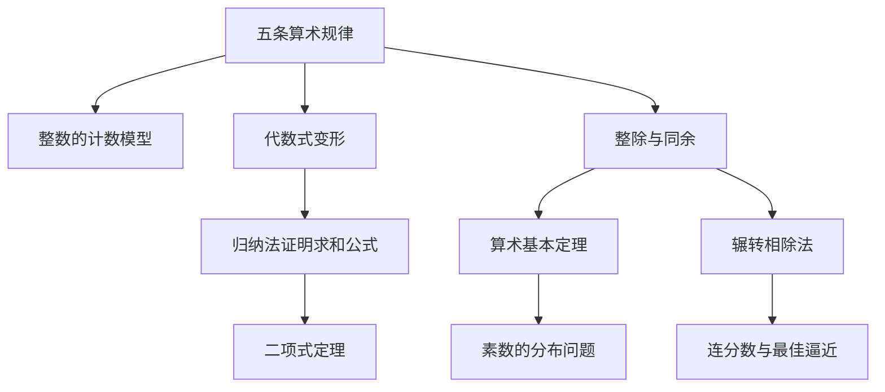

# 第 1 章：自然数与数学归纳法

- **难度**：★☆☆ | **预估学时**：2.5 小时 | **前置**：会做整数四则运算
- **对应原书**：第 1 章「自然数」§1—§2，第 1 章补充「数论」§1—§4（原书 p42—119）

## 学习目标

学完本章，你能：

1. 说出算术的五条基本规律，并解释为什么它们需要被当成公理而不是"显然的事"。
2. 用数学归纳法完整写出一个求和公式的证明，指出基底步和递推步各在哪。
3. 用辗转相除法求两个整数的最大公因数，并说明它为什么能给出算术基本定理。
4. 判断一个归纳证明错在哪里，说出它失效的具体一步。

## 一句话核心

自然数的全部算术都能从五条规律推出来；数学归纳法是把无穷多个待证情形压成"第一步 + 每一步"的证明机器。

## 零基础讲解

### 概念：算术的基本规律（难度：基础）

**规律**在这里不是"通常如此"，而是"对任意两个整数都成立"。把这句话写成符号，才有办法讨论：

- 交换律：`a + b = b + a`，`a · b = b · a`
- 结合律：`(a + b) + c = a + (b + c)`，`(a · b) · c = a · (b · c)`
- 分配律：`a · (b + c) = a · b + a · c`

柯朗在书里做了一个容易被跳过的动作：他拿化学举例。硫酸倒进水里得到稀硫酸，水倒进纯硫酸里会把容器炸掉。两种"加法"的结果完全不同，交换律在这里失效。这个例子的用处不是讲化学，而是说明**这几条规律只对特定的运算对象成立**，它们不靠"看起来显然"来保证。

**类比**：五条规律像游戏规则。象棋里"马走日"不是因为马想走日，而是规则这么定；一旦换了棋盘，规则就得重新立。这个类比的边界在于：整数不是人定的游戏，它有实际计数模型（书里用方框里的点来演示加法和乘法），规律之所以成立，是因为那个模型里确实成立。

### 概念：数学归纳法（难度：基础）

要证明"对所有自然数 n，某命题 P(n) 成立"，逐个验证 n=1,2,3… 永远验不完。归纳法把它换成两步：

1. **基底步**：验证 P(1) 成立。
2. **递推步**：假设 P(n) 成立，推出 P(n+1) 也成立。

两步做完，结论就对所有自然数成立。

**类比**：一排多米诺骨牌。推倒第一块，并保证"任意一块倒下都会撞倒下一块"，那么整排都会倒。这个类比的边界有两处：骨牌必须是连续排列的（对应"每个 n 都能推到 n+1"，中间不能断），而且骨牌必须是有限或可数无限的一排（归纳法管不了实数连续统，那是第 2 章要处理的问题）。

写递推步时常见的写法是"假设 P(n) 成立"，这个假设叫**归纳假设**。它不是循环论证：你假设的是第 n 块已倒，要证的是第 n+1 块会倒，两件事不同。

### 概念：等差级数与等比级数（难度：基础）

**等差级数**是相邻两项差为常数 d 的数列之和：

`a + (a+d) + (a+2d) + … + (a+(n−1)d) = n·a + d·n(n−1)/2`

**等比级数**是相邻两项比为常数 q 的数列之和（q ≠ 1 时）：

`a + aq + aq² + … + aq^(n−1) = a(q^n − 1)/(q − 1)`

书里特意提醒：这两个公式不是"背下来的"，都能用归纳法证。等差那个还可以用高斯小时候的办法：把和倒着写一遍再相加，每一对都等于首项加末项。

### 概念：二项式定理与帕斯卡三角（难度：进阶）

`(a+b)^n` 展开后每项的系数是组合数 `C(n,k)`，排列成三角形就是帕斯卡三角。它满足 `C(n,k) = C(n−1,k−1) + C(n−1,k)`，这条递推关系正是归纳法证明二项式定理的关键一步。

书里用这个例子说明一件事：**归纳法不只证等式，也能证"结构如何生成"**。帕斯卡三角的每一行由上一行相加得到，这是构造性的，不只是计数。

### 概念：素数与算术基本定理（难度：基础）

**素数**是大于 1 且只能被 1 和自身整除的整数。**算术基本定理**说：每个大于 1 的整数都能唯一地分解成素数的乘积（不计次序）。

这里的"唯一"需要证明，而且证明用的是反证法加最小反例：假设有不满足的整数，取其中最小的 n，它会导出更小的反例，矛盾。

书里还给了素数无穷多的欧几里得证明：假设只有有限个素数 p₁…pₖ，构造 N = p₁p₂…pₖ + 1，N 除以任何一个 pᵢ 都余 1，所以 N 要么自己是新素数，要么含新素因子。两种情况都和"只有这些素数"矛盾。

### 概念：同余与费马小定理（难度：进阶）

**同余**是"除以 m 余数相同"的等价关系，记作 `a ≡ b (mod m)`。它把整数按余数分成 m 类，加减乘都能在这 m 类上做，这一结构后来在第 4 章的公理体系里叫**剩余类环**。

**费马小定理**：若 p 是素数且 a 不被 p 整除，则 `a^(p−1) ≡ 1 (mod p)`。

它的一个实用后果是快速检验一个大数是否为素数（费马检验），但书里也提醒这类检验会漏（伪素数存在）。

### 概念：欧几里得算法与连分数（难度：进阶）

**辗转相除法**求最大公因数：用较大数除以较小数取余，再把除数当被除数、余数当除数，直到余数为 0，最后一个非零余数就是最大公因数。

它为什么有效，靠一条等式：`gcd(a,b) = gcd(b, a mod b)`。因为 a 和 b 的任何公因数都整除 a − qb，反之亦然。

书里把这个算法一路推到**连分数**：把除法过程中的商依次排开，就得到 a/b 的连分数展开，它给出有理数的最佳逼近。这条线索在第 2 章讲无理数时会再出现一次。

## 图示

看图说明：左上是全章的起点，两条主线分别是"代数恒等式"和"整除结构"。前者通向求和公式与二项式定理，后者通向素数、最大公因数和连分数。第 2 章会从右下角那条线接着往下走。

## 类比与实例

**类比**：归纳法像对账。你核对了第一笔，又证明了"任意一笔对得上就能让下一笔也对上"，那么整本账都对得上。失效边界：账页必须是连续编号的，跳号的地方就断链了。

**实例**：证明 `1 + 3 + 5 + … + (2n−1) = n²`。

基底步：n = 1 时左边 = 1，右边 = 1² = 1，成立。

递推步：假设 `1 + 3 + … + (2n−1) = n²`。要证 n+1 的情形成立，即

`1 + 3 + … + (2n−1) + (2n+1) = (n+1)²`

左边用归纳假设替换前 n 项，得 `n² + (2n+1) = n² + 2n + 1 = (n+1)²`。等号右边正是要证的形式，递推步完成。

两步合起来，对一切自然数 n 成立。

**第二个实例**：求 `gcd(1071, 1029)`。

1071 − 1029 = 42，所以 1071 ≡ 42 (mod 1029)，`gcd(1071,1029) = gcd(1029,42)`。
1029 = 42 × 24 + 21，`gcd(1029,42) = gcd(42,21)`。
42 = 21 × 2 + 0，余数为 0，最大公因数是 21。

## 常见误解

- **别以为归纳法验了几项就算证完了**——验 n = 1,2,3 只说明前三块骨牌倒了。递推步必须写成"假设 P(n) 推出 P(n+1)"，缺这一步就没有覆盖到无穷。
- **别以为递推步可以从 P(n) 直接推到 P(n+1) 而不做假设**——那等于把要证的东西用了一次。递推步的合法性来自归纳假设。
- **别以为"显然"是可以接受的证明**——柯朗用化学反例说明，直觉上的显然只对熟悉的运算对象成立。数学里要的是从公理出发的推导。
- **别以为归纳法能证明实数命题**——实数不可数，没有"下一块骨牌"，实数上的命题要走第 2 章的极限与完备性。

## 自测题（答案）

1. **单选**：数学归纳法证明中，"假设 P(n) 成立"这一步的作用是（　）。
   - A. 证明 P(n) 对所有 n 成立
   - B. 作为递推步的前提，用来推出 P(n+1)
   - C. 验证基底情形
   - D. 证明命题的唯一性

   **答案：B**。解析：归纳假设是递推步的出发点，本身不构成结论。基底步单独由 A 之外的第一步完成。

2. **填空**：`gcd(1071, 1029)` 的值是（　）。

   **答案：21**。解析：1071 与 1029 之差为 42，1029 = 42×24+21，42 = 21×2，最后非零余数为 21。

3. **简答**：证明素数有无穷多个，并指出证明中"构造 N = p₁p₂…pₖ + 1"为什么能导出矛盾。

   **答案要点**：假设素数有限，列出全部 p₁…pₖ。令 N 为它们乘积加 1。N 除以任一 pᵢ 余 1，故没有任何 pᵢ 整除 N。N > 1，按算术基本定理它必有素因子，这个素因子不在列表中，与"已经列全"矛盾。所以素数不能有限。

## 复习锚点

- 五条算术规律不是"显然"，它们是对整数计数模型成立、对别的对象可能失效的规则。
- 归纳法 = 基底步 + 递推步；两条都写完才算证完，缺一条覆盖不到全体。
- 辗转相除法的合法性来自 `gcd(a,b) = gcd(b, a mod b)`，它同时是算术基本定理和连分数的入口。
