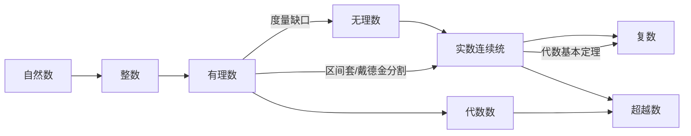

# 第 2 章：数学中的数系

- **难度**：★★☆ | **预估学时**：4 小时 | **前置**：第 1 章（归纳法、同余）
- **对应原书**：第 2 章 §1—§6，第 2 章补充「集合代数」（原书 p120—210）

## 学习目标

学完本章，你能：

1. 从"度量长度"出发说明分数为什么必须成为独立的数，而不只是未完成的除法。
2. 用反证法证明 √2 不是有理数，并说清这个证明依赖的整除前提。
3. 说明为什么有理数在数轴上是"稠密"的却仍然到处都是洞，以及区间套怎么把这些洞补上。
4. 区分可数与不可数，说清康托对角线证明的关键一步。
5. 解释复数为什么不是"凭空造出来的符号"，以及代数基本定理说了什么。

## 一句话核心

数系的每一步扩张都是被一次"算不下去"逼出来的：分数补上除法的缺口，无理数补上度量的缺口，复数补上方程求根的缺口。

## 零基础讲解

### 概念：从度量到分数（难度：基础）

自然数用来数个数。度量一件连续的量（长度、重量、时间）时，事情变了：一截绳子的长度往往不是"整 3 个单位"，而是落在 3 和 4 之间。处理办法是把单位等分成 n 份，用 `m/n` 去表示。这一步把**度量问题**变成了**计数问题**，也把 `m/n` 从一个"测量记录"变成独立的数。

关键转折在于：一旦 `m/n` 独立成数，它就得服从算术规律，而这些规律必须**定义**出来，不能从度量里直接看出来。书里给的定义是：

`a/b + c/d = (ad + bc)/(bd)`，`(a/b)(c/d) = ac/(bd)`，`a/b = c/d` 当且仅当 `ad = bc`

为什么要定成这样？因为只有这样定，第 1 章那五条规律才在分数范围内继续成立。柯朗的说法很直接：这些规则是按我们的意志加上去的，除了相容和好用，没有先验的必要性。

**类比**：给新员工定报销规则。规则不是从天上掉下来的，是你定的；但定完以后必须和已有的财务制度对得上，否则整套账就乱了。类比失效的边界：数学规则还要满足"扩张后旧结论不变"，这一条比公司制度更硬。

### 概念：不可公度与无理数（难度：进阶）

正方形的对角线与边长之比 `√2` 不能写成两个整数之比。证明用反证法：设 `√2 = p/q` 且 p、q 已约到最简（互素），则 `p² = 2q²`，所以 p 是偶数，设 p = 2r，代回得 `4r² = 2q²`，即 `q² = 2r²`，q 也是偶数。p 和 q 都是偶数，与"已约到最简"矛盾。

这个证明的关键前提是**每个有理数都能写成最简分数**，也就是第 1 章的算术基本定理。逻辑链条不能断在这里：如果约分不唯一，反证法就失效了。

**不可公度**（不能用同一个单位同时量尽）这件事在当时是危机：毕达哥拉斯学派相信万物皆可用整数比表达，这个发现直接推翻了它。

### 概念：极限与区间套（难度：进阶）

有理数稠密：任意两个有理数之间还有有理数。但稠密不等于没有洞，`√2` 的位置上就没有有理数。

补洞的办法是**区间套**：取一串嵌套的区间 `[a₁,b₁] ⊃ [a₂,b₂] ⊃ …`，长度趋于 0。如果这些区间的端点都是有理数而长度可以任意小，它们就"锁定"了一个点。这个点可能是有理数，也可能不是；把所有这样的锁定位置都算进来，就得到**实数连续统**。

书里还给了另一条等价路径：**戴德金分割**。把一个有理数集分成左右两半，左半没有最大元、右半没有最小元，这个"切口"本身就定义了一个实数。两条路径的共同点是把"数"从"可以用分数表示"改成"可以用有理数逼近"。

**类比**：用越来越窄的取景框对准一颗星，框可以小到任意程度，星的位置就由这串框定下来。失效边界：框必须真的一层套一层并且宽度趋于 0，光换位置而不收缩是锁不住的。

### 概念：可数与不可数（难度：高难）

**可数**指能和自然数一一对应。有理数是可数的：把分数按分子分母之和排序，`1/1, 1/2, 2/1, 1/3, 2/2, 3/1, …`，每个有理数都会在某一层出现。

实数不可数，康托的对角线证明：假设 0 到 1 之间的实数能排成一列，把每个写成无限小数，构造一个新数，它的第 n 位与第 n 个数的第 n 位不同。这个新数在每一位上都和第 n 个数不同，所以不在列表中，与"已经排全"矛盾。

**基数**是集合大小的度量。可数集合的基数是 ℵ₀，连续统的基数更大。

### 概念：复数与代数基本定理（难度：进阶）

方程 `x² + 1 = 0` 在实数里无解。引入 `i² = −1` 后，`a + bi` 构成复数。复数有几何解释：平面上的点，加法是向量平移，乘法是"模相乘、角相加"。由此得到**棣莫弗公式** `(cos θ + i sin θ)^n = cos nθ + i sin nθ`。

**代数基本定理**：每个次数 ≥ 1 的复系数多项式至少有一个复根。它的意义是数系扩张到此为止：再往上的方程不会逼出新的数。

### 概念：代数数与超越数（难度：高难）

**代数数**是某个整系数多项式的根；不是代数数的实数叫**超越数**。刘维尔构造出第一个超越数（用连分数的逼近速度做文章），后来康托用基数论证说明超越数不仅存在，而且比代数数"多得多"。

### 概念：集合代数（难度：基础）

补充部分把集合的并与交写成一套运算律：交换、结合、分配，还有德摩根律 `(A∪B)' = A'∩B'`。它和算术共用同一套骨架，这一点在第 6 章讲函数时会被用上。

## 图示

看图说明：两条从有理数出发的路在实数处汇合。向上的箭头标出的是"为什么必须扩张"，不是时间顺序。代数数与超越数是实数内部的另一条分界线，和"有理/无理"这条线交叉。

## 类比与实例

**类比**：数系扩张像修路。先有土路（自然数），发现过不了河就架桥（分数），发现桥墩地基不够深就往下打桩（无理数），最后发现整片区域都需要连通（连续统）。失效边界：修路是补缺口，数学扩张还必须保证旧路上的规则在新路上照样成立。

**实例**：把 `0.333…` 写成最简分数。

设 `x = 0.333…`，则 `10x = 3.333…`，两式相减得 `9x = 3`，所以 `x = 1/3`。这个推导的合法性来自第 1 章的等比级数求和：`0.333… = 3/10 + 3/100 + …` 是首项 `3/10`、公比 `1/10` 的无穷等比级数，和为 `(3/10)/(1 − 1/10) = 1/3`。

**第二个实例**：用棣莫弗公式求 `(1+i)^8`。写成极坐标：`1+i = √2 (cos45° + i sin45°)`，于是 `(1+i)^8 = (√2)^8 (cos360° + i sin360°) = 16`。

## 常见误解

- **别以为有理数稠密就等于没有洞**——稠密说的是任意两个有理数之间还有有理数，它并不保证每个位置都有有理数。`√2` 就在那里但不是有理数。
- **别以为"无限小数"都是无理数**——循环小数全是有理数，`0.333… = 1/3`；只有不循环的无限小数才对应无理数。
- **别以为复数是为了好玩造出来的符号**——它是为了让每个多项式方程都有根，代价是放弃"数必须能比大小"这条直觉。
- **别以为可数就是"无穷多"**——自然数和有理数都无穷多且可数，实数也无穷多但不可数。可数衡量的是能不能编号，不是数量多少。

## 自测题（答案）

1. **单选**：√2 不是有理数的证明中，"设 √2 = p/q 且 p、q 互素"这一步的作用是（　）。
   - A. 保证 q 不为 0
   - B. 保证 p、q 都是偶数
   - C. 为"p、q 同为偶数"与"互素"的矛盾埋下条件
   - D. 说明 √2 是小数

   **答案：C**。解析：推导得到 p、q 都是偶数后，必须用"互素"来制造矛盾。若不做最简假设，同为偶数并不构成矛盾。

2. **填空**：`0.272727…` 化成最简分数是（　）。

   **答案：3/11**。解析：设 x = 0.272727…，100x = 27.2727…，相减得 99x = 27，x = 27/99 = 3/11。

3. **简答**：说明为什么"有理数在数轴上稠密"和"实数不可数"这两件事可以同时成立。

   **答案要点**：稠密是拓扑性质，指任意小区间内都有有理数；不可数是基数性质，指有理数无法与实数一一对应。有理数在数轴上到处都有，但"到处有"只保证每个区间非空，不保证覆盖全部点。康托对角线证明给出的是：把实数排成一列必然漏掉某个数，因此实数的基数大于可数基数，尽管有理数在其中稠密。

## 复习锚点

- 分数成为独立的数，靠的是把加法乘法和相等定义出来，并让五条规律继续成立。
- 实数 = 有理数 + 用区间套或戴德金分割锁定的那些位置；"稠密"补不了这个洞。
- 复数的合法性来自几何解释和代数基本定理，不是来自"定义一个符号"。
