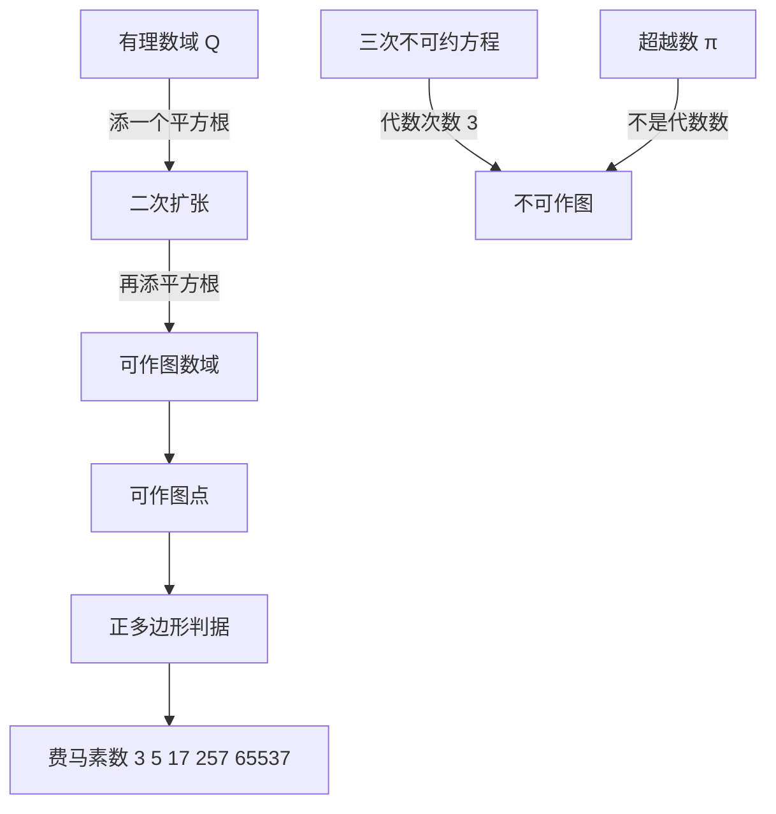

# 第 3 章：几何作图与数域的代数

- **难度**：★★☆ | **预估学时**：4 小时 | **前置**：第 2 章（代数数、复数）
- **对应原书**：第 3 章「几何作图 数域的代数」第 1 部分与第 2 部分（原书 p211—276）

## 学习目标

学完本章，你能：

1. 说明尺规作图允许的每一步对应哪种代数运算，并写出可作图点所在的数域。
2. 证明倍立方体、三等分任意角、作正七边形在尺规下不可实现，指出每个证明卡在哪条代数条件上。
3. 说清"化圆为方"为什么比前三个更难，它需要的是超越性而不是代数次数。
4. 解释反演变换怎么把直线和圆互相变，以及马歇罗尼定理说了什么。

## 一句话核心

尺规能做的事，代数上就是"从已知数出发反复加减乘除和开平方"；三个古希腊难题做不出来，是因为它们要求的数不落在这个范围里。

## 零基础讲解

### 概念：可作图与数域（难度：进阶）

尺规作图只有两类动作：过两点作直线，以一点为圆心过另一点作圆。两直线的交点、直线与圆的交点、两圆的交点，是唯一能产生新点的位置。把这些交点坐标算出来，会发现它们只用到四则运算和**开平方**。

由此得到一个关键结论：从长度为 1 的线段出发，所有可作图线段的长度都落在某个**数域**里，而这个数域是从有理数出发、每次添一个平方根扩张出来的。这类扩张叫**二次扩张**，扩出来的次数是 2 的幂。

这里的**数域**指一个对加减乘除封闭的数集。有理数本身是一个域，实数、复数也是。

**类比**：可作图点像用固定工具箱搭出来的位置。工具箱里只有直尺和圆规，能搭出的高度是有限的层级；每加一层平方根，就多一层台阶。做不到的东西不是手艺不够，是台阶不够高。失效边界：如果允许三等分角尺或其他工具，台阶就变了，结论随之改变（书里第 2 部分正是讲这个）。

### 概念：正多边形的可作图性（难度：进阶）

正 n 边形可作，等价于 `cos(2π/n)` 可作。高斯给出了完整判据：n 必须是 2 的幂乘以若干个**互不相同的费马素数**（形如 `2^(2^k) + 1` 的素数）。

前几个费马素数是 3、5、17、257、65537。所以正 3、4、5、6、8、10、12、15、16、17 边形可作，正 7、9、11、13 边形不可作。正十七边形可作是高斯 19 岁的成果，也是他决定投身数学的理由。

### 概念：三个不可解问题（难度：高难）

**倍立方体**：要求作出 `³√2`。这个数是三次方程 `x³ − 2 = 0` 的根。若 `x³ − 2` 在有理数上不可约，则 `³√2` 的代数次数是 3，不是 2 的幂，所以不可作。不可约性用有理根检验：候选有理根只有 ±1、±2，代入均不为 0，因此没有一次因式，三次多项式不可约。

**三等分任意角**：以 60° 为例，三等分要作出 20°，等价于解 `4cos³20° − 3cos20° = cos60° = 1/2`。令 `x = 2cos20°`，方程变成 `x³ − 3x − 1 = 0`。这个三次方程没有有理根（候选 ±1 代入得 −3 和 1），所以不可约，`2cos20°` 的代数次数是 3，不可作。

**正七边形**：`cos(2π/7)` 满足一个三次不可约方程（由分圆多项式 `x⁶ + x⁵ + … + 1` 约化而来），次数是 3，不可作。

**化圆为方**：要求作出 `√π`。这里的问题不在次数，而在**π 是超越数**（林德曼 1882 年证明）。超越数不是任何整系数多项式的根，连"代数次数"都谈不上，所以尺规更够不着。前三个难题的证明只用到代数次数，这个要用到超越性，难度不在一个层级。

**类比**：前三个难题像要打开一把锁，钥匙的齿数不对；化圆为方是连锁孔的形状都不在钥匙库里。失效边界：这个类比只说明难度差别，不说明证明方法差别。

### 概念：反演变换（难度：进阶）

**反演**关于一个圆（圆心 O、半径 r）把点 P 映到射线 OP 上的 P′，满足 `OP · OP′ = r²`。它有两个好用性质：

- 过 O 的直线不变，不过 O 的直线变成过 O 的圆；不过 O 的圆变成不过 O 的圆。
- 角度保持不变（保角），只是方向反转。

**阿波罗尼斯问题**（作一个圆与给定三个圆相切）用反演可以大幅简化：把其中一个圆反演成直线，问题就退化成"作圆与两条直线和一个圆相切"。书里用这个例子说明变换的价值：不是把问题算得更快，而是把问题变成另一个已知能解的问题。

### 概念：只规作图与机械工具（难度：进阶）

**马歇罗尼定理**：凡是尺规能作的图，只用圆规也能作。这条定理推翻了一个直觉：直尺不是必需品。证明思路是用圆规模拟"作直线与圆相交"，代价是步骤变多。

书里还讲了**连杆机构**：用铰接的杆件画出直线（波西里叶-利普金连杆）或实现反演（哈特反演器）。这类装置的意义在于，它把"作图"从纸面搬到了机械，后来影响了蒸汽机与机床的设计。

## 图示

看图说明：左侧是"能作"的链条，每加一层平方根扩一次域；右侧是"不能作"的两类理由，一类是次数不是 2 的幂，一类是根本不在代数数里。中间那条判据把两边连起来。

## 类比与实例

**类比**：可作图数域像一个只能用加法、乘法、除法和"开平方"按钮的计算器。按多少次都行，但按不出立方根。倍立方体要的正是立方根，所以按钮不够用。失效边界：这个类比没有说清"为什么开平方对应尺规"，那需要看圆与直线交点的坐标公式。

**实例**：验证 `x³ − 3x − 1 = 0` 没有有理根。

有理根定理说，整系数多项式的有理根 `p/q`（最简）必满足 p 整除常数项、q 整除首项系数。这里首项系数是 1，常数项是 −1，所以候选只有 ±1。代入：`1 − 3 − 1 = −3 ≠ 0`，`−1 + 3 − 1 = 1 ≠ 0`。两个候选都不成立，方程无有理根。三次多项式若无一次因式则不可约，因此 `2cos20°` 的代数次数为 3，三等分 60° 不可作。

## 常见误解

- **别以为"作不出来"是因为没人足够聪明**——不可能性有证明，证明的对象是工具允许的运算范围，不是人的能力。
- **别以为尺规作图的限制只是"工具简陋"**——真正的限制是代数结构：只允许二次扩张。换成允许标记刻度的直尺，倍立方体就能作。
- **别以为化圆为方和另外三个是同一类难题**——前三个靠代数次数排除，化圆为方靠 π 的超越性，后者需要 1882 年的林德曼定理。
- **别以为圆规比直尺弱**——马歇罗尼定理说明只用圆规就够，直尺可以省掉。

## 自测题（答案）

1. **单选**：尺规作图能构造的数，其代数次数必须是（　）。
   - A. 任意整数
   - B. 2 的幂
   - C. 素数
   - D. 3 的倍数

   **答案：B**。解析：每一步作图只引入平方根，域扩张次数每次乘 2，总次数是 2 的幂。

2. **填空**：正 n 边形可作的必要条件是 n 形如 `2^k · p₁p₂…pₛ`，其中各 `pᵢ` 是互不相同的（　）素数。

   **答案：费马**。解析：高斯的判据要求这些奇素因子必须是形如 `2^(2^m)+1` 的费马素数。

3. **简答**：为什么"化圆为方"不能用"代数次数不是 2 的幂"来排除？

   **答案要点**：那条判据只适用于代数数。π 是超越数，不是任何整系数多项式的根，因此没有代数次数可言。要排除它必须证明 π 的超越性（林德曼定理），这属于另一类论证。

## 复习锚点

- 尺规的代数本质是二次扩张，可作图数的次数是 2 的幂，这条判据一次性排掉三个古希腊难题。
- 正多边形判据：2 的幂乘互不相同的费马素数。
- 反演把直线和圆互换并保角，阿波罗尼斯问题因此可以降级成切直线的问题。
