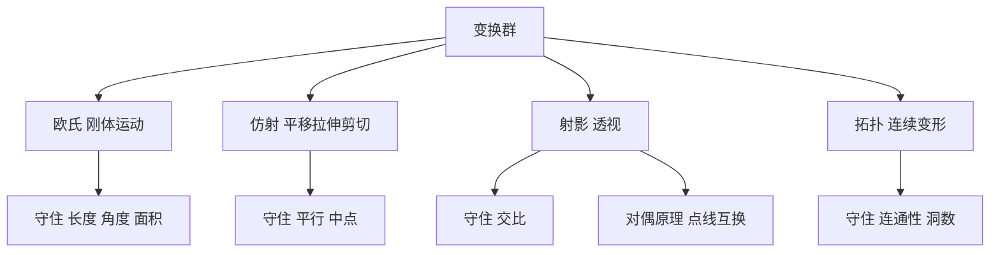

# 第 4 章：射影几何、公理体系与非欧几何

- **难度**：★★☆ | **预估学时**：4 小时 | **前置**：第 3 章（数域与不可能性）
- **对应原书**：第 4 章 §1—§5（原书 p277—365）

## 学习目标

学完本章，你能：

1. 用"在什么变换下不变"给几何分类，说出欧氏几何、仿射几何、射影几何分别守住什么。
2. 说明交比为什么是射影不变量，而长度、角度、平行都不是。
3. 写出射影平面上的对偶原理，并把一个定理的对偶定理写出来。
4. 解释公理体系的相容性与独立性各是什么，为什么非欧几何的模型能证明它相容。

## 一句话核心

几何学的种类由"允许做什么变换"决定；换个变换集合，守住的量就变，几何就换了一门。

## 零基础讲解

### 概念：按变换分类的几何（难度：基础）

克莱因在 1872 年的厄兰格纲领里给了一个统一说法：一门几何由它的**变换群**决定，几何命题就是在这个变换群下保持不变的性质。

- **欧氏几何**：允许刚体运动（平移、旋转、反射）。守住长度、角度、面积。
- **仿射几何**：允许更一般的仿射变换（含拉伸、剪切）。长度和角度丢了，平行性和"中点"还在。
- **射影几何**：允许射影变换（含把平行线变成相交、把有限点送到无穷远）。平行也不保了，守住的更少。
- **拓扑**：允许任意连续变形。连直线都不保，只剩连通性、洞的个数这类性质。

书里用一个很直观的实验说明这件事：把一个画着圆和两条垂直直径的软木块夹到老虎钳里压扁一半，圆变椭圆，直角不成直角，圆上各点到中心等距也不成立。但"中心平分每条直径"这条依然成立。压扁这个变换守住了什么、丢了什么，一目了然。

**类比**：同样是描述一个人，"身高体重"在换装后不变，"衣服颜色"一换就变，"是不是同一个人"怎么换都不变。选哪组描述，等于选哪门几何。失效边界：几何的变换是数学上精确的映射群，不是随便换装。

### 概念：射影变换与交比（难度：进阶）

**射影变换**来自透视：把一张平面上的图形投到另一张平面上，直线还是直线，但长度、角度、平行都被破坏。

在这种变换下活下来的量是**交比**。四个共线点 A、B、C、D 的交比定义为

`(A,B;C,D) = (AC/BC) ÷ (AD/BD)`

注意它用的是同一条直线上的长度之比，比值上面的长度扭曲会在上下相抵，所以交比在射影变换下不变。

**无穷远点**的作用是让射影几何的定理不用分情况。平行线在射影平面里交于无穷远点，"任意两条直线必相交"于是没有例外。

### 概念：对偶原理（难度：进阶）

在射影平面里，"点"和"直线"的角色可以互换：把"两点确定一条直线"和"两直线交于一点"对照着看，命题结构完全一样。这就是**对偶原理**：一个射影命题成立，把点和线互换、把关联关系反向，得到的对偶命题也成立。

书里用帕斯卡定理和布里安雄定理做了演示：圆内接六边形的三组对边交点共线（帕斯卡），圆外切六边形的三组对顶点连线共点（布里安雄）。两条定理互为对偶，证明只需要做一次。

### 概念：公理体系（难度：进阶）

希尔伯特把欧氏几何整理成若干组公理：关联公理、顺序公理、合同公理、平行公理、连续公理。整理完要回答两个问题：

- **相容性**：这些公理会不会推出矛盾？办法是造一个模型，把公理翻译成某个已知体系里成立的命题。欧氏几何可以用解析几何的实数模型来担保。
- **独立性**：某条公理能不能从其他公理推出来？如果不能，它就是独立的。平行公理的独立性靠造一个让其他公理成立、平行公理不成立的模型，也就是非欧几何。

**类比**：公理体系像一套法律条文。相容性是"这套法律不会自相矛盾"，独立性是"这条法不能从别的法推出来，必须单独立"。失效边界：法律可以有意含糊，数学公理不允许，每条都得能判定真假。

### 概念：非欧几何（难度：高难）

把平行公理换成罗巴切夫斯基公理：过直线外一点，至少有两条直线与已知直线不相交。得到的体系就是**双曲几何**。

在双曲几何里，三角形内角和小于 180°，相似三角形一定全等（因为没有可以随意缩放的角度结构），过不在同一直线上的三点不一定有外接圆。

它相容吗？有模型就相容。**庞加莱圆盘**是一个模型：把圆盘内部当平面，其中的"直线"是与边界正交的圆弧。在这个模型里，过一点可以作多条与给定"直线"不相交的"直线"，而欧氏几何的其他公理照样成立。模型的存在把双曲几何的相容性归结到欧氏几何的相容性上。

黎曼后来给出另一条路：把平行公理换成"没有平行线"，得到**椭圆几何**（球面几何是它的一个局部版本）。三种几何的差别只在对平行公理的选择，其余公理共用。

## 图示

看图说明：越往下变换越宽松，守住的量越少。这条阶梯是本章的主轴，第 5 章的拓扑学就在最下面一级。

## 类比与实例

**类比**：射影几何像从不同角度看同一张照片。正面看是矩形，斜着看是梯形，边长和角度都变了，但"四条边、两组对边交于两点"这个结构没变。交比就是那个不随视角改变的比值。失效边界：透视是中心投影，射影变换比它更一般，还包括把无穷远拉进有限区域的情形。

**实例**：验证交比在简单射影变换下的不变性。取直线上四点 A=0、B=1、C=3、D=6。交比 `(A,B;C,D) = (AC/BC)/(AD/BD) = (3/2)/(6/5) = 15/12 = 1.25`。作变换 `x ↦ 2x + 1`（一种仿射变换，也是射影变换的特例），四点变为 1、3、7、13。`AC' = 6`，`BC' = 4`，`AD' = 12`，`BD' = 10`，交比 `(6/4)/(12/10) = 1.5/1.2 = 1.25`。数值一致。

## 常见误解

- **别以为非欧几何是"错误的几何"**——它和欧氏几何一样相容，只是选了不同的平行公理。哪一个描述真实空间，要靠物理测量回答，不靠直觉。
- **别以为公理是"显然为真"的命题**——现代理解里公理是体系内的出发点，选它不选它看你想建什么体系。希尔伯特的说法是：点、线、面可以换成桌子、椅子、酒杯，只要满足公理，定理照样成立。
- **别以为射影几何只是"画法几何"**——它是一种结构，交比和对偶原理在代数几何、计算机视觉里都在用。
- **别以为无穷远点是个凑数的东西**——它让射影平面成为封闭的、没有例外情况的平面，定理因此可以统一表述。

## 自测题（答案）

1. **单选**：在射影变换下保持不变的量是（　）。
   - A. 线段长度
   - B. 两条直线的夹角
   - C. 交比
   - D. 图形面积

   **答案：C**。解析：长度、角度、面积都会被射影变换破坏，交比由同一直线上的长度比构成，比值中的尺度因子相消。

2. **填空**：非欧几何的相容性可以通过构造（　）来保证，例如庞加莱圆盘模型。

   **答案：模型**。解析：模型把非欧公理翻译成欧氏体系内成立的命题，于是非欧的矛盾会变成欧氏的矛盾。

3. **简答**：写出"两点确定一条直线"在射影平面里的对偶命题，并说明为什么它成立。

   **答案要点**：对偶命题是"两条直线确定一个交点"。在射影平面里任意两条直线都相交，平行线交于无穷远点，所以这个对偶命题成立，不需要额外条件。

## 复习锚点

- 厄兰格纲领一句话：几何 = 变换群 + 不变量。选群等于选几何。
- 射影几何守住交比，丢掉长度、角度、平行；对偶原理让定理成对出现。
- 非欧几何靠模型获得相容性，平行公理的三选一（唯一、多条、没有）分出三类几何。
