# 第 5 章：拓扑学

- **难度**：★★☆ | **预估学时**：3.5 小时 | **前置**：第 4 章（变换与不变量）
- **对应原书**：第 5 章 §1—§4 与附录（原书 p366—414）

## 学习目标

学完本章，你能：

1. 用欧拉公式 `V − E + F = 2` 检验一个多面体是否与球面同胚，并解释这个数为什么不依赖棱柱怎么切。
2. 判断两个图形是否拓扑等价，说出你用了哪条变形规则。
3. 说明若尔当曲线定理在说什么，以及它在球面上为什么失效。
4. 用亏格和欧拉示性数给闭曲面分类。

## 一句话核心

拓扑学研究的是"随便怎么揉都不变"的性质，它把几何从量长度换成数洞。

## 零基础讲解

### 概念：拓扑性质（难度：基础）

**拓扑性质**是在任意连续变形（不撕裂、不粘合）下保持不变的性质。它不是"大致不变"，而是严格的：变形必须是双向连续且可逆的映射，叫**同胚**。

在橡皮膜上画一个圆和两条互相垂直的直径，膜怎么拉怎么扭，"两条线交于一点并且把圆分成四块"这条始终成立，而"它们是直角"早就不成立了。这条就是拓扑性质。

**类比**：把图形当成面团。可以揉、压、拉，不能撕开也不能把两块粘上。拓扑学研究的是面团揉成什么形状之后还剩什么。失效边界：拓扑允许的变形不能把洞填上，也不能把新洞戳出来，这一点让洞的个数成为核心指标。

### 概念：欧拉公式（难度：基础）

对**简单多面体**（表面能连续变形为球面、没有洞的多面体），有

`V − E + F = 2`

其中 V 是顶点数，E 是棱数，F 是面数。正方体：8 − 12 + 6 = 2。三棱锥：4 − 6 + 4 = 2。

这个公式的价值在于它是拓扑的：把一个正方体削去一个角，V、E、F 都变了，但组合 `V − E + F` 还是 2，因为削角只是连续变形，洞的个数没变。

反过来，环面（甜甜圈）上 `V − E + F = 0`，因为它有一个洞。这个差值正是洞的计数器。

### 概念：连通性与若尔当曲线定理（难度：进阶）

**连通**指不能分成两个不相交的非空开集之并。直观说法是一条能走通的路。

**若尔当曲线定理**：平面上一条简单闭曲线（不自交的封闭曲线）把平面分成内部和外部两块。听起来像废话，证明却不容易，因为它涉及"内部"这个概念的严格化。

书里还提到它的一个后果：多边形版本的证明更初等，可以靠射线与边的交点个数是奇数还是偶数来判定内点外点。这个判定法在计算机图形学里就是"奇偶规则"。

在球面上，若尔当曲线定理仍然成立；在环面上就不成立了，环面上一条绕洞的闭曲线可能切不开曲面，也可能切开后两侧都带洞。

### 概念：不动点定理（难度：高难）

把一张纸揉成一团塞进原来那张纸的范围内，总有至少一个点回到了它原来的位置，这是布劳威尔不动点定理的直观版本。严格表述：闭圆盘到自身的连续映射必有不动点。

它在经济学（一般均衡存在性）、微分方程（解的存在性）里被反复使用，因为它把"存在某个解"这类问题转化成"某个连续映射有不动点"。

### 概念：曲面的分类与亏格（难度：进阶）

**亏格**是曲面上的洞的个数，直观理解为"最多能剪几刀而不把曲面剪成两块"。

闭曲面（紧致、无边界）的分类：

- 可定向的：亏格 g 的曲面，欧拉示性数 `χ = 2 − 2g`。球面 g=0，环面 g=1，双环面 g=2。
- 不可定向的：克莱因瓶、射影平面。莫比乌斯带是最有名的单侧曲面，它只有一个面、一条边，沿中线剪开会得到一个更长的带子而不是两个。

**单侧曲面**指沿法向量走一圈会回到出发点的反面。书里用莫比乌斯带演示这件事，做法很具体：拿一条纸带，扭转半圈后把两端粘上。

**类比**：亏格是"洞的预算"。球面没有预算，剪一刀就成两块；环面有一份预算，绕一圈剪开还是一整块。失效边界：这个说法对可定向闭曲面成立，克莱因瓶这类不可定向曲面要另算，书里用 `χ` 统一处理。

## 图示

```mermaid
flowchart TD
    A[橡皮膜上的图形] -->|连续变形 不撕不粘| B[同胚类]
    B --> C[欧拉示性数 χ]
    C --> D[球面 χ=2 亏格0]
    C --> E[环面 χ=0 亏格1]
    C --> F[克莱因瓶 χ=0 不可定向]
    B --> G[连通性]
    B --> H[若尔当曲线 分内外]
    B --> I[不动点定理]
```

看图说明：从"允许什么样变形"出发，落到一个数 `χ`。这个数把曲面分成几族，同族的曲面互相同胚。右边三支是拓扑学最常用的三条结论，各自对应一类问题。

## 类比与实例

**类比**：拓扑学像盘点一家店的资产，只数保险柜有几个，不关心保险柜多大、什么颜色。变形可以改大小颜色，改不了柜子个数。失效边界：拓扑还管"能不能从 A 走到 B"，连通性和洞的分布不是单纯计数能覆盖的。

**实例**：数一个足球的 `V − E + F`。传统足球用 12 个五边形和 20 个六边形拼成，共 32 个面。每个五边形的边与六边形共享，每条棱被两个面共用，所以 `E = (12×5 + 20×6)/2 = (60 + 120)/2 = 90`。顶点处总是一个五边形和两个六边形相接，每个顶点被 3 个面共用，`V = (12×5 + 20×6)/3 = 180/3 = 60`。代入：60 − 90 + 32 = 2，与球面一致。

**第二个实例**：判断"环面减去一个开圆盘"的欧拉示性数。原环面 χ=0，挖掉一个开圆盘相当于剪开一个洞并留下边界，χ 减 1，得 −1。这个曲面带一条边界，不能直接用闭曲面公式。

## 常见误解

- **别以为拓扑等价就是"看起来像"**——必须是双向连续的映射，一个圆和一个方框同胚，一个圆和一个"8"字不同胚。
- **别以为欧拉公式对所有多面体都成立**——它只对简单多面体成立。带洞的多面体（比如框形）算出来不是 2，差值正好反映洞数。
- **别以为莫比乌斯带只是个折纸游戏**——它是最简单的不可定向曲面，说明"双侧"这件事不是曲面的必然属性。
- **别以为若尔当曲线定理是显然的**——"简单闭曲线把平面分成两块"这句话里，"内部"要先定义清楚，严格证明需要拓扑工具。

## 自测题（答案）

1. **单选**：一个多面体算出 `V − E + F = 0`，它最可能是（　）。
   - A. 球面
   - B. 环面
   - C. 平面
   - D. 圆柱侧面

   **答案：B**。解析：`χ = 2 − 2g`，χ=0 对应 g=1，即有一个洞的闭曲面，典型代表是环面。

2. **填空**：莫比乌斯带只有（　）个面和一条边。

   **答案：1**。解析：它不可定向，沿法向量走一圈会到反面，所以只有一个面。

3. **简答**：为什么欧拉公式是拓扑性质而不是度量性质？

   **答案要点**：V、E、F 都是计数，不涉及长度、角度、面积。连续变形可以改变棱长和角度，但顶点数、棱数、面数在"不撕裂不粘合"的变形下保持对应关系，因此 `V − E + F` 不变。它只依赖曲面的洞数，而洞数是拓扑不变量。

## 复习锚点

- 拓扑 = 允许任意连续变形的几何，核心指标是连通性、洞数和定向性。
- 欧拉示性数 `χ = V − E + F` 是洞的计数器：球面 2，环面 0，每多一个洞减 2。
- 闭曲面按"可定向/不可定向"和亏格分类，莫比乌斯带是单侧曲面的最小模型。
