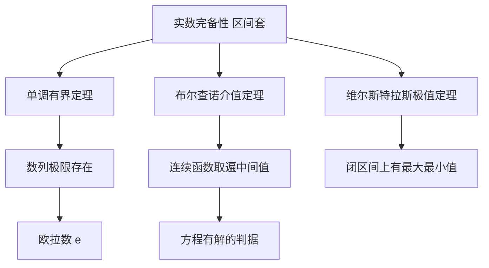

# 第 6 章：函数与极限

- **难度**：★★☆ | **预估学时**：4 小时 | **前置**：第 2 章（实数连续统）
- **对应原书**：第 6 章 §1—§6，第 6 章补充（原书 p415—502）

## 学习目标

学完本章，你能：

1. 用 ε-δ 语言写出"函数在一点连续"的定义，并说清它和"图像一笔画"的差别。
2. 判断一个数列是否收敛，算出 `q^n`、`(1+1/n)^n` 这类常见极限。
3. 说出布尔查诺定理与维尔斯特拉斯极值定理各断言了什么，为什么它们都依赖实数完备性。
4. 解释 `sin x / x → 1 (x→0)` 为什么成立，以及它和弧度制的关系。

## 一句话核心

极限把"越来越接近"变成一句可以判断真假的话：不管你把误差压到多小，后面总有一项比它更小。

## 零基础讲解

### 概念：函数（难度：基础）

**函数**是从定义域到值域的对应规则：每个输入对应唯一输出。柯朗强调，函数不等于"有一个解析式子"。素数的个数 `π(n)` 没有简单公式，它照样是函数；三角形面积是三边长的函数；气缸里气体的体积是压强和温度的函数。

这个观点在历史上打了一仗：18 世纪很多人认为函数必须能用幂级数写出，19 世纪才发现那太窄。

**反函数**把输入输出对调，条件是原函数必须一一对应。**复合函数**是串联，`f(g(x))` 先算 g 再算 f。

### 概念：数列的极限（难度：基础）

数列 `aₙ` 收敛到 L，意思是：对任意给定的 ε > 0，都存在一个 N，使得当 n > N 时，`|aₙ − L| < ε`。

这句话的结构值得拆开看。ε 是别人给的误差要求，N 是你的回应。别人要得多小都行，你都得找到一个起点，从那以后所有项都进到误差范围里。**N 可以依赖 ε**，这个依赖是定义的核心。

**类比**：验收货物。客户说"误差不能超过 0.01 毫米"，你指出"从第 500 件起都达标"。客户改成 0.001，你重新算，可能说"从第 2000 件起"。只要每次都能给出一个起点，就算收敛。失效边界：如果无论怎么往后找，总有项跳出范围，那就是发散；"看起来越来越近"不算证明。

常见的两个极限：

- `q^n → 0`（|q| < 1）。因为 `|q|^n` 单调减且有下界 0，由单调有界定理收敛，极限只能是 0。
- `(1 + 1/n)^n → e`。这个数列单调增、有上界，极限定义为 e ≈ 2.71828。

书里同时用这个极限引出 `e`，又用内接正多边形周长引出 `π`，两个常数都不是"规定"的，而是某个极限过程的结果。

### 概念：函数的极限与连续（难度：进阶）

`lim(x→a) f(x) = L` 的 ε-δ 定义：对任意 ε > 0，存在 δ > 0，使得当 `0 < |x − a| < δ` 时，`|f(x) − L| < ε`。

**连续**在这个语言里就是 `lim(x→a) f(x) = f(a)`，即极限存在且等于函数值。

**类比**：连续像一条没有台阶的路，你走一小步，高度也只变一小点。图像上"一笔画"只是直观说法，严格的判据是上面的极限等式。失效边界：有些函数处处连续却处处不可微（比如维尔斯特拉斯函数），"能一笔画"并不蕴含"光滑"。

### 概念：布尔查诺定理与极值定理（难度：高难）

**布尔查诺定理**（介值定理）：闭区间上的连续函数从负值走到正值，中间必经过 0。

**维尔斯特拉斯极值定理**：闭区间上的连续函数必取得最大值和最小值。

这两条定理看起来都"显然"，但它们的证明依赖实数完备性，也就是第 2 章的区间套。在有界闭区间上，连续函数的值域是闭区间，这件事在有理数范围内就不成立。

**紧致集**是这两个定理的舞台：闭且有界的集合。在这样的集合上，任何开覆盖都有有限子覆盖，这是把"局部性质"推到"整体性质"的桥。

### 概念：sin x / x 的极限（难度：进阶）

`lim(x→0) sin x / x = 1`。

证明靠面积比较：在单位圆里，取圆心角 x（弧度），比较三个面积：三角形、扇形、大三角形。得到 `sin x < x < tan x`，同除以 `sin x` 得 `1 < x/sin x < 1/cos x`，取倒数并夹逼，`cos x < sin x / x < 1`。当 x→0 时 `cos x → 1`，由夹逼得极限为 1。

这里用到的前提是**弧度制**：只有用弧度，扇形面积才等于 `x/2`。如果用角度，这个极限会变成 π/180。这是弧度制在微积分里不可替代的原因。

## 图示

看图说明：所有箭头最终指回左上角那条完备性。没有它，下面每一条都会失效。这是本章和上一章的分界：第 2 章把洞补上，第 6 章才能在补好的数轴上谈极限。

## 类比与实例

**类比**：ε-δ 像两个人讨价还价。对方出价 ε（要多精确），你还价 δ（走多近），只要每次都能还上价，交易就算成立。失效边界：讨价还价可以僵持，数学里必须对所有 ε 都能给出 δ，差一个都不行。

**实例**：证明 `q^n → 0`（0 < q < 1）。设 `q = 1/(1+h)`，h > 0，则 `q^n = 1/(1+h)^n`。由二项式定理 `(1+h)^n ≥ 1 + nh`，所以 `0 < q^n ≤ 1/(1+nh)`。给定 ε，解 `1/(1+nh) < ε` 得 `n > (1/ε − 1)/h`。取 N 为这个数的整数部分加一，则 n > N 时 `|q^n| < ε`。收敛性得证，且给出了 N 的具体算法。

**第二个实例**：求 `lim(n→∞) (1 + 1/n)^n` 的大致值。n=1 得 2；n=2 得 2.25；n=10 得 2.5937；n=100 得 2.7048；n=1000 得 2.7169。逐渐逼近 e ≈ 2.71828，且始终从下方逼近，符合"单调递增有上界"。

## 常见误解

- **别以为极限就是"代入数值"**——`sin x / x` 在 x=0 处没有定义，但极限存在。极限关心的是趋近过程，不是那一点的值。
- **别以为连续就一定可导**——连续只保证没有跳跃，不保证没有尖角或无限震荡。`|x|` 在 0 处连续但不可导。
- **别以为单调有界定理对有理数也成立**——它依赖实数完备性，在有理数里一个单调递增有上界的序列可能收敛到无理数，从而"没有极限"。
- **别以为 ε-δ 只是形式主义**——它是判断"能不能任意逼近"的唯一严格标准，工程师用的误差分析就是它的实际版本。

## 自测题（答案）

1. **单选**：`lim(x→0) sin x / x = 1` 的证明中，关键的不等式是（　）。
   - A. `sin x > x`
   - B. `cos x < sin x / x < 1`
   - C. `tan x < x`
   - D. `sin x < cos x`

   **答案：B**。解析：由面积比较得 `sin x < x < tan x`，取倒数并整理得 `cos x < sin x/x < 1`，再用夹逼定理。

2. **填空**：`lim(n→∞) (1 + 1/n)^n` 的值是（　）。

   **答案：e**。解析：这是 e 的定义式，数列单调递增且有上界 3，极限存在，记作 e ≈ 2.71828。

3. **简答**：为什么维尔斯特拉斯极值定理要求区间"闭且有界"？举一个去掉条件后失效的例子。

   **答案要点**：闭保证极限点不被排除，有界保证不会跑到无穷。反例：`f(x) = x` 在开区间 (0,1) 上连续，但没有最大值也没有最小值；`f(x) = 1/x` 在 (0,1] 上连续但无上界，取不到最大值。两个条件各去掉一个，定理都不成立。

## 复习锚点

- 极限的定义是"对任意 ε 存在 N 或 δ"，N 和 δ 可以依赖 ε，这个依赖是全部内容。
- 连续 = 极限等于函数值；可导比连续强，两者不等价。
- 布尔查诺定理和极值定理都站在实数完备性上，把它们抽掉，结论就不成立。
