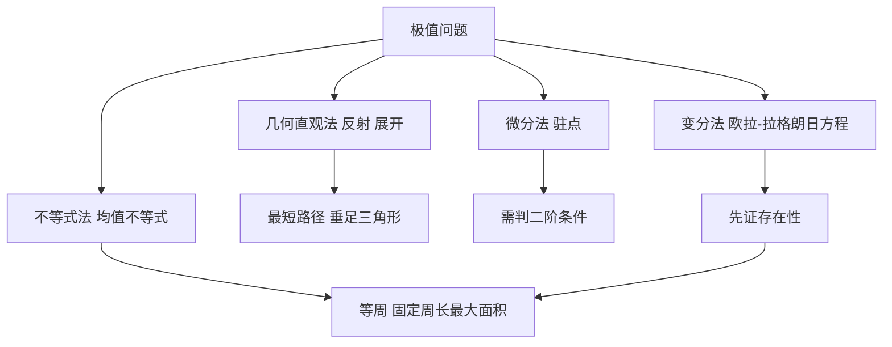

# 第 7 章：极大与极小

- **难度**：★★☆ | **预估学时**：4 小时 | **前置**：第 6 章（极限、连续）
- **对应原书**：第 7 章 §1—§10（原书 p503—591）

## 学习目标

学完本章，你能：

1. 用"等角反射"解出最短路径问题，并写出赫伦定理的证明。
2. 区分驻点、极大点、极小点和鞍点，说明为什么"导数为零"不是充分条件。
3. 用均值不等式证明固定周长下正方形面积最大。
4. 说明等周问题为什么需要存在性证明，而不只是解方程。
5. 说出变分法在做什么，它和普通极值问题的区别在哪。

## 一句话核心

极值问题有两层：先证明最优解存在，再找出它。只做第二层，很容易对着一个不存在的解算半天。

## 零基础讲解

### 概念：反射与最短路径（难度：基础）

给定直线 L 和同侧两点 P、Q，求 L 上一点 R 使 `PR + RQ` 最小。做法是把 P 关于 L 作对称点 P′，连接 P′Q 与 L 的交点就是 R。

证明：对 L 上任意点 R′，`PR′ = P′R′`（对称），所以 `PR′ + R′Q = P′R′ + R′Q ≥ P′Q`（三角不等式），等号只在 R′=R 时成立。而 `P′Q = PR + RQ`，所以 R 是最小点。

这个结论还有一个物理解释：光线反射时入射角等于反射角，正是因为光走的是最短路径。赫伦在公元一世纪就注意到这件事，它算是费马原理的雏形。

**类比**：把 L 当镜子，看自己的像在哪，然后直接朝像走过去。这条路在地面上看是折线，在"镜子后面"看是直线。失效边界：这招只在 L 是直线时好用，曲线镜面要另算。

### 概念：驻点与极值（难度：进阶）

**驻点**是导数等于零的点。在可微函数上，极值点必然是驻点，但驻点未必是极值点，`f(x) = x³` 在 0 处导数为零，那里既不是极大也不是极小，是**拐点**。

判断要靠二阶导数或导数变号：`f''>0` 是极小，`f''<0` 是极大，`f''=0` 要往高阶看。

多元函数更麻烦，除了极大极小，还有**鞍点**：沿一个方向上升、沿另一个方向下降。判定用海森矩阵的正定性。

书里还提到一个拓扑视角：极小极大点。在球面这样的紧致曲面上，任何连续函数至少有两点是"沿某条闭曲线上的极值"，这是山路引理的雏形，后来成了变分法的核心工具。

### 概念：施瓦茨三角形问题（难度：进阶）

在锐角三角形里作内接三角形，使周长最小。答案是**垂足三角形**：三条高的垂足连成的三角形。

这个结论有一串等价说法：光线在三角形内反射一圈回到原点，路径正是垂足三角形；把三角形反复镜像展开，最短路径变成一条直线。书里给了两种证法，一种用镜像展开，一种用初等几何。

### 概念：施泰纳问题（难度：进阶）

给定三角形，求一点 P 使 `PA + PB + PC` 最小。答案是**费马点**：当三个内角都小于 120° 时，费马点满足三边张角都是 120°；若有一角 ≥ 120°，最小点就是那个钝角顶点。

这个问题的解法也是旋转 60° 造等边三角形，把三段折线拉直。

书里把它推广成**道路网问题**：给若干城市修最短的连通路网，允许在中间加分叉点。答案是最小生成树与施泰纳树的组合，分叉点处的三条边两两成 120°。这个结论今天用在芯片布线和水管网络设计上。

### 概念：均值不等式与极值（难度：基础）

两个正数的算术平均不小于几何平均：

`(a + b)/2 ≥ √(ab)`，等号当且仅当 a = b。

用法：固定 `a + b = S`，则 `ab ≤ (S/2)²`，等号在 a=b 时取到。这就是"周长固定时正方形面积最大"的证明。

推广到 n 个正数：`(a₁+…+aₙ)/n ≥ (a₁…aₙ)^(1/n)`。这个不等式是极值问题里最省力的工具，很多时候不用求导就能出结果。

### 概念：最小二乘法（难度：进阶）

给一组数据点，要找一条直线使"偏差平方和"最小。**最小二乘**的名字来自这里：不是让偏差之和最小（正负会抵消），而是让平方和最小。

解法是对截距和斜率分别求偏导并令其为零，得到一个二元一次方程组。这套方法后来成了统计回归的基础。

### 概念：等周问题与变分法（难度：高难）

**等周问题**：在所有周长相同的平面闭曲线中，圆围成的面积最大。

它的难点不在列方程，而在**存在性**：在所有候选曲线里，凭什么断定最优的那条一定存在？书里 §7 专门讲这件事，用一个"取一列越来越好的曲线，取极限"的论证，需要事先限制曲线族的紧致性。没有这一步，后面的推导都是空的。

**变分法**处理的是"函数的函数"的极值，也就是在曲线族里找一条最优曲线。它的基本方程是欧拉-拉格朗日方程，由"一阶变分为零"导出。等周问题、最速降线问题、测地线问题都是它的例子。

**类比**：普通极值是山坡上找最低点，变分法是"在所有可能的路线里找最短的那条"。失效边界：变分法给的是必要条件（一阶变分为零），存在性和是否真的是极小还要另证，这一点和普通极值一样。

## 图示

看图说明：四条解题路线，右边那条最硬，因为它多了"存在性"这一关。其余三条各自有适用场景，反射法管直线与角，微分法管可微函数，不等式法管对称结构。

## 类比与实例

**类比**：找最低点像在山里找谷底。可以顺着坡度走（求导），也可以先看地图确认这座山真的有个谷底（存在性）。只顺着走，可能走到一个平台就停了，也可能走出边界。失效边界：数学里的"平台"是驻点，"走出边界"是开区间，两者的处理办法不同。

**实例**：用均值不等式证明"周长 4L 的矩形中正方形面积最大"。设长宽为 x、y，`x + y = 2L`。面积 `xy ≤ ((x+y)/2)² = L²`，等号当 x=y=L 时成立，此时是正方形。最大面积 L²，对应周长 4L。

**第二个实例**：求 `PA + PB + PC` 最小的费马点位置。以 AB 为边向外作等边三角形 ABD，连接 CD。对任意 P，把 △APB 绕 A 旋转 60°，P 落到 P′，则 `PA = PP′`，`PB = P′D`（因为旋转把 B 送到 D）。于是 `PA + PB + PC = PP′ + P′D + PC ≥ CD`，等号当 P、P′、D、C 共线时成立，此时 P 在 CD 上且三边张角 120°。

## 常见误解

- **别以为导数为零就是极值**——`x³` 在 0 处导数为零但不是极值。必须看导数是否变号或二阶导数的符号。
- **别以为极值一定在驻点**——在闭区间上，端点也可能取到最大值，端点不是驻点。
- **别以为等周问题"显然"是圆**——直觉给出答案，但证明要过存在性这一关，还要证明圆确实满足条件。历史上这个问题拖了很久才被严格解决。
- **别以为最小二乘是"让误差最小"**——它最小化的是平方和，对异常点敏感，这也是它后来被稳健回归补充的原因。

## 自测题（答案）

1. **单选**：直线 L 同侧两点 P、Q，L 上使 `PR + RQ` 最小的点 R 满足（　）。
   - A. PR 与 RQ 垂直
   - B. PR、RQ 与 L 成等角
   - C. R 是 PQ 的中点投影
   - D. R 到 P、Q 距离相等

   **答案：B**。解析：由对称点构造，R 是 P′Q 与 L 的交点，此时入射角等于反射角，两条线段与 L 成等角。

2. **填空**：固定周长的一切平面闭曲线中，围成面积最大的是（　）。

   **答案：圆**。解析：这是等周问题的结论，等号情形为圆，证明需要先确立存在性再用变分或几何论证。

3. **简答**：为什么"导数为零"只是极值的必要条件而不是充分条件？

   **答案要点**：极值点处若可微，切线水平，所以导数为零，这给出必要性。反过来，导数为零只说明切线水平，函数在该点可能继续上升（如 x³），因此不充分。判断需要看导数在两侧是否变号，或二阶导数的符号。

## 复习锚点

- 反射法把折线拉直，是解决"直线上的最短路径"的标准手法。
- 极值问题分两步：存在性、定位。跳过第一步，后面的计算可能对着一个不存在的东西做。
- 均值不等式是最省力的极值工具，对称结构下优先试它，再考虑求导。
