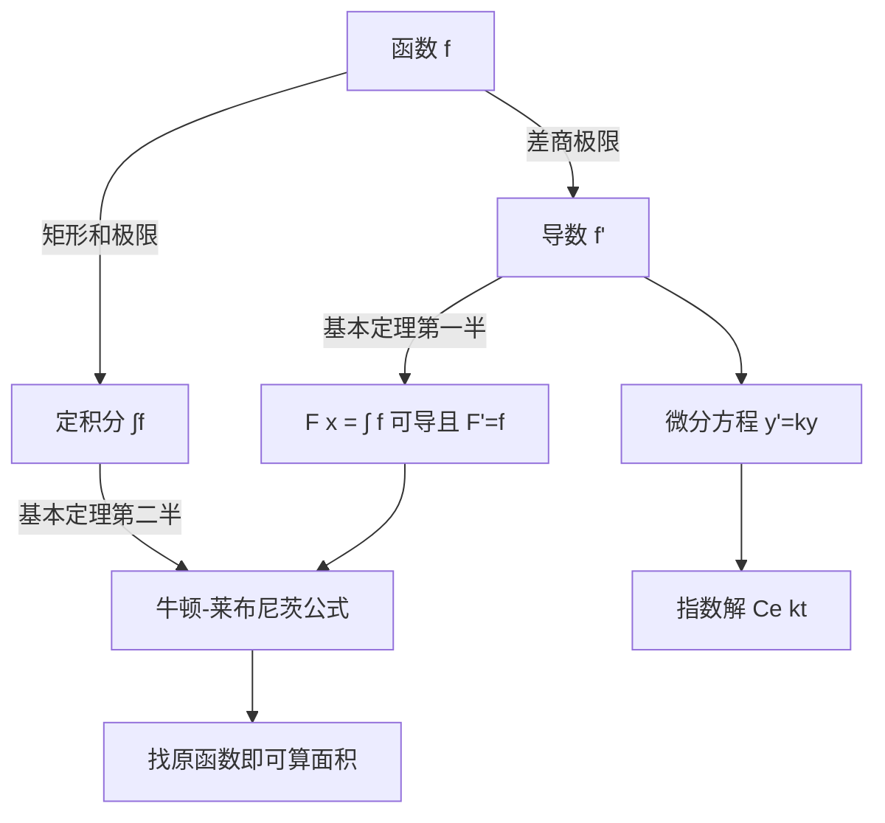

# 第 8 章：微积分

- **难度**：★★★ | **预估学时**：5 小时 | **前置**：第 6 章（极限）、第 7 章（极值）
- **对应原书**：第 8 章 §1—§7，第 8 章补充（原书 p592—733）

## 学习目标

学完本章，你能：

1. 用矩形逼近写出定积分的定义，并把 `∫₀¹ x² dx` 真的算出来。
2. 从极限定义算出 `x²` 的导数，说清导数的三种解释（斜率、速度、变化率）为什么一致。
3. 写出微积分基本定理的两半，并解释它为什么把"求面积"和"求斜率"这两个问题连成一件。
4. 用微分方程描述指数增长，并解出 `y = Ce^(kt)`。

## 一句话核心

微分和积分是同一个运算的两个方向：一个把整体切成小段看变化率，一个把无数小段拼回整体，基本定理说这两件事互为逆运算。

## 零基础讲解

### 概念：定积分（难度：进阶）

求曲线下的面积，办法是把它切成竖条。把区间 `[a,b]` 分成 n 段，每段宽度 `Δx`，在第 i 段上任取一点 `ξᵢ`，用高 `f(ξᵢ)` 的矩形代替那一小条，求和：

`Sₙ = Σ f(ξᵢ) Δx`

当 n 增大、`Δx → 0`，如果这个和趋于一个与分法和取点都无关的数，就把它定义为**定积分** `∫ₐᵇ f(x) dx`。

"与分法和取点无关"这句话是定义的关键。少了它，不同切法会得到不同结果，面积就没意义了。

**类比**：用方格纸量地图上的湖面。格子越小，估计越准；但只要湖岸足够规整，格子细到一定程度后结果就稳定下来。失效边界：函数不连续或震荡太厉害时，细格子也稳不下来，那就不叫可积。

### 概念：导数的三种身份（难度：进阶）

**导数**是差商的极限：

`f'(x) = lim(h→0) [f(x+h) − f(x)] / h`

它有三种解释，指向同一个数：

- **几何**：曲线在这一点切线的斜率。
- **物理**：位置对时间的导数就是速度，再求一次是加速度。
- **变化率**：任何量对另一个量的瞬时变化。

用定义算 `x²` 的导数：`[(x+h)² − x²]/h = (2xh + h²)/h = 2x + h`，令 h→0 得 `2x`。全过程只用了代数展开和极限，没有神秘操作。

**莱布尼茨记号** `dy/dx` 把导数写成一个比值，看起来像分数。这个记号在链式法则里特别好用，因为 `dy/dx = (dy/du)(du/dx)` 真的像分数相乘。但它是记号，不是真的除法，`dy` 和 `dx` 单独没有定义。

### 概念：微积分基本定理（难度：高难）

定理分两半：

**第一半**：若 `F(x) = ∫ₐˣ f(t) dt`，则 `F'(x) = f(x)`。求积函数对上限求导，得到被积函数。

**第二半**（牛顿-莱布尼茨公式）：`∫ₐᵇ f(x) dx = F(b) − F(a)`，其中 F 是 f 的任一原函数。

为什么成立？第一半说的是"累积量的变化率等于流入速度"。把水槽灌水，水位是累积，水龙头流量是导数。第二半说：要算总累积，只要找任意一个"流量的原函数"，用末状态减初状态。

这个定理的威力在于它把一个求和极限问题变成了"找原函数"，而找原函数有一套机械法则（幂函数、三角函数、指数函数的公式表加换元、分部积分）。这是微积分能成为通用工具的原因。

**类比**：开车旅行。速度表读数是导数，里程表读数是积分。里程表的增量等于速度对时间的积分，而"末读数减初读数"就能算总里程，不用把每一秒的速度都加起来。失效边界：这个类比对"变速但不停车"的情形有效，遇到倒车（速度为负）也成立，因为积分带符号。

### 概念：指数函数与 e（难度：进阶）

`e` 定义为 `lim(1+1/n)^n`，它出现在"增长率与当前量成正比"的一切过程中。以 e 为底的指数函数 `eˣ` 有一个别处没有的性质：它的导数等于自己。

由这个性质解微分方程 `y' = ky`，得到 `y = C e^(kt)`。放射性衰变（k<0）、复利（k>0）、简谐振动（写成复数形式）都是这个方程。

书里还给出 `ln x` 的级数展开，用它可以手算对数。这个级数收敛得慢，实际计算要用加速技巧，但思路是从这里来的。

### 概念：微分方程入门（难度：进阶）

**微分方程**是含导数的方程。`y' = ky` 是最简单的一类，解是上面那个指数函数。

牛顿动力学定律 `F = ma` 写成 `F = m d²x/dt²`，它是一个二阶微分方程，给定初始位置和初始速度就能定解。这是"用方程描述世界"的模板：定律给出局部关系，解给出全局轨迹。

## 图示

看图说明：中间那条虚线是本章的枢纽。左边两条路分别从"切"和"拼"出发，在基本定理处会合，右边是它的直接应用。

## 类比与实例

**类比**：微积分像把一段录像拆成帧再拼回去。导数是一帧一帧看变化，积分是把所有帧连成完整运动。基本定理说，只要知道每一帧的变化量，就能还原全片，不必逐帧累加。失效边界：录像是离散的，数学取的是连续极限，中间的"无穷小"要靠极限定义才站得住。

**实例**：用定义算 `∫₀¹ x² dx`。

把 `[0,1]` 分成 n 等份，取右端点，`Sₙ = Σ(i/n)² (1/n) = (1/n³) Σ i²`。

用第 1 章的平方和公式 `Σ i² = n(n+1)(2n+1)/6`，得

`Sₙ = (1/n³) · n(n+1)(2n+1)/6 = (2n³ + 3n² + n)/(6n³)`

令 n→∞，分子分母同除以 n³：`(2 + 3/n + 1/n²)/6 → 2/6 = 1/3`。

所以 `∫₀¹ x² dx = 1/3`。用基本定理验证：`x³/3` 是原函数，代入上下限得 `1/3 − 0 = 1/3`，两条路结果一致。

**第二个实例**：解 `y' = 2y`，`y(0) = 5`。通解 `y = Ce^(2t)`，代入初值 `C = 5`，得 `y = 5e^(2t)`。检验：`y' = 10e^(2t) = 2 · 5e^(2t) = 2y`，成立。

## 常见误解

- **别以为积分就是"面积"**——定积分是带符号的。曲线在 x 轴下方时积分是负的，面积要取绝对值。物理上"位移"和"路程"的差别就来自这里。
- **别以为导数就是"切线斜率"**——斜率只是几何解释。同一个数在物理里是速度，在经济学里是边际成本，换场景不换运算。
- **别以为 `dy/dx` 可以当分数随便约**——它是记号。链式法则看起来像约分，是因为定理保证了这个形式成立，不是因为 `dy` 真的是个数。
- **别以为基本定理对所有函数都成立**——它要求 f 连续（或至少可积且原函数存在）。有反例说明条件不能省。

## 自测题（答案）

1. **单选**：微积分基本定理第一半说的是（　）。
   - A. 连续函数必可积
   - B. 积分上限函数的导数等于被积函数
   - C. 导数等于切线斜率
   - D. 原函数一定存在

   **答案：B**。解析：`d/dx ∫ₐˣ f(t)dt = f(x)`，这是把积分和微分接起来的那一步。

2. **填空**：`∫₀¹ x² dx` 的值是（　）。

   **答案：1/3**。解析：原函数 `x³/3`，代入上下限得 1/3。也可用矩形和极限验证。

3. **简答**：为什么说微分方程 `y' = ky` 的解一定是指数形式？给出推导。

   **答案要点**：把方程写成 `y'/y = k`，左边是 `ln|y|` 的导数，所以 `(ln|y|)' = k`，积分得 `ln|y| = kt + C`，取指数得 `y = ±e^C e^(kt)`，合并常数记作 `y = Ce^(kt)`。这个方法要求 y 不为零，y 恒为零也是一个解。

## 复习锚点

- 定积分是矩形和的极限，且要求结果与分法无关；这一点决定了哪些函数可积。
- 导数是差商的极限，三种解释共用同一个数，换场景不换运算。
- 基本定理把"求面积"降级成"找原函数"，它是微积分成为通用工具的枢纽。
