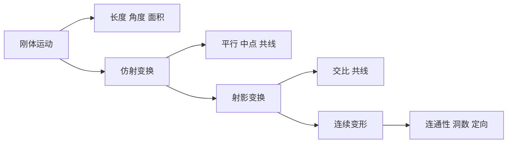

# 变换群与不变量

- **难度**：进阶 | **涉及章节**：第 4 章、第 5 章

## 一句话定义

一门几何由它允许的变换群决定，几何命题就是在这个群的变换下保持不变的陈述。

## 为什么重要

它把"几何"从一个模糊的词变成可以分类的对象。欧氏、仿射、射影、拓扑不再是四门并列的学问，而是同一件事在不同宽松程度下的四个版本。

## 图示

看图说明：从左到右变换越来越宽松，能守住的量越来越少。这条链条就是厄兰格纲领的直观版本。

## 详解

**变换群**要满足三条：包含恒等变换，两个变换的复合仍在群里，每个变换都有逆。这三条保证"能不能从 A 变到 B"是一种等价关系，几何才有了分类的基础。

**不变量**是在群的所有变换下保持不变的量或性质。找不变量是几何的核心工作：长度是欧氏不变量，平行是仿射不变量，交比是射影不变量，欧拉示性数是拓扑不变量。

**为什么结构越宽松，不变量越少**：群越大，要同时满足的约束越多，能留下来的性质越少。这是包含关系的直接后果。

**类比**：用不同精度的仪器观察同一块材料。卡尺测长度，天平测质量，显微镜看结构；换仪器等于换变换群，看到的不变量不同。失效边界：仪器是物理限制，变换群是数学定义，前者的"精度"没有严格对应。

**实例**：判断"两条线段等长"属于哪门几何。在刚体运动下这是不变量，在仿射变换下不是（拉伸会改长度），在射影变换下更不是。反过来，"三点共线"在射影变换下仍成立，所以它属于射影几何的命题。

## 常见误解

- **别以为拓扑学是"不精确的几何"**——它有严格定义和不变量，只是不变量比欧氏几何少。
- **别以为变换越宽松定理越弱**——宽松变换下的定理适用范围反而更广，代价是结论更粗。
- **别以为不变量一定要是数**——连通性、可定向性、洞的个数都是不变量，不是数值。

## 在书中出现的脉络

| 章节 | 语境 | 关键结论 |
|---|---|---|
| 第 4 章 §1 | 几何性质的分类 | 克莱因厄兰格纲领，按变换分类 |
| 第 4 章 §2—§3 | 射影变换与对偶 | 交比不变，点线对偶 |
| 第 5 章 §2 | 图形的拓扑性质 | 连续变形下的不变量：连通性、洞数 |

## 相关概念

- 前置：映射与变换（第 4 章）、等价关系
- 后续：拓扑不变量（第 5 章）、欧拉示性数（第 5 章）、群论（第 3 章引出的代数结构）
