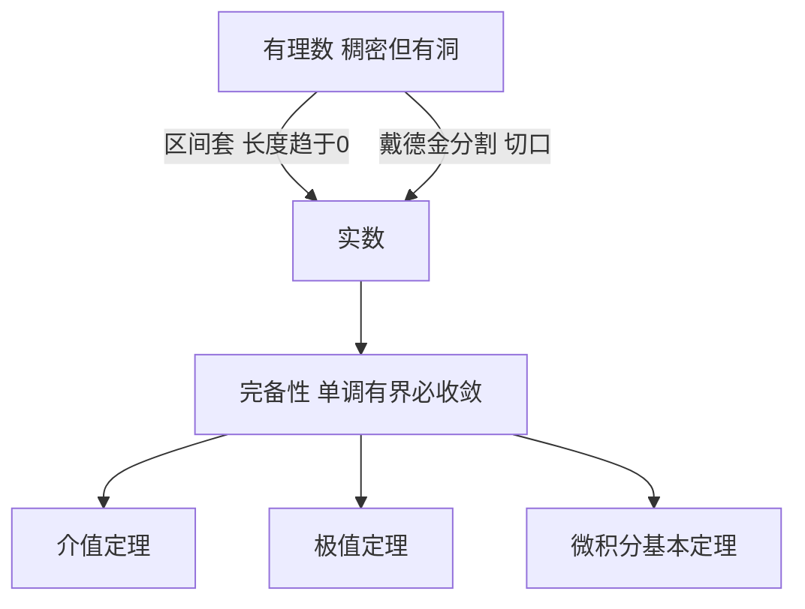

# 实数连续统

- **难度**：进阶 | **涉及章节**：第 2 章、第 6 章

## 一句话定义

实数是把有理数的"洞"全部补上之后得到的数集，补洞的方式是区间套或戴德金分割。

## 为什么重要

极限、连续、微积分全都建立在它上面。有理数稠密但到处是洞，没有连续统，`√2` 就没有落脚处，单调有界数列也可能"没有极限"。

## 图示

看图说明：两条补洞路线等价，都能得到同一个实数集。下面的三条定理都靠完备性支撑，它们不是"常识"，是有条件的结论。

## 详解

**区间套**的做法：取一串嵌套闭区间 `[aₙ, bₙ]`，长度趋于 0，端点都是有理数。这串区间锁定了一个位置。把所有可能被锁定的位置都算进数集，就得到实数。

**戴德金分割**的做法：把有理数分成左右两半，左半没有最大元、右半没有最小元。这个切口本身就定义了一个实数。

两种做法等价：每个区间套给出一个切口，每个切口也对应一串区间。

**完备性**是实数区别于有理数的唯一本质特征。它的几种等价表述：单调有界数列必收敛；柯西列必收敛；闭区间套必有公共点。第 2 章用区间套引入，第 6 章用单调有界证极限存在，两处是同一件事的不同说法。

**类比**：有理数像撒在一条线上的芝麻，密到任意一段都有，但线本身有缝。实数是把线填实。这个类比的失效边界在于"缝"的严格含义：不是视觉上的空隙，而是"存在一个有上界的集合却没有最小上界"。

**实例**：数列 `1.4, 1.41, 1.414, …`（√2 的逐位逼近）单调递增且有上界 1.5。它的极限不是有理数。若只有有理数，这个数列"没有极限"；补上实数后它收敛到 `√2`。

## 常见误解

- **别以为稠密就等于连续**——稠密说的是任意两个元素之间还有元素，连续说的是每个"应该有"的位置上都真的有点。
- **别以为实数就是"所有小数"**——小数只是表示法。实数的定义靠序结构和完备性，不靠十进制展开。
- **别以为完备性只是技术细节**——去掉它，介值定理、极值定理、微积分基本定理全部失效。

## 在书中出现的脉络

| 章节 | 语境 | 关键结论 |
|---|---|---|
| 第 2 章 §2 | 不可公度线段与无理数 | 用区间套定义无理数，给出戴德金分割作为另一条路 |
| 第 2 章 §4 | 无限的数学分析 | 有理数可数、连续统不可数，康托基数 |
| 第 6 章 §2 | 单调序列 | 单调有界必收敛，用它证 `qⁿ→0` 与 `(1+1/n)ⁿ→e` |

## 相关概念

- 前置：有理数、算术基本定理
- 后续：极限（第 6 章）、连续性与介值定理（第 6 章）、定积分（第 8 章）
