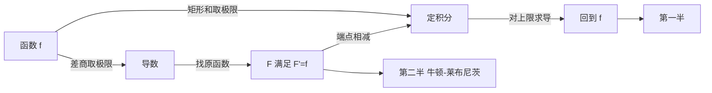

# 微积分基本定理

- **难度**：高难 | **涉及章节**：第 8 章

## 一句话定义

求积函数的导数等于被积函数，且定积分等于原函数的端点差；这两句话把微分和积分接成互为逆运算。

## 为什么重要

它把"算面积"从一个求和极限问题降级成"找一个原函数"。微积分能成为通用工具，靠的就是这一步降级。

## 图示

看图说明：两条箭头形成一个闭环。左边是定义，右边是计算公式，中间那个闭环说明两个运算互逆。

## 详解

**第一半**：设 `F(x)=∫ₐˣ f(t)dt`，则 `F'(x)=f(x)`。证明用差商：`[F(x+h)−F(x)]/h` 等于 `f` 在 `[x,x+h]` 上的平均值（积分中值定理），当 h→0 时趋于 `f(x)`（连续性）。

**第二半**：`∫ₐᵇ f(x)dx = F(b)−F(a)`。证明用第一半加"两个原函数只差常数"。

**为什么这两半合起来有威力**：第一半说明积分是微分的一个逆运算，第二半说明只要找到任一原函数就能算定积分，不必回到矩形和。原函数有公式表（幂函数、三角函数、指数函数）和两条通用法则（换元、分部），于是积分变成了查表和变形。

**类比**：里程表和速度表。速度读数是导数，里程读数是积分，末读数减初读数就是总路程。这个类比对变速运动成立，对倒车也成立，因为积分带符号。

**实例**：算 `∫₁² (3x²+2x)dx`。原函数 `x³+x²`，代入得 `(8+4)−(1+1)=10`。用矩形和验证也可以，但没人愿意做。

## 常见误解

- **别以为基本定理对所有函数都成立**——它要求 f 连续（或至少可积且原函数存在）。
- **别以为原函数唯一**——原函数差一个常数，端点相减时抵消，所以用哪个都行。
- **别以为积分就是面积**——定积分带符号，x 轴下方的部分算负的。
- **别以为 `dy/dx` 是真分数**——它是记号，链式法则的"约分"外观是定理保证的结果。

## 在书中出现的脉络

| 章节 | 语境 | 关键结论 |
|---|---|---|
| 第 8 章 §1 | 面积看作极限 | 积分的定义来自矩形和 |
| 第 8 章 §5 | 微积分基本定理 | 两半定理与初步应用 |
| 第 8 章 §6 | 指数与对数 | 用基本定理算 `∫dx/x = ln x` |
| 第 8 章 §7 | 微分方程 | `y'=ky` 的解由积分得到 |

## 相关概念

- 前置：极限（第 6 章）、导数与积分（第 8 章）
- 后续：微分方程（第 8 章）、多元积分与格林公式（数学手册 ch06）
