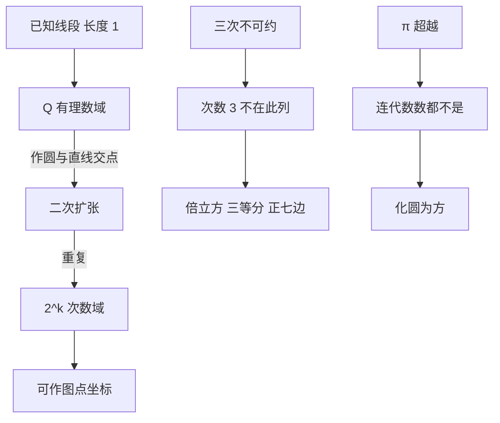

# 数域与尺规代数

- **难度**：进阶 | **涉及章节**：第 3 章

## 一句话定义

可作图线段的长度落在从有理数出发、逐次添加平方根得到的数域里，扩张次数只会是 2 的幂。

## 为什么重要

它把"作不出来"从一句抱怨变成一条定理。三个古希腊难题不是手艺问题，是代数结构问题：要求的数不在这个数域里。

## 图示

看图说明：上面一条是"能作"的层级，下面两条是两类失败原因。左边那条链每一层都只乘 2，所以次数不会出现 3。

## 详解

**数域**是对加减乘除封闭的数集。有理数是一个域，实数、复数也都是。从 Q 出发添一个数，如果这个数满足一个二次方程，扩张次数是 2；添三次方程的根，扩张次数是 3。

**尺规为什么只产生二次扩张**：直线和圆的方程都是一次的或二次的，解交点就是解一个二次方程组，结果是系数的四则运算加一个平方根。归纳到每一步，都只在当前域上做二次扩张。

**判据**：可作图数必须落在某个 `2^k` 次扩张里，因此它的代数次数必须是 2 的幂。这条判据一次性解决三个难题：

- 倍立方要 `³√2`，它满足 `x³−2=0`，不可约，次数 3，不可作。
- 三等分 60° 要 `2cos20°`，它满足 `x³−3x−1=0`，不可约，次数 3，不可作。
- 正七边形要 `cos(2π/7)`，对应的分圆多项式约化后是三次，不可作。

**化圆为方**要 `√π`。π 是超越数（林德曼 1882），不是代数数，代数次数这个判据用不上，需要另一条论证。

**类比**：可作图数域像一个只能加、乘、除、开平方的计算器。按多少次都行，按不出立方根。这个类比的失效边界是"工具"这层：计算器是离散操作，尺规是连续作图，两者对应关系要靠交点方程来建立，不能直接类比。

**实例**：证明 `³√2` 的代数次数是 3。多项式 `x³−2` 若可约，必有一次因式，其有理根只能是 ±1、±2。代入：`1−2=−1`，`−1−2=−3`，`8−2=6`，`−8−2=−10`，全不为零。所以无一次因式，三次多项式不可约，`³√2` 的次数为 3。

## 常见误解

- **别以为不可作是因为没找到方法**——不可作有证明，证明的是工具允许的运算范围不足以产生该数。
- **别以为所有不可作问题都靠代数次数**——化圆为方靠超越性，两类论证不能互换。
- **别以为尺规的限制是"工具太简单"**——限制在代数结构上；允许带刻度的直尺，倍立方立刻可作。
- **别以为次数是 2 的幂就一定可作**——还要满足具体的构造条件，判据给的是必要条件，正多边形的完整判据要看出费马素数条件。

## 在书中出现的脉络

| 章节 | 语境 | 关键结论 |
|---|---|---|
| 第 3 章 §1 | 基本几何作图与正多边形 | 正 n 边形可作的费马素数判据 |
| 第 3 章 §2 | 可作图的数与数域 | 一般理论：可作图数必为代数数 |
| 第 3 章 §3 | 三个不可解的希腊问题 | 倍立方、三等分、正七边形、化圆为方逐个处理 |
| 第 3 章 §4—§6 | 反演、马歇罗尼、连杆 | 换工具或换变换后结论如何改变 |

## 相关概念

- 前置：有理数、代数数（第 2 章）
- 后续：群与伽罗华理论（第 3 章引出的近世代数线索）、射影变换（第 4 章）
