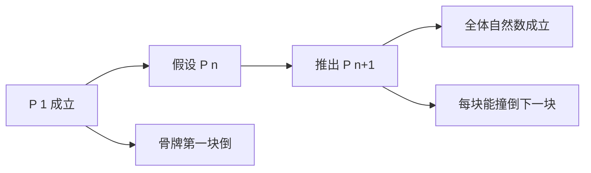

# 数学归纳法

- **难度**：基础 | **涉及章节**：第 1 章

## 一句话定义

先验证第一项成立，再证明"任意一项成立就能推出下一项成立"，两步做完，全部自然数都覆盖。

## 为什么重要

它是处理"无穷多个情形"的第一件工具。没有它，求和公式、整除性质、递推结构都只能验几个算几个。柯朗把它放在全书第一章，因为后面每一章几乎都要用它。

## 图示

看图说明：中间那条回路是递推步，它把"一个点"变成"一整条链"。左上角是链的起点，没有它，链挂不住。

## 详解

归纳法有两个容易被混淆的部分。

**基底步**是验证起点，通常只有一项，偶尔要验两项（当递推式依赖前两项时）。

**递推步**是先假设 P(n) 成立（这个假设叫归纳假设），再推出 P(n+1)。它证明的是一条条件句：如果第 n 项成立，那么第 n+1 项也成立。它本身不产生任何结论，必须和基底步合起来才有力量。

**类比**：一排多米诺。推倒第一块是基底，摆好间距保证每块都能撞倒下一块是递推。两件事都做到，整排才倒。这个类比的失效边界在"连续性"：骨牌要连续排列，对应的是归纳法只能覆盖自然数这样有"下一个"的结构，实数上就没有下一块。

**实例**：证明 `1 + 2 + … + n = n(n+1)/2`。基底 n=1 时两边都是 1。递推时假设前 n 项和为 `n(n+1)/2`，加上 n+1 得 `n(n+1)/2 + (n+1) = (n+1)(n+2)/2`，正是 n+1 的公式。

## 常见误解

- **别以为验了前几项就等于证明了**——不管验多少项，都是有限个，覆盖不到无穷。
- **别以为归纳假设是循环论证**——假设的是 P(n)，证的是 P(n+1)，两者不同，不构成循环。
- **别以为归纳法可以倒着用**——它从最小元出发往上推，不能从大往小推，除非另做"强归纳"或"良序原理"的论证。

## 在书中出现的脉络

| 章节 | 语境 | 关键结论 |
|---|---|---|
| 第 1 章 §2 | 等差、等比、平方和、二项式定理 | 所有求和公式都用归纳法证 |
| 第 1 章 §2 第 7 小节 | 再谈归纳法 | 说明归纳法的适用边界与常见误用 |
| 第 8 章 §1 | 矩形和求极限 | 平方和公式在这里被用来算出 ∫₀¹x² |

## 相关概念

- 前置：算术五条基本规律
- 后续：数列与级数（第 1 章）、极限（第 6 章）、定积分（第 8 章）
