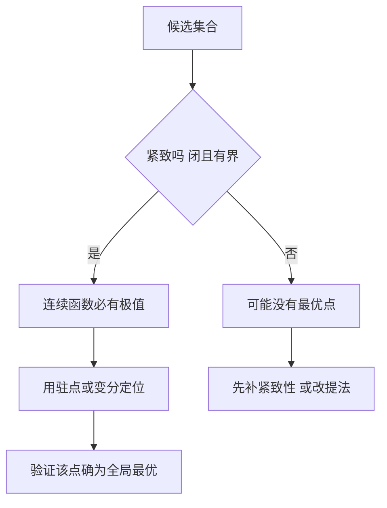

# 极值与存在性

- **难度**：进阶 | **涉及章节**：第 7 章

## 一句话定义

极值问题分两步走：先证明最优解真的存在，再找出它；只做第二步，结论随时可能是空谈。

## 为什么重要

初等做法（求导、列方程）只能定位候选点，不能保证候选点真的能取到，也不能保证候选点就是全局最优。等周问题、狄利克雷原理都卡在这一步上，卡了几十年。

## 图示

看图说明：右上角的判断是分水岭。紧致性不成立时，右边那条路要求你先改造问题，否则后面的计算没有立足点。

## 详解

**存在性靠紧致性**：连续函数在有界闭集上必取到最大最小值（维尔斯特拉斯极值定理）。这条定理是第 6 章的结论，在这里成了极值问题的前置条件。

**定位靠必要条件**：可微函数的极值点必是驻点；变分问题的极值曲线必满足欧拉-拉格朗日方程。必要条件只筛掉不可能的候选，留下的还要逐个验证。

**等周问题为什么难**：曲线族不是紧致的，长度有界不保证曲线族有收敛子列（可能越来越"毛糙"）。必须先把曲线族限制到"可求长且有界"的子族上，才能用极值定理。

**狄利克雷原理**：断言某个变分问题的最小值存在且满足方程。它曾被批评"循环论证"（用存在性去证存在性），后来由希尔伯特用更细的紧致性论证补上。

**类比**：招聘。先确认岗位真的缺人（存在性），再筛选简历（定位）。岗位根本不存在时，筛得再细也是白费。失效边界：招聘可以取消岗位，数学问题不能，缺存在性就得改提法。

**实例**：`f(x)=x` 在开区间 (0,1) 上连续，没有最大值也没有最小值。同一函数在闭区间 [0,1] 上有最大值 1、最小值 0。差别只在端点是否属于定义域，这一个条件决定了极值是否存在。

## 常见误解

- **别以为连续函数一定有极值**——开区间上的 `x` 就是反例，必须闭且有界。
- **别以为驻点就是答案**——驻点只是候选，还要判二阶条件，还要和其他候选比。
- **别以为变分法给出的一定是最小**——它给的是驻值，可能是极大也可能是鞍点，需要二阶变分判断。
- **别以为存在性可以"以后再补"**——很多推导在存在性缺失时会得出错误结论，补不回来。

## 在书中出现的脉络

| 章节 | 语境 | 关键结论 |
|---|---|---|
| 第 7 章 §3 | 驻点与微分学 | 驻点是必要条件，鞍点是多元情形的新现象 |
| 第 7 章 §7 | 极值的存在性 狄利克雷原理 | 存在性不能跳过，历史上曾被误用 |
| 第 7 章 §8—§10 | 等周问题与变分法 | 曲线族的紧致性是关键前提 |

## 相关概念

- 前置：极限与连续性（第 6 章）、维尔斯特拉斯极值定理（第 6 章）
- 后续：变分法（第 7 章）、测地线与极小曲面（普林斯顿 IV.12）
