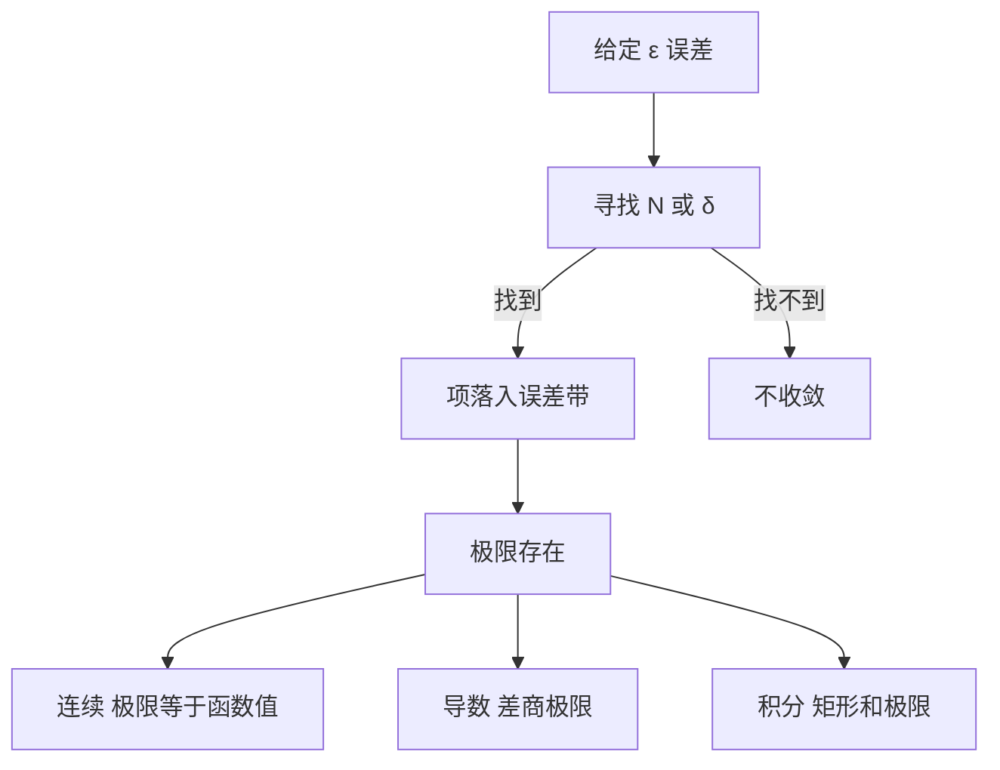

# 极限

- **难度**：进阶 | **涉及章节**：第 6 章、第 8 章

## 一句话定义

不管把允许的误差压到多小，从某一项之后所有值都落在误差范围内，这时就说极限存在。

## 为什么重要

它是连续、导数、积分三个概念的共同底座。没有极限，"越来越接近"只是一句形容，没法判断真假。

## 图示

看图说明：所有结论都从左上角那一步长出来。ε 是外部要求，N 和 δ 是内部回应，能不能回应决定收敛与否。

## 详解

**数列极限**：对任意 ε>0，存在 N，使 n>N 时 `|aₙ−L|<ε`。N 可以依赖 ε，这一点常被忽略。ε 越小，N 一般越大，但每次都存在。

**函数极限**：对任意 ε>0，存在 δ>0，使 `0<|x−a|<δ` 时 `|f(x)−L|<ε`。这里用的是去心邻域，`x=a` 那一点的值不参与判断。

**连续**：在 a 处连续的判据是 `lim(x→a) f(x)=f(a)`，即极限存在且等于函数值。三个条件缺一不可：f 在 a 有定义、极限存在、两者相等。

**单调有界定理**：单调递增且有上界的数列必收敛。它依赖实数完备性，证明方式是取上确界，再验证它就是极限。

**类比**：验收。客户给容差，你报"从第几件起达标"。容差收紧就重报，只要每次都能报出一个数，就算合格。失效边界：验收是有限批次，极限要求的是无穷序列，不能验完就宣布。

**实例**：证明 `lim(n→∞) 1/n = 0`。给定 ε>0，取 `N = ⌈1/ε⌉`，当 n>N 时有 `1/n < 1/N ≤ ε`。这个 N 是显式构造出来的，符合定义要求的"存在"。

## 常见误解

- **别以为极限就是函数在那一点的值**——`sin x/x` 在 0 处无定义，极限却是 1。
- **别以为"看起来越来越近"就是收敛**——`1, 1/2, 1/3, …` 收敛，`1, 2, 3, …` 不收敛，但都可以说"在变化"，要看的是能否被任意误差带罩住。
- **别以为单调有界定理在有理数里也成立**——它依赖完备性，去掉就失效。
- **别以为 ε-δ 只是形式**——它把"能不能任意逼近"变成可判定的命题，工程里的误差估计就是它的实例。

## 在书中出现的脉络

| 章节 | 语境 | 关键结论 |
|---|---|---|
| 第 6 章 §2 | 数列极限 | 单调有界、e 与 π 的极限定义 |
| 第 6 章 §3—§4 | 连续趋近的极限 | ε-δ 定义，`sin x/x` 的夹逼 |
| 第 6 章 §5—§6 | 两个基本定理 | 介值定理、极值定理，紧致集 |
| 第 8 章 §1—§2 | 积分与导数 | 两者都是极限，只是求和的形状不同 |

## 相关概念

- 前置：实数连续统（第 2 章）
- 后续：连续性与介值定理（第 6 章）、导数（第 8 章）、定积分（第 8 章）
