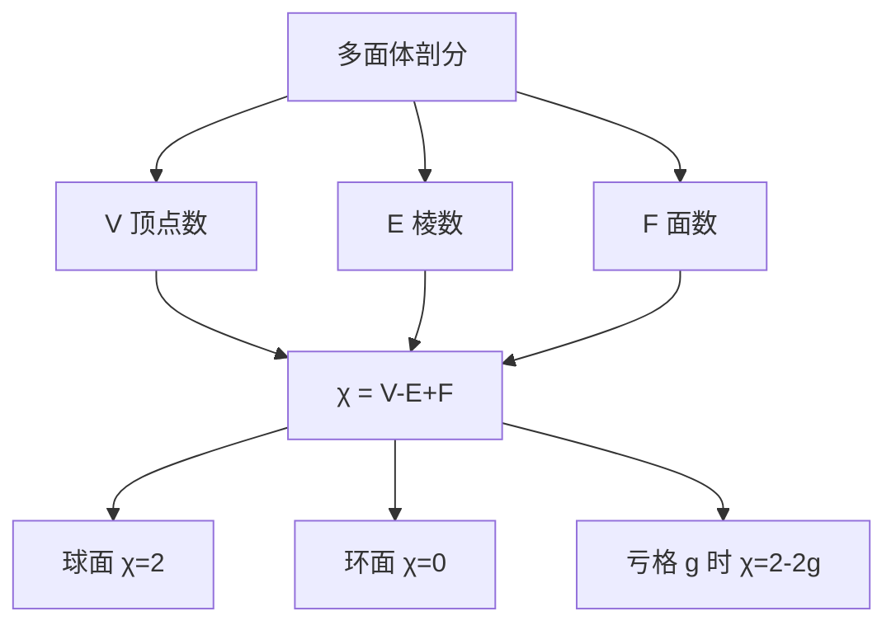

# 欧拉示性数

- **难度**：进阶 | **涉及章节**：第 5 章

## 一句话定义

`χ = V − E + F`，顶点数减棱数加面数，它只依赖曲面的洞数，不依赖怎么剖分。

## 为什么重要

它是第一个被发现的拓扑不变量，把"洞的个数"这个几何直觉变成可计算的数。有了它，闭曲面的分类才有统一的记账方式。

## 图示

看图说明：三个计数怎么组合，右边的三种取值对应三类曲面。同一个 `χ` 的曲面互相同胚（在可定向情形下）。

## 详解

**为什么与剖分无关**：把一个面切一刀，面数加 1，棱数加 1，顶点数不变，`χ` 不变。加一条从顶点到顶点的对角线，棱数加 1，面数加 1，`χ` 也不变。任何细分都保持这个组合量，所以它只依赖曲面的整体形状。

**亏格与 χ**：对可定向闭曲面，`χ = 2 − 2g`。球面 g=0 得 2，环面 g=1 得 0，双环面 g=2 得 −2。不可定向曲面用另一套公式，但 `χ` 仍然是分类依据。

**边界的影响**：曲面每开一个洞（挖去一个开圆盘），`χ` 减 1。带边界的曲面要单独记账。

**类比**：记账。收入加资产减负债，怎么拆分条目都不改总数。这个类比的失效边界在于：`χ` 只抓住洞的个数，抓不住"洞怎么分布"，两个 `χ` 相同的不可定向曲面未必同胚。

**实例**：足球的 `χ`。12 个五边形加 20 个六边形，`F=32`。每条棱被两面共用，`E=(12×5+20×6)/2=90`。每个顶点被三面共用，`V=(12×5+20×6)/3=60`。`χ=60−90+32=2`，与球面一致。

## 常见误解

- **别以为 `χ` 相同的曲面都同胚**——可定向闭曲面确实由 `χ` 决定，但不可定向情形还要看定向性。
- **别以为欧拉公式只对正多面体成立**——任何与球面同胚的多面体都满足 `V−E+F=2`，不管面是否正多边形。
- **别以为 `χ` 是度量量**——它由计数得到，拉伸和弯曲都不改它。

## 在书中出现的脉络

| 章节 | 语境 | 关键结论 |
|---|---|---|
| 第 5 章 §1 | 多面体的欧拉公式 | `V−E+F=2` 对简单多面体成立 |
| 第 5 章 §4 | 曲面的拓扑分类 | 用亏格与 `χ` 分类闭曲面 |
| 第 5 章附录 | 五色定理 | 用欧拉公式推出每个平面图有低度顶点 |

## 相关概念

- 前置：多面体与剖分（第 5 章）
- 后续：亏格与曲面分类（第 5 章）、平面图与四色问题（第 5 章）
