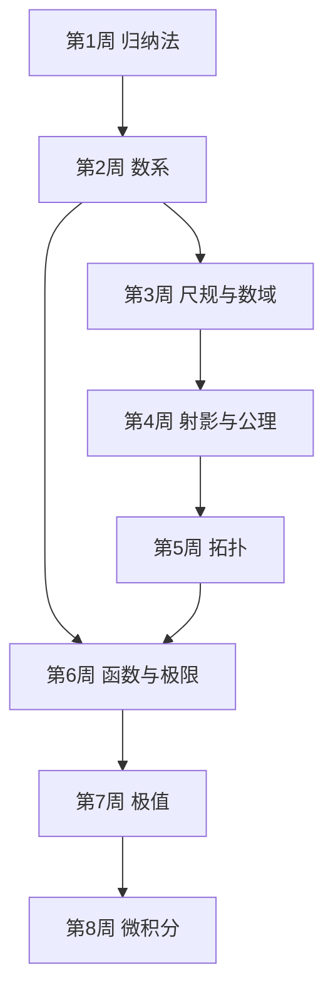

# 学习路径：八周走完《什么是数学》

面向零基础读者，覆盖全书 8 个核心章节。终点能力：能独立完成一个"从定义出发证明一个数学命题"的完整练习，并说清每步用了哪条已知结论。

## 路径总览

## 步骤 1：自然数与归纳法

**目标**：能用归纳法写出一个完整证明，并指出基底步和递推步各在哪。
**阅读**：`chapters/ch01-自然数与归纳法.md`
**检查点**：ch01 自测 3 题全对，且能独立证明 `1+3+…+(2n−1)=n²`。
**复习**：卡片标签 `归纳法`

## 步骤 2：数系

**目标**：能说清数系为什么一步步扩张，能复述 √2 的反证和区间套的定义。
**阅读**：`chapters/ch02-数学中的数系.md`
**检查点**：ch02 自测 3 题全对。
**复习**：卡片标签 `数系`

## 步骤 3：几何作图与数域

**目标**：能用代数次数判断一个作图问题是否可解。
**阅读**：`chapters/ch03-几何作图与数域.md`
**检查点**：能独立说明倍立方体为什么不可作。
**复习**：卡片标签 `尺规`

## 步骤 4：射影几何与公理体系

**目标**：能用变换群给几何分类，能写出一个命题的对偶命题。
**阅读**：`chapters/ch04-射影几何与公理体系.md`
**检查点**：ch04 自测 3 题全对。
**复习**：卡片标签 `变换`

## 步骤 5：拓扑学

**目标**：能算多面体的欧拉示性数，能判断两个图形是否同胚。
**阅读**：`chapters/ch05-拓扑学.md`
**检查点**：能独立算出足球的 `V−E+F=2`。
**复习**：卡片标签 `拓扑`

## 步骤 6：函数与极限

**目标**：能写出 ε-N 和 ε-δ 定义，能算常见极限。
**阅读**：`chapters/ch06-函数与极限.md`
**检查点**：ch06 自测 3 题全对。
**复习**：卡片标签 `极限`

## 步骤 7：极大与极小

**目标**：能区分驻点与极值点，能用均值不等式解极值题。
**阅读**：`chapters/ch07-极大与极小.md`
**检查点**：能独立证明"周长固定时正方形面积最大"。
**复习**：卡片标签 `极值`

## 步骤 8：微积分

**目标**：能用定义算定积分，能写出基本定理的两半。
**阅读**：`chapters/ch08-微积分.md`
**检查点**：ch08 自测 3 题全对，能独立算出 `∫₀¹x²dx`。
**复习**：卡片标签 `微积分`

## 学完全程后

- 你能：把"证明"写成可复核的步骤链，指出每一步依赖哪条定义或定理。
- 你能：判断一个数学命题属于哪门几何（欧氏、射影、拓扑），依据是它守住的量。
- 综合检验：任选一个未在书中出现的初等命题（比如"圆内接四边形对角互补"），写出完整证明，并标注每步依据。
