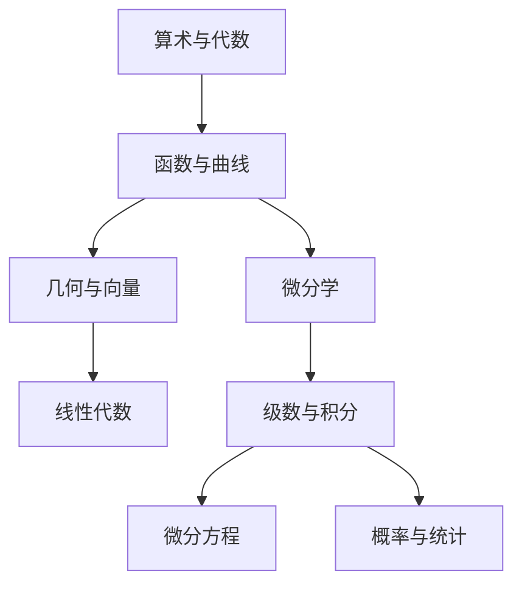

# 《数学手册（原书第 10 版）》点化学习系统

## 这本书在讲什么

布龙施泰因与谢马佳耶夫的这本手册不解释原理，它把从算术到数值分析的全部公式压缩成可查的条目。原书 21 章、1500 多页，覆盖初等数学、微积分、代数、几何、微分方程、概率统计、优化、数值方法。它的定位是"用的时候翻得到"，不是"从头读到尾"。

本学习系统挑了 8 个最常被翻到的章节，把它们从"公式清单"改写成"什么场景查什么公式、为什么这条公式管用"。八章合起来是一条从初等运算通向工程计算的路。

## 全书心智模型

看图说明：左列是"描述空间与结构"的路线，右列是"描述变化与累积"的路线。两条线在积分处交叉，最后各自通向方程与统计两个应用出口。

## 学习路径（推荐顺序）

| 步骤 | 章节 | 主题 | 前置 | 检查点 |
|---|---|---|---|---|
| 01 | ch01 | 算术与初等代数 | 无 | ch01 自测全对，能算复利与年金 |
| 02 | ch02 | 函数与初等函数 | ch01 | 能在半对数纸上判断指数律 |
| 03 | ch03 | 几何学 | ch02 | 能算球面三角形的边角关系 |
| 04 | ch04 | 线性代数 | ch03 | 能求特征值与特征向量 |
| 05 | ch05 | 微分学 | ch02 | 能算梯度与方向导数 |
| 06 | ch06 | 无穷级数与积分学 | ch05 | 能判断级数收敛并算重积分 |
| 07 | ch07 | 微分方程 | ch06 | 能解二阶常系数方程 |
| 08 | ch08 | 概率论与数理统计 | ch01 | 能用贝叶斯公式更新概率 |

## 章节索引

- 第 1 章 算术与初等代数（难度 ★☆☆）→ `chapters/ch01-算术与初等代数.md`
- 第 2 章 函数与初等函数（难度 ★★☆）→ `chapters/ch02-函数与初等函数.md`
- 第 3 章 几何学（难度 ★★☆）→ `chapters/ch03-几何学.md`
- 第 4 章 线性代数（难度 ★★☆）→ `chapters/ch04-线性代数.md`
- 第 5 章 微分学（难度 ★★☆）→ `chapters/ch05-微分学.md`
- 第 6 章 无穷级数与积分学（难度 ★★★）→ `chapters/ch06-级数与积分学.md`
- 第 7 章 微分方程（难度 ★★★）→ `chapters/ch07-微分方程.md`
- 第 8 章 概率论与数理统计（难度 ★★☆）→ `chapters/ch08-概率与统计.md`

## 前置知识（零基础缺口补讲）

| 缺口 | 对应补讲位置 | 学完标志 |
|---|---|---|
| 分不清整式、分式、根式的变形限制 | ch01「运算律与代数式」 | 能说出每类式子先要检查什么 |
| 不知道函数可以用表格和图像定义 | ch02「函数的定义与表示」 | 能举出三个不是公式的函数 |
| 没用过向量 | ch03「向量代数」 | 能算点积与叉积并解释结果 |
| 没接触过矩阵 | ch04「矩阵」 | 能判断两个矩阵能否相乘 |
| 不会用积分表 | ch06「不定积分」 | 能用换元算一个积分 |
| 不懂概率为什么能算 | ch08「概率的基本公式」 | 能算出二项分布的一个具体概率 |

## 术语表 / 模式库 / 速查表 入口

- 术语表：`glossary.md`
- 模式与框架：`patterns.md`
- 速查表：`cheatsheet.md`
- 测验：`quiz.md`
- 抽认卡：`flashcards.md`
- 学习路径：`paths/learn.md`
