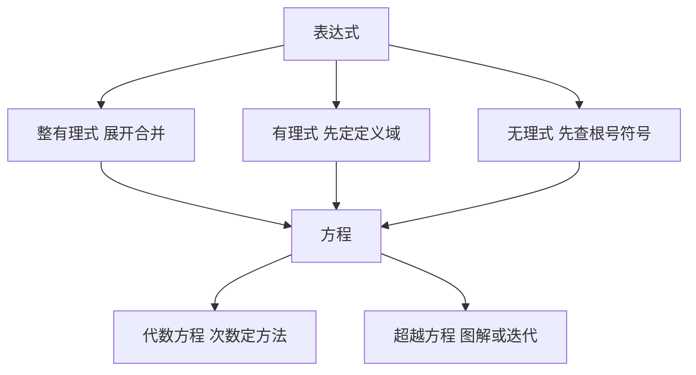

# 第 1 章：算术与初等代数

- **难度**：★☆☆ | **预估学时**：2 小时 | **前置**：初中代数
- **对应原书**：第 1 章「算术」§1.1—§1.6（原书 p30—89）

## 学习目标

学完本章，你能：

1. 认出五条基本运算律在代数式变形中的位置，说明哪一步用了哪条。
2. 用等比级数公式手算复利、年金和折旧，不必逐期累加。
3. 在不等式、复数、代数方程三类问题中选对工具，知道每一类在手册里查哪一节。

## 一句话核心

手册的第一章不是"复习小学算术"，而是把初等运算整理成可以查的规则表：运算律、级数公式、复利公式、不等式解法、复数运算、方程求根。

## 零基础讲解

### 概念：运算律与代数式（难度：基础）

**代数式**是用字母和数通过加减乘除与乘方组成的表达式。手册把整有理式、有理式、无理式分开处理，因为它们允许的变形不同：整有理式可以随意展开合并，有理式要先定定义域（分母不为零），无理式要检查根号下的符号。

**类比**：三类式子像三种材料。整式是木头，随便锯；分式是带接缝的板，得避开接缝；根式是受力的构件，得先算强度。失效边界：这个类比只说明限制从哪来，不说明具体限制是什么，限制要看每节的规则。

### 概念：有限级数（难度：基础）

手册列了三类常用求和：

- 等差：`Σ = n(a₁+aₙ)/2`
- 等比：`Σ = a₁(1−qⁿ)/(1−q)`，q≠1
- 特殊有限级数：`Σk = n(n+1)/2`，`Σk² = n(n+1)(2n+1)/6`，`Σk³ = [n(n+1)/2]²`

最后一组值得记，因为它在积分和数值分析里反复出现。

### 概念：商业数学（难度：基础）

手册专门用一节讲利息、复利、分期付款、年金、折旧。这些公式是同一件事的不同侧面：

| 场景 | 公式 |
|---|---|
| 单利 | `I = P·i·n` |
| 复利终值 | `S = P(1+i)ⁿ` |
| 复利现值 | `P = S/(1+i)ⁿ` |
| 年金终值 | `S = R[(1+i)ⁿ−1]/i` |
| 年金现值 | `P = R[1−(1+i)⁻ⁿ]/i` |

其中 P 是本金或现值，S 是终值，i 是每期利率，n 是期数，R 是每期支付额。

**实例**：本金 10000 元，年利率 5%，按年复利存 10 年。`S = 10000 × 1.05^10`。1.05^10 ≈ 1.628895，所以 S ≈ 16288.95 元。若按单利只有 15000 元，差额就是复利的效果。

### 概念：不等式（难度：基础）

手册把不等式分成纯不等式（对一切实数成立，如 `a²+b² ≥ 2ab`）和条件不等式（在特定范围成立）。解线性不等式要注意除以负数时不等号翻转，解二次不等式则先求根再定区间符号。

常用不等式值得抄进速查表：均值不等式、柯西不等式 `(Σaᵢbᵢ)² ≤ (Σaᵢ²)(Σbᵢ²)`、三角不等式。

### 概念：复数（难度：进阶）

复数写成 `z = a + bi`，几何上是平面上的点。手册给出的核心运算：

- 加减：实部虚部分别相加减。
- 乘除：用 `i²=−1` 展开；除法要乘共轭 `(a+bi)/(c+di) = (a+bi)(c−di)/(c²+d²)`。
- 三角形式：`z = r(cosφ + i sinφ)`，乘除变成模相乘除、角相加减。

`r = √(a²+b²)` 叫模，`φ` 叫辐角。这套形式让 `zⁿ` 的计算变成 `rⁿ(cos nφ + i sin nφ)`。

### 概念：代数方程与超越方程（难度：进阶）

手册按次数分档：一次、二次（求根公式）、三次（卡尔达诺公式）、四次（费拉里法），并明确说五次及以上一般不能用根式解（阿贝尔-鲁菲尼定理）。

**超越方程**指含指数、对数、三角函数的方程，一般没有公式解，用手册给的方法：图解法找近似根、迭代法、牛顿法。

## 图示

看图说明：左边是变形前的分类，右边是求解路径。分类做错，后面的变形会出错，尤其是分式和根式。

## 类比与实例

**类比**：手册第一章像工具箱的第一层抽屉，里面全是常用扳手。用得最多的是运算律和几个级数公式，其余按需取。失效边界：工具箱只给工具，不给判断，选错工具照样拧不动。

**实例**：解 `x² − 5x + 6 = 0`。判别式 `Δ = 25 − 24 = 1`，根为 `(5±1)/2`，即 x=3 或 x=2。检验：3+2=5，3×2=6，符合韦达定理。

## 常见误解

- **别以为复利和单利的差别只是算法不同**——长期看差别是量级的，10 年 5% 的差距就有 1289 元。
- **别以为分式可以随便约**——约分要先保证约掉的因子不为零，否则定义域变了。
- **别以为五次方程没有解**——它有解，只是不能用根式写出。数值解照样能算到任意精度。
- **别以为手册里的公式都要背**——手册的用法是查，不是背。要知道"该查哪一节"。

## 自测题（答案）

1. **单选**：`Σk³`（k 从 1 到 n）等于（　）。
   - A. `n(n+1)/2`
   - B. `[n(n+1)/2]²`
   - C. `n(n+1)(2n+1)/6`
   - D. `n²(n+1)²/4`

   **答案：B**。解析：前 n 项立方和等于前 n 项和的平方，这是手册特殊有限级数一节的结论。

2. **填空**：本金 1000 元，年利率 10%，按年复利 2 年后的终值是多少元？（填数字）

   **答案：1210**。解析：`1000 × 1.1² = 1000 × 1.21 = 1210`。

3. **简答**：为什么解分式方程时必须检验增根？

   **答案要点**：去分母时乘以了含未知数的式子，若该式在某解处为零，则原方程在这一解处无定义。乘出来的解可能来自这个零点，所以必须代回原方程检验，排除使分母为零的值。

## 复习锚点

- 三类式子（整式、分式、根式）的变形限制不同，先分类再动手。
- 复利、年金、折旧是同一组公式的不同变形，记住现值与终值两条主线即可。
- 五次以上方程有解但不能用根式表达，求数值解走迭代法。
