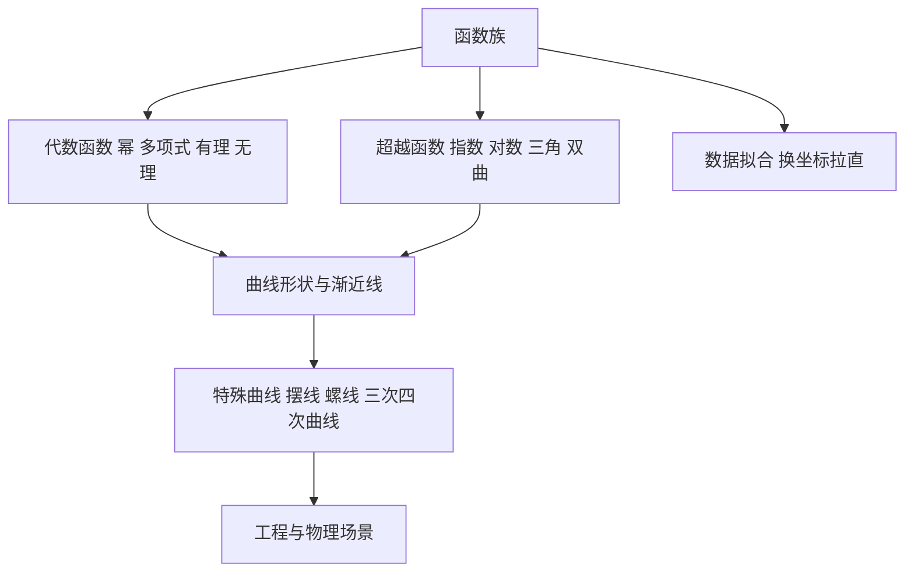

# 第 2 章：函数与初等函数

- **难度**：★★☆ | **预估学时**：3 小时 | **前置**：第 1 章
- **对应原书**：第 2 章「函数」§2.1—§2.19（原书 p90—196）

## 学习目标

学完本章，你能：

1. 说出函数的定义方式有哪几种，为什么表格、图像、公式都算函数。
2. 在幂函数、指数函数、对数函数、三角函数、双曲函数中按图像特征快速辨认。
3. 认出摆线、螺线、三阶曲线、四阶曲线的方程形式，说出它们各自出现在什么物理场景。
4. 用对数坐标纸判断一组数据是否服从幂律或指数律。

## 一句话核心

手册的函数章不是讲函数论，而是给出一张"曲线与公式的对照表"，让你看到一个形状就能找到方程，看到一个方程就能画出形状。

## 零基础讲解

### 概念：函数的定义与表示（难度：基础）

函数是定义域到值域的对应。手册列了三种定义方式：公式、表格、图像。三者可以互相转换，各有适用场景。公式适合计算，表格适合实验数据，图像适合看趋势。

**复合函数**和**反函数**是两台加工机器。复合是串联，反函数是把输出接回输入。反函数存在的条件是原函数一一对应，否则会"一个输出对应多个输入"。

### 概念：初等函数的家族（难度：基础）

手册按族介绍，每族给方程、定义域、值域、图像特征：

| 族 | 形式 | 关键特征 |
|---|---|---|
| 幂函数 | `y = xⁿ` | 过 (1,1)；n 为偶数时关于 y 轴对称 |
| 多项式 | `a₀+a₁x+…+aₙxⁿ` | 次数决定端点行为 |
| 有理函数 | `P(x)/Q(x)` | 分母零点处有垂直渐近线 |
| 指数函数 | `y = aˣ` | 恒过 (0,1)；a>1 递增 |
| 对数函数 | `y = log_a x` | 恒过 (1,0)；是指数的反函数 |
| 三角函数 | `sin, cos, tan` | 周期 2π（tan 为 π） |
| 反三角函数 | `arcsin, arccos, arctan` | 定义域受限，取主值 |
| 双曲函数 | `sinh, cosh, tanh` | 由 eˣ 与 e⁻ˣ 组合而成 |

**双曲函数**值得单独记：`cosh²x − sinh²x = 1`，它和三角函数的关系是"差一个负号"（圆是 `cos²+sin²=1`，双曲线是 `cosh²−sinh²=1`）。悬链线的方程就是 `y = a cosh(x/a)`。

### 概念：特殊曲线（难度：进阶）

手册用了好几节讲"不常出现在课本里但工程上常见"的曲线：

- **摆线**：圆在直线上滚动时圆周上一点的轨迹，参数方程 `x = a(t−sin t)`，`y = a(1−cos t)`。它是最速降线问题的解，也是摆钟的等时曲线。
- **螺线**：阿基米德螺线 `r = aθ`，等角螺线 `r = ae^(bθ)`。后者在缩放后与自己相似，鹦鹉螺的壳就是这个形状。
- **三阶曲线**：如 `y² = x³ + ax + b`（椭圆曲线），它在密码学里是主角。
- **四阶曲线**：如卡西尼卵形线、双纽线，用于描述某些场的等势线。

**类比**：这些曲线像方言。标准课本讲普通话（多项式、三角），手册把方言也收录进来，因为工程问题里它们真的会出现。失效边界：方言词表不能替代语法，要看懂曲线的性质还得回到参数方程和导数。

### 概念：经验曲线的确定与坐标纸（难度：进阶）

实验给出若干数据点，要判断它们服从什么规律。手册给的办法是**换坐标**：

- 若 `y = axᵇ`（幂律），取 `lg y` 对 `lg x` 作图，得到直线，斜率是 b。
- 若 `y = ae^(bx)`（指数律），取 `lg y` 对 x 作图，得到直线，斜率是 `b lg e`。

这是对数坐标纸的用途：把曲线"拉直"，再用直线拟合。

**实例**：某组数据在双对数纸上呈直线且斜率为 −2，则规律是 `y = ax⁻²`，即平方反比律。万有引力、点电荷的库仑力都符合这个形式。

### 概念：多元函数与算图法（难度：进阶）

多元函数的图像是曲面，等值线是它的等高线。手册还介绍了**算图法**（nomography）：用三根刻度尺的连线读出计算结果，是计算器普及之前的工程计算工具。现在少用，但它的几何原理（射影对应）仍值得看。

## 图示

看图说明：上半部分是"从公式到形状"，下半部分是"从数据到公式"。手册的两大用途正好对应这两条路。

## 类比与实例

**类比**：函数家族像乐器。每种乐器有自己的音域（定义域）和音色（图像特征），听一段就知道是哪种。失效边界：乐器不能互相替换，函数可以复合，复合后的行为可能超出任何单一族的特征。

**实例**：判断 `y = 3 · 2^(0.5x)` 的增长速度。写成 `y = 3e^(0.5 ln2 · x)`，`0.5 ln2 ≈ 0.3466`，即以约 34.66% 的连续增长率增长。每增加 2 个单位 x，y 翻一倍（因为 `2^(0.5×2)=2`）。

## 常见误解

- **别以为函数必须有解析式**——分段函数、查表函数、实验曲线都是函数，只要满足"一个输入一个输出"。
- **别以为 `arcsin` 和 `1/sin` 是一回事**——前者是反函数，后者是倒数，两者完全不同。
- **别以为双曲函数是"双曲线上的三角函数"**——它们由指数组合定义，和双曲线的关系是类比而非定义。
- **别以为对数纸只能画对数**——它把乘除变加减，任何幂律或指数律都能在上面变成直线。

## 自测题（答案）

1. **单选**：`y = ae^(bx)` 的数据在什么坐标下呈直线？（　）
   - A. 普通直角坐标
   - B. 半对数坐标（lg y 对 x）
   - C. 双对数坐标
   - D. 极坐标

   **答案：B**。解析：取对数得 `lg y = lg a + (b lg e)x`，对 x 是线性的，所以在半对数纸上成直线。

2. **填空**：双曲函数满足的基本恒等式是 `cosh²x − sinh²x =`（　）。

   **答案：1**。解析：由 `cosh x=(eˣ+e⁻ˣ)/2`、`sinh x=(eˣ−e⁻ˣ)/2` 展开相减即得。

3. **简答**：摆线的参数方程是什么，它为什么出现在最速降线问题里？

   **答案要点**：`x=a(t−sin t)`，`y=a(1−cos t)`。小球在重力下从一点滑到另一点，最快的路径不是直线而是倒摆线的一段，因为摆线起始段陡、能迅速获得速度，中段平缓、能保持速度。

## 复习锚点

- 函数的三要素：定义域、对应规则、值域；表示方式有公式、表格、图像三种。
- 幂律看双对数纸，指数律看半对数纸，这是数据拟合最快的判断法。
- 双曲函数由指数定义，`cosh²−sinh²=1` 是它的身份证。
