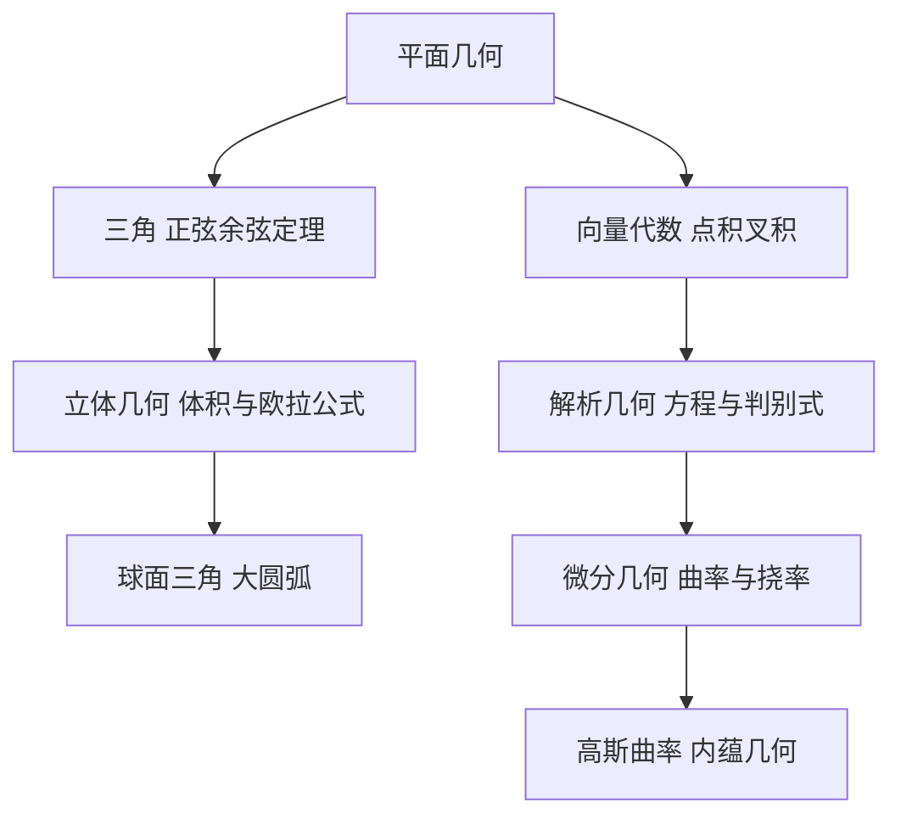

# 第 3 章：几何学

- **难度**：★★☆ | **预估学时**：4 小时 | **前置**：第 2 章
- **对应原书**：第 3 章「几何学」§3.1—§3.6（原书 p197—389）

## 学习目标

学完本章，你能：

1. 在平面几何、三角、立体几何、球面三角、解析几何、微分几何六个分支之间判断一个问题该用哪套工具。
2. 写出正弦定理、余弦定理和球面余弦定理，说清球面版本为什么多了个余弦乘积项。
3. 用向量点积与叉积判断垂直、平行，算出面积和体积。
4. 写出曲线曲率与挠率的公式，解释它们各描述什么。

## 一句话核心

几何的手册章是一条"维度升级"的路线：平面到空间，直线到曲面，平直到弯曲，每一级都换一套度量。

## 零基础讲解

### 概念：平面几何与三角（难度：基础）

平面几何处理直线、三角形、圆的关系。三角把它代数化，给出两条核心定理：

- 正弦定理：`a/sin A = b/sin B = c/sin C = 2R`（R 是外接圆半径）
- 余弦定理：`c² = a² + b² − 2ab cos C`

余弦定理是勾股定理的推广：当 C=90° 时 `cos C=0`，退化成 `c²=a²+b²`。

**三角形面积**有好几种算法：`S = ah/2`、`S = (1/2)ab sin C`、海伦公式 `S = √(p(p−a)(p−b)(p−c))`，其中 p 是半周长。海伦公式只依赖三边，不需要角，适合测量场景。

### 概念：立体几何与球面三角（难度：进阶）

空间里的多面体有欧拉公式 `V−E+F=2`（第 5 章会再讲）。体积公式按形状分类：棱柱、棱锥、圆柱、圆锥、球、球缺。

**球面三角**是关键升级。球面上的"直线"是大圆弧，三角形的边是弧长（用角度表示）。它的余弦定理是：

`cos c = cos a cos b + sin a sin b cos C`

和平面版本的差别在于：平面是 `c² = a²+b²−2ab cos C`，球面多出了 `sin a sin b` 这一项，而且是用余弦而不是平方。当球半径趋于无穷、a、b、c 都很小时，球面公式退化为平面公式。

**类比**：球面三角像在地球仪上量距离。北京到纽约的最短航线不是纬线而是大圆，因为纬线在球面上不是"直线"。失效边界：这个类比只适用于球面，椭球面上要用地测线，公式更复杂。

### 概念：向量代数与解析几何（难度：进阶）

**点积** `a·b = |a||b|cosθ` 给出夹角和投影，**叉积** `a×b` 给出垂直于两者的向量，模等于平行四边形面积。

| 运算 | 用途 |
|---|---|
| 点积为零 | 两向量垂直 |
| 叉积为零 | 两向量平行 |
| 混合积 `(a×b)·c` | 平行六面体体积，为零则三向量共面 |

解析几何把图形翻译成方程：直线 `Ax+By+C=0`，圆 `(x−a)²+(y−b)²=r²`，平面 `Ax+By+Cz+D=0`，球 `(x−a)²+(y−b)²+(z−c)²=r²`。二次曲线用判别式 `B²−4AC` 分类：小于零是椭圆，等于零是抛物线，大于零是双曲线。

### 概念：微分几何（难度：高难）

曲线用弧长参数化后，两个量刻画它的弯曲方式：

- **曲率** `κ`：切线方向转动的速率，`κ = |r''(s)|`。直线的曲率为 0，半径 R 的圆曲率为 1/R。
- **挠率** `τ`：曲线偏离平面的程度。平面曲线的挠率为 0。

空间曲线由曲率和挠率唯一确定（在刚体运动意义下），这是曲线论基本定理。

曲面用两个主曲率 `κ₁`、`κ₂` 刻画弯曲，**高斯曲率** `K = κ₁κ₂`。高斯绝妙定理说 K 只依赖曲面的度量，不依赖它在空间里怎么弯，这是内蕴几何的起点，后来长成了黎曼几何。

**实例**：圆柱面的高斯曲率为 0（一个主曲率为 0，另一个为 1/R），所以它能摊平成平面而不撕裂。球面的高斯曲率为 `1/R²`，不能摊平，这就是地图投影必然变形的根本原因。

## 图示

看图说明：左边两条支线分别从"形状"和"坐标"出发，在微分几何处汇合。最下面那条是通向现代几何的出口。

## 类比与实例

**类比**：几何分支像不同倍率的镜头。平面几何看局部形状，球面三角看整个球面，微分几何看每一点的弯曲。换镜头等于换问题。失效边界：镜头只能换视角，微分几何还要换度量方式，内蕴和外蕴是两种不同的看法。

**实例**：求过点 (1,2,3) 且垂直于平面 `2x−y+2z=5` 的直线方程。平面的法向量是 `(2,−1,2)`，直线方向就取它。参数方程：`x=1+2t`，`y=2−t`，`z=3+2t`。

**第二个实例**：求三角形三边 3、4、5 的面积。用海伦公式，`p=(3+4+5)/2=6`，`S=√(6·3·2·1)=√36=6`。用 `(1/2)ab sin C` 验证：这是直角三角形，`S=3×4/2=6`，一致。

## 常见误解

- **别以为球面三角只是平面三角的近似**——它是另一套精确公式，`cos c = cos a cos b + sin a sin b cos C` 在小范围才退化成平面形式。
- **别以为叉积满足交换律**——`a×b = −b×a`，顺序决定方向，这在物理的力矩和洛伦兹力里必须注意。
- **别以为曲率就是"弯得厉害"的模糊描述**——它有精确定义 `κ=|r''(s)|`，圆、直线、摆线的曲率都能算出具体值。
- **别以为地图画不准是技术不够**——球面高斯曲率非零，任何平面地图都必然在长度、角度或面积上失真，这是定理不是工艺问题。

## 自测题（答案）

1. **单选**：球面三角形的余弦定理比平面版本多出的项是（　）。
   - A. `sin a sin b cos C`
   - B. `cos a cos b`
   - C. `tan a tan b`
   - D. `a²+b²`

   **答案：A**。解析：球面余弦定理为 `cos c = cos a cos b + sin a sin b cos C`，多出的正是含正弦乘积的那一项。

2. **填空**：半径为 R 的圆，其曲率为（　）。

   **答案：1/R**。解析：曲率是切线方向对弧长的转动率，圆周转一圈 2π 走过 2πR，比值为 1/R。

3. **简答**：为什么圆柱面可以摊平而球面不能？用高斯曲率解释。

   **答案要点**：圆柱面两个主曲率分别是 0 和 1/R，乘积为 0，所以高斯曲率为 0，可以等距映射到平面。球面两个主曲率都是 1/R，乘积为 1/R²，非零。高斯绝妙定理说明高斯曲率是内蕴量，等距变形不能改变它，因此球面无法在不撕裂的前提下摊平。

## 复习锚点

- 正弦定理管边角对应，余弦定理管三边一角，海伦公式只用三边。
- 球面三角的公式多出正弦乘积项，小范围时才退化成平面形式。
- 高斯曲率是内蕴量，它决定了曲面能不能摊平，也决定了地图为什么必然失真。
