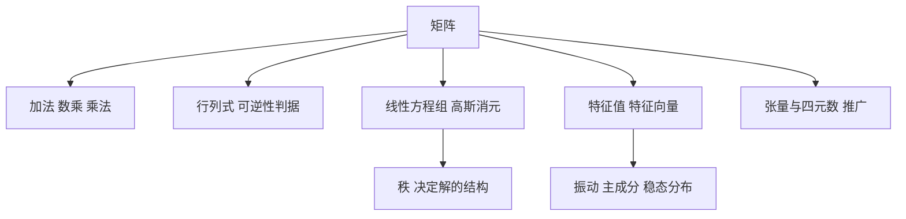

# 第 4 章：线性代数

- **难度**：★★☆ | **预估学时**：3 小时 | **前置**：第 1 章（复数）、第 3 章（向量）
- **对应原书**：第 4 章「线性代数」§4.1—§4.6（原书 p390—460）

## 学习目标

学完本章，你能：

1. 做矩阵的加减乘和转置，说清乘法为什么要求内维相等。
2. 用行列式判断矩阵是否可逆，算出 2×2 和 3×3 的行列式。
3. 用高斯消元解线性方程组，判断无解、唯一解、无穷多解三种情形。
4. 求矩阵的特征值与特征向量，说明它为什么是振动与主成分分析的核心。

## 一句话核心

线性代数把"联立方程"整理成一套矩阵运算，矩阵是变换，行列式是体积缩放因子，特征值是变换不改变方向的那些方向上的缩放倍数。

## 零基础讲解

### 概念：矩阵（难度：基础）

**矩阵**是数排成的矩形表。`m×n` 矩阵有 m 行 n 列。运算规则：

- 加法：同型矩阵对应元素相加。
- 数乘：每个元素乘以该数。
- 乘法：`(m×n)(n×p) = m×p`，第 i 行第 j 列元素是左矩阵第 i 行与右矩阵第 j 列的点积。

矩阵乘法不满足交换律：`AB ≠ BA` 一般成立不了。这一点必须记牢，因为物理里的旋转顺序不可交换正源于此。

**类比**：矩阵像一台加工机器，输入一个向量，输出另一个向量。乘法是两台机器串联。失效边界：机器串联的顺序会影响结果，但矩阵还有更抽象的解释（线性映射），后者在换基下不变。

### 概念：行列式（难度：进阶）

**行列式**是方阵的一个数。2×2 时 `det = ad − bc`，3×3 用对角线法则展开。

几何意义：行列式的绝对值等于矩阵所代表的线性变换对面积（二维）或体积（三维）的缩放倍数。行列式为零表示变换把平面压成一条线，信息丢失，矩阵不可逆。

性质：交换两行变号；某行乘以 k 则行列式乘以 k；两行成比例则行列式为零。这些性质让行列式的计算可以先化简再展开。

### 概念：线性方程组（难度：进阶）

解 `Ax = b` 的标准办法是**高斯消元**：用行变换把系数矩阵化成上三角，再回代。

三种结局对应秩的关系：

| 情形 | 条件 | 解的情况 |
|---|---|---|
| 唯一解 | `rank(A) = rank([A|b]) = n` | 一组解 |
| 无解 | `rank(A) < rank([A|b])` | 矛盾行出现 |
| 无穷多解 | `rank(A) = rank([A|b]) < n` | 有自由变量 |

克拉默法则给出唯一解时的公式解 `xᵢ = det(Aᵢ)/det(A)`，但计算量大，实际用消元。

### 概念：特征值与特征向量（难度：高难）

若存在非零向量 v 使 `Av = λv`，则 λ 是**特征值**，v 是对应的**特征向量**。几何含义：矩阵代表的变换在这个方向上只拉伸不转向。

求法：解特征方程 `det(A − λI) = 0`，得到 λ，再代回求 v。

**实例**：`A = [[2,1],[1,2]]`。特征方程 `(2−λ)²−1=0`，λ=3 或 1。λ=3 时解 `−x+y=0` 得 v=(1,1)；λ=1 时得 v=(1,−1)。这两个方向就是变换的主轴。

**为什么重要**：振动分析里，特征值是固有频率的平方；主成分分析里，特征向量是数据变异最大的方向；马尔可夫链的稳态分布是特征值 1 对应的特征向量。

### 概念：张量与四元数（难度：高难）

**张量**是矩阵的推广，用多个指标索引。应力张量、曲率张量、度规张量都是它的例子。手册只给定义与基本运算，深入要查专门的教材。

**四元数**是 `a + bi + cj + dk` 形式的数，乘法不交换，适合表示三维旋转。它的优点是插值平滑、没有万向锁，所以在图形学和姿态控制里还在用。

## 图示

看图说明：左边是运算，中间是"能不能解方程"，右边是"变换的主方向"。三条线都从矩阵出发，分别服务不同问题。

## 类比与实例

**类比**：矩阵像一张变形网。行列式是网的面积变化倍数，特征向量是拉伸后仍保持方向的那几条线。失效边界：网只能拉伸，矩阵还能旋转和剪切，旋转时没有实特征向量（对应复特征值）。

**实例**：解方程组 `2x+y=5`，`x+3y=10`。

消元：第二式乘以 2 减去第一式，得 `5y=15`，y=3；回代 `2x+3=5`，x=1。检验：`1+9=10`，成立。

行列式检验：`det = 2×3 − 1×1 = 5 ≠ 0`，所以唯一解，与消元结果一致。

## 常见误解

- **别以为矩阵乘法可以交换**——`AB` 和 `BA` 一般是两个不同的矩阵，只有特殊情形（如同时对角化）才相等。
- **别以为行列式为零就是"没有解"**——行列式为零说明矩阵不可逆，方程组可能无解也可能无穷多解，要看增广矩阵的秩。
- **别以为特征值一定是实数**——实矩阵也可能有复特征值，对应旋转型变换，比如平面旋转 90°。
- **别以为四元数只是数学玩具**——它是工程上表示姿态的实用工具，卫星和游戏引擎都在用。

## 自测题（答案）

1. **单选**：`A` 是 3×2 矩阵，`B` 是 2×4 矩阵，`AB` 的尺寸是（　）。
   - A. 3×4
   - B. 2×2
   - C. 4×3
   - D. 不能相乘

   **答案：A**。解析：内维都是 2，可以相乘，结果取外维，即 3×4。

2. **填空**：矩阵 `[[2,1],[1,2]]` 的两个特征值分别是 3 和（　）。

   **答案：1**。解析：特征方程 `(2−λ)²−1=0`，解得 λ=3 和 λ=1。

3. **简答**：行列式的几何意义是什么，为什么行列式为零意味着矩阵不可逆？

   **答案要点**：行列式的绝对值是线性变换对面积或体积的缩放倍数。行列式为零表示变换把整个空间压到低一维的子空间上，不同的输入被映到同一个输出，映射不是一一对应，因此没有逆映射。

## 复习锚点

- 矩阵乘法要求内维相等，结果取外维，且不满足交换律。
- 行列式为零等价于不可逆，但方程组解的情况还要看增广矩阵的秩。
- 特征向量是变换不转向的方向，特征值是该方向上的缩放倍数。
