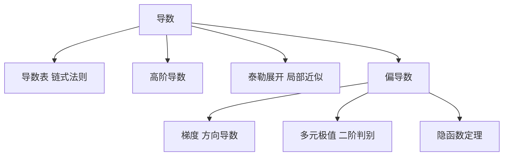

# 第 5 章：微分学

- **难度**：★★☆ | **预估学时**：3 小时 | **前置**：第 2 章（函数）、第 3 章（向量）
- **对应原书**：第 6 章「微分学」§6.1—§6.2（原书 p610—641）

## 学习目标

学完本章，你能：

1. 用导数表加链式法则算复合函数的导数，不依赖死记硬背。
2. 写出泰勒展开并估计余项，说明它和"用直线近似曲线"的关系。
3. 算偏导数、梯度和方向导数，说明梯度为什么指向最陡上升方向。
4. 写出多元函数极值的必要条件与二阶判别式，区分极值点和鞍点。

## 一句话核心

微分学把"局部"这件事系统化：一点附近，任何光滑函数都能用线性函数近似，高阶信息用二阶项补上。

## 零基础讲解

### 概念：一元函数的导数（难度：基础）

手册给了一张基本导数表，加上四条运算法则：和差、乘积、商、链式。有了这张表和链式法则，几乎所有初等函数的导数都能推出来，不需要一个个记。

| 函数 | 导数 |
|---|---|
| `xⁿ` | `n x^(n−1)` |
| `eˣ` | `eˣ` |
| `ln x` | `1/x` |
| `sin x` | `cos x` |
| `cos x` | `−sin x` |
| `tan x` | `1/cos²x` |
| `arcsin x` | `1/√(1−x²)` |
| `arctan x` | `1/(1+x²)` |

**高阶导数**是对导数再求导。`f''` 描述凹凸性，`f'''` 在物理里对应加速度的变化率（加加速度）。

**微分** `dy = f'(x)dx` 是导数的线性近似版本。它的用途是误差估计：输入有 Δx 的误差，输出约有 `|f'(x)|Δx` 的误差。

### 概念：泰勒展开（难度：进阶）

`f(x) = f(a) + f'(a)(x−a) + f''(a)(x−a)²/2! + … + f⁽ⁿ⁾(a)(x−a)ⁿ/n! + Rₙ`

**余项** `Rₙ` 是误差。拉格朗日形式 `Rₙ = f⁽ⁿ⁺¹⁾(ξ)(x−a)ⁿ⁺¹/(n+1)!`，其中 ξ 在 a 与 x 之间。

**类比**：泰勒展开像"用越来越复杂的尺子量曲线"。一阶是直尺，二阶是抛物线尺，阶数越高越贴合。失效边界：只在展开点附近有效，离得远可能发散，比如 `ln(1+x)` 在 x>1 时展开不收敛。

**实例**：`eˣ ≈ 1 + x + x²/2`，在 x=0.1 处误差约 `x³/6 ≈ 0.00017`，计算精度已经够用。

### 概念：偏导数与梯度（难度：进阶）

**偏导数**是把其他变量当常数求导。`∂f/∂x` 表示沿 x 方向的变化率。

**全微分** `df = (∂f/∂x)dx + (∂f/∂y)dy` 把各方向的贡献加起来。

**梯度** `∇f = (∂f/∂x, ∂f/∂y)` 是这些偏导组成的向量。它的两个性质：

- 方向：指向函数增长最快的方向。
- 模：等于该方向的方向导数，即最大变化率。

**方向导数** `∂f/∂l = ∇f · l`（l 是单位向量），所以任意方向的变化率就是梯度在该方向的投影。

**类比**：梯度像山坡上最陡的那条上坡线。你朝它走，海拔升得最快；朝垂直方向走，海拔不变。失效边界：这个类比只在二维曲面上直观，高维时"最陡方向"要靠内积定义。

### 概念：多元极值与隐函数（难度：高难）

极值的必要条件是梯度为零（驻点）。判别要二阶偏导：

设 `A = f_xx`，`B = f_xy`，`C = f_yy`，判别式 `Δ = AC − B²`。

- `Δ > 0` 且 `A > 0`：极小。
- `Δ > 0` 且 `A < 0`：极大。
- `Δ < 0`：鞍点。
- `Δ = 0`：需要更高阶判断。

**隐函数定理**：方程 `F(x,y)=0` 在一点附近能解出 `y=y(x)` 的条件是 `F_y ≠ 0`。这时 `dy/dx = −F_x/F_y`。

**实例**：`x²+y²=1` 在 (0,1) 附近，`F_y=2y=2≠0`，可解出 `y=√(1−x²)`，导数为 `−x/y`，在 (0,1) 处为 0，符合圆的切线水平。

## 图示

看图说明：左边是一元的工具，右边是把它按变量拆开后的版本。泰勒展开是"局部近似"这条线的顶点，它把一阶、二阶信息组织成一个多项式。

## 类比与实例

**类比**：偏导数像同时看几个仪表。调一个旋钮，其他不动，读变化率；梯度是把所有旋钮的变化率合成一个方向。失效边界：仪表之间可能互相影响（变量耦合），这时单看一个偏导不足以判断全局行为。

**实例**：求 `f(x,y)=x²+2y²` 在 (1,1) 的梯度与方向导数。`∇f=(2x,4y)=(2,4)`。沿单位向量 `(1/√2,1/√2)` 的方向导数 `= (2+4)/√2 = 6/√2 ≈ 4.24`，这是该方向的变化率。梯度方向 `(2,4)` 归一化后是 `(1,2)/√5`，此时方向导数 `= (2+8)/√5 = 10/√5 ≈ 4.47`，比刚才的 4.24 更大，符合"梯度方向最陡"。

## 常见误解

- **别以为导数表要全背**——基本表加链式法则就够了，其它都能推。
- **别以为泰勒展开总是收敛到原函数**——收敛半径有限，超出范围可能发散，`1/(1−x)` 在 x>1 时就是反例。
- **别以为梯度为零就是极值**——鞍点也满足梯度为零，必须用二阶判别式。
- **别以为偏导数存在就意味着连续**——多元函数在一点各方向偏导都存在，函数仍可能在该点不连续，一元的"可导必连续"不能直接搬。

## 自测题（答案）

1. **单选**：`f(x,y)=x²+y²` 在 (1,2) 处的梯度是（　）。
   - A. (1,2)
   - B. (2,4)
   - C. (2,2)
   - D. (1,4)

   **答案：B**。解析：`∂f/∂x=2x=2`，`∂f/∂y=2y=4`，梯度为 (2,4)。

2. **填空**：`eˣ` 的三阶泰勒展开（在 0 处）到 x² 项为 `1 + x + x²/`（　）。

   **答案：2**。解析：`eˣ` 的各阶导数都是 `eˣ`，在 0 处都为 1，所以 x² 项系数是 `1/2!`。

3. **简答**：为什么梯度方向是函数增长最快的方向？

   **答案要点**：方向导数 `∂f/∂l = ∇f·l = |∇f|cosθ`，其中 θ 是 l 与梯度的夹角。cosθ 最大为 1，在 θ=0 时取到，此时 l 与梯度同向，方向导数等于 `|∇f|`，是所有方向中的最大值。

## 复习锚点

- 基本导数表加链式法则，是全部求导的起点。
- 泰勒展开是局部近似，阶数越高越贴合，但只在收敛半径内有效。
- 梯度同时给出方向和最大变化率，多元极值要用二阶判别式才分得清。
