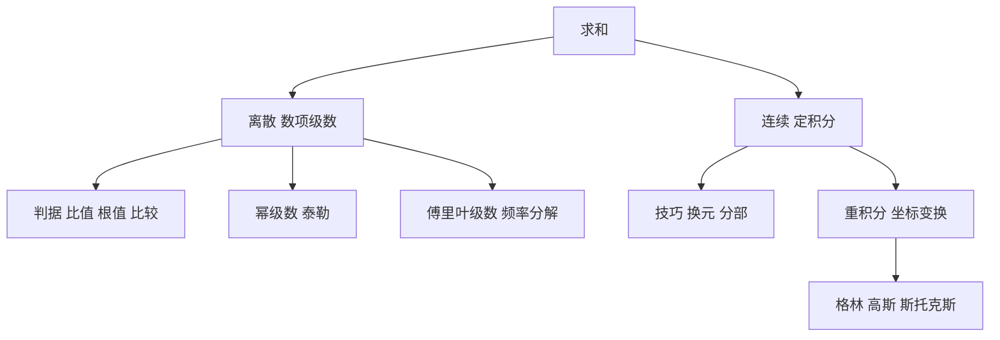

# 第 6 章：无穷级数与积分学

- **难度**：★★★ | **预估学时**：4 小时 | **前置**：第 5 章
- **对应原书**：第 7 章「无穷级数」与第 8 章「积分学」（原书 p642—742）

## 学习目标

学完本章，你能：

1. 用比值、根值、比较三种判据判断一个正项级数是否收敛。
2. 写出幂级数的收敛半径求法，并用它展开 `eˣ`、`ln(1+x)`、`1/(1−x)`。
3. 把周期函数展开成傅里叶级数，说出系数公式的含义。
4. 用换元与分部积分算不定积分，用重积分算面积、体积与质心。

## 一句话核心

级数是"离散的积分"，积分是"连续的求和"；两者的判据和技巧几乎可以一一对应。

## 零基础讲解

### 概念：数项级数的判据（难度：进阶）

级数 `Σaₙ` 收敛的必要条件是 `aₙ→0`，但不充分（调和级数 `Σ1/n` 发散）。常用判据：

| 判据 | 条件 | 结论 |
|---|---|---|
| 比值 | `lim aₙ₊₁/aₙ = L` | L<1 收敛，L>1 发散 |
| 根值 | `lim ⁿ√aₙ = L` | 同上 |
| 比较 | `aₙ ≤ bₙ` 且 `Σbₙ` 收敛 | `Σaₙ` 收敛 |
| 交错 | `aₙ` 单调减且趋于 0 | `Σ(−1)ⁿaₙ` 收敛 |

**实例**：`Σ1/n²` 收敛（p 级数 p>1 收敛），`Σ1/n` 发散（p=1）。这两条是判断其他级数的基准。

### 概念：幂级数与泰勒级数（难度：进阶）

幂级数 `Σcₙ(x−a)ⁿ` 的收敛半径 `R = 1/lim|cₙ₊₁/cₙ|`（比值法）。在 `|x−a|<R` 内绝对收敛，外面发散，端点上要单独判断。

常用展开：

- `eˣ = Σ xⁿ/n!`，全轴收敛
- `ln(1+x) = Σ(−1)ⁿ⁺¹xⁿ/n`，`|x|≤1`（x=1 时收敛到 ln2）
- `1/(1−x) = Σxⁿ`，`|x|<1`
- `sin x = Σ(−1)ⁿx^(2n+1)/(2n+1)!`

这些展开是计算器和计算机算函数值的底层方法。

### 概念：傅里叶级数（难度：进阶）

周期为 2π 的函数可以展开成

`f(x) = a₀/2 + Σ(aₙcos nx + bₙsin nx)`

系数由积分给出：

`aₙ = (1/π)∫f(x)cos nx dx`，`bₙ = (1/π)∫f(x)sin nx dx`

它的意义是把函数分解成不同频率的正弦波之和，这是信号处理的起点。方波的傅里叶级数只含奇次正弦项，系数按 `1/n` 衰减，所以用少数几项逼近方波时会出现吉布斯现象（边缘过冲）。

**类比**：傅里叶级数像把一段音乐拆成各个音高的音量。拆开以后，想滤掉某个频率，只要把对应系数置零。失效边界：只有周期函数能这样拆，非周期函数要用傅里叶变换。

### 概念：不定积分与基本技巧（难度：进阶）

不定积分是求原函数。手册给出基本积分表，配合两条技巧：

- **换元**：`∫f(g(x))g'(x)dx = ∫f(u)du`。
- **分部**：`∫u dv = uv − ∫v du`。

分部积分适合"多项式乘指数或三角"的情形，反复用能降次。

**实例**：`∫x eˣ dx`。取 `u=x`，`dv=eˣdx`，则 `du=dx`，`v=eˣ`，得 `x eˣ − ∫eˣdx = x eˣ − eˣ + C`。

### 概念：定积分与重积分（难度：高难）

定积分有中值定理、变上限求导、换元与分部。重积分把区域切成小块求和：

- 二重积分：`∬f(x,y)dxdy`，极坐标下 `dxdy = r dr dθ`。
- 三重积分：柱坐标 `dV = r dr dθ dz`，球坐标 `dV = ρ² sinφ dρ dφ dθ`。

这三个体积元是重积分最容易错的地方，记住"换坐标要乘雅可比行列式"就不会漏。

**线积分与曲面积分**是重积分的降维版本，它们和格林公式、高斯公式、斯托克斯公式配套，把"边界上的积分"与"内部积分"联系起来。

## 图示

看图说明：左右两列是同一件事的两种形态，中间的判据与技巧分别对应。最下面是三维情形，坐标变换的雅可比是共同的关键。

## 类比与实例

**类比**：级数像分期付款，积分像连续计息。前者一笔笔加，后者一刻刻积；判据管"总额会不会爆"，技巧管"怎么算得快"。失效边界：分期有固定期数，级数要求无穷项收敛，这一点在类比里体现不出来。

**实例**：判断 `Σ n/2ⁿ` 是否收敛。用比值法：`aₙ₊₁/aₙ = [(n+1)/2ⁿ⁺¹]/(n/2ⁿ) = (n+1)/(2n)`，极限为 1/2 < 1，收敛。

**第二个实例**：用极坐标算单位圆面积。`∬dxdy = ∫₀^(2π)∫₀¹ r dr dθ = 2π · (1/2) = π`。这里 `r dr dθ` 就是雅可比，漏掉 r 会算出 2π。

## 常见误解

- **别以为 `aₙ→0` 就能保证收敛**——调和级数是反例，通项趋于 0 但和发散。
- **别以为幂级数在收敛半径端点一定收敛**——端点要单独判断，`Σxⁿ/n` 在 x=1 收敛、在 x=−1 也收敛，但很多级数不同。
- **别以为傅里叶级数处处等于原函数**——在不连续点它收敛到左右极限的平均值，这是狄利克雷定理。
- **别以为换坐标不用乘因子**——极坐标要乘 r，球坐标要乘 ρ²sinφ，来源是雅可比行列式。

## 自测题（答案）

1. **单选**：`Σ 1/n²` 的敛散性是（　）。
   - A. 发散
   - B. 收敛
   - C. 条件收敛
   - D. 无法判断

   **答案：B**。解析：p 级数在 p>1 时收敛，p=2 满足条件。

2. **填空**：`Σxⁿ`（n 从 0 开始）的和函数是 `1/(1−x)`，其收敛半径是（　）。

   **答案：1**。解析：几何级数在 `|x|<1` 时收敛到 `1/(1−x)`，收敛半径为 1。

3. **简答**：极坐标下二重积分为什么要多乘一个 r？

   **答案要点**：直角坐标到极坐标的变换 `x=r cosθ`，`y=r sinθ` 的雅可比行列式值为 r，面积元 `dxdy` 变成 `r dr dθ`。不乘 r 会低估面积，单位圆会算出 2π 而不是 π。

## 复习锚点

- 判据先看通项是否趋于 0，再用比值或根值，最后用比较。
- 幂级数的收敛半径由系数比给出，端点是例外区。
- 换坐标必须乘雅可比，这是重积分最常见的失分点。
