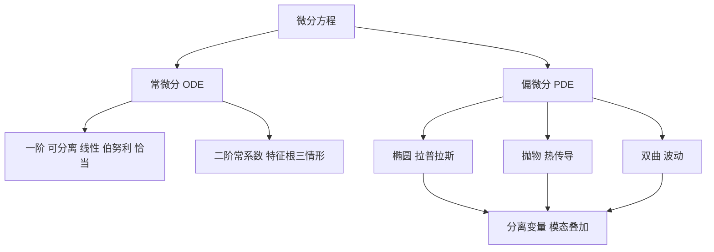

# 第 7 章：微分方程

- **难度**：★★★ | **预估学时**：4 小时 | **前置**：第 5 章、第 6 章
- **对应原书**：第 9 章「微分方程」§9.1—§9.2（原书 p743—831）

## 学习目标

学完本章，你能：

1. 判断一个一阶方程属于可分离、线性、伯努利还是恰当类型，并选对解法。
2. 解二阶常系数线性齐次与非齐次方程，说清特征根三种情形的物理含义。
3. 把二阶偏微分方程按判别式分成椭圆、抛物、双曲三类，各举一个物理例子。
4. 用分离变量法解热传导方程的简单边值问题。

## 一句话核心

微分方程把"变化规律"写成方程，解出的是满足这个规律的全部过程；阶数决定需要几个初始条件，类型决定用什么解法。

## 零基础讲解

### 概念：一阶方程的分类与解法（难度：进阶）

**可分离方程** `y' = f(x)g(y)`：把 y 和 x 分到两边，各自积分。注意分离时假设 `g(y)≠0`，`g(y)=0` 对应的常数解要单独检查。

**一阶线性方程** `y' + P(x)y = Q(x)`：乘以积分因子 `e^(∫Pdx)`，左边就变成 `(y e^(∫Pdx))'`，直接积分即可。

**伯努利方程** `y' + P(x)y = Q(x)yⁿ`：令 `u = y^(1−n)`，化成一阶线性。

**恰当方程** `M dx + N dy = 0`，若 `∂M/∂y = ∂N/∂x`，则存在势函数 `F(x,y)`，解为 `F = C`。

**实例**：解 `y' = 2xy`，`y(0)=1`。分离得 `dy/y = 2x dx`，积分 `ln|y| = x² + C`，即 `y = Ce^(x²)`。代入初值 C=1，解为 `y = e^(x²)`。

### 概念：二阶常系数线性方程（难度：进阶）

方程 `y'' + py' + qy = f(x)`。先解齐次部分 `y'' + py' + qy = 0`，特征方程 `λ² + pλ + q = 0`：

| 判别式 | 特征根 | 齐次通解 |
|---|---|---|
| `p²−4q > 0` | 两个相异实根 λ₁、λ₂ | `C₁e^(λ₁x) + C₂e^(λ₂x)` |
| `= 0` | 重根 λ | `(C₁ + C₂x)e^(λx)` |
| `< 0` | 共轭复根 α±βi | `e^(αx)(C₁cos βx + C₂sin βx)` |

三种情形对应物理上的过阻尼、临界阻尼、欠阻尼。弹簧振子的三种运动方式就是这三种解。

**非齐次**用待定系数法或常数变易法。待定系数法适用于 f(x) 是多项式、指数、正弦余弦的组合。

**类比**：二阶方程像带阻尼的弹簧。特征根是"系统自己的回应方式"，非齐次项是外力。失效边界：这个类比对线性系统成立，非线性方程没有叠加原理，解法完全不同。

### 概念：偏微分方程的分类（难度：高难）

二阶线性偏微分方程 `Au_xx + Bu_xy + Cu_yy + … = 0` 按判别式 `B²−4AC` 分类：

| 判别式 | 类型 | 典型方程 | 物理场景 |
|---|---|---|---|
| `< 0` | 椭圆型 | 拉普拉斯方程 `u_xx+u_yy=0` | 静电场、稳态温度 |
| `= 0` | 抛物型 | 热传导方程 `u_t = a²u_xx` | 扩散、传热 |
| `> 0` | 双曲型 | 波动方程 `u_tt = a²u_xx` | 弦振动、声波 |

这三类的定解条件不同：椭圆型给边界条件，抛物型给初始加边界，双曲型给两个初始条件。给错条件，解不唯一或不稳定。

### 概念：分离变量法（难度：高难）

以热传导为例：`u_t = a²u_xx`，边界 `u(0,t)=u(L,t)=0`，初始 `u(x,0)=f(x)`。

设 `u(x,t)=X(x)T(t)`，代入得 `T'/a²T = X''/X = −λ`。于是得到两个常微分方程：

- `X'' + λX = 0`，配合边界条件解出 `Xₙ = sin(nπx/L)`，`λₙ = (nπ/L)²`。
- `Tₙ' + a²λₙTₙ = 0`，解出 `Tₙ = e^(−a²λₙt)`。

把各模态叠加：`u(x,t) = Σ bₙ sin(nπx/L) e^(−a²λₙt)`，系数 `bₙ` 由初始条件用傅里叶正弦级数确定。

这个方法的骨架是"先拆成单变量，再按边界条件挑出允许的模态，最后叠加"。波动方程、拉普拉斯方程在矩形区域上都用同一套。

## 图示

看图说明：上半是"按阶数与类型分派解法"，下半是三类物理方程，最下面那条是它们共用的求解框架。分离变量能把 PDE 降成 ODE，这是全章的关键动作。

## 类比与实例

**类比**：微分方程像菜谱，初始条件是食材，解是做出来的菜。同样的菜谱配不同食材，出来的是不同的一份。失效边界：菜谱是确定的，微分方程可能无解、解不唯一或解不稳定，这些都要单独讨论。

**实例**：解 `y'' − 3y' + 2y = 0`。特征方程 `λ²−3λ+2=0`，根为 1 和 2。通解 `y = C₁eˣ + C₂e^(2x)`。若给 `y(0)=1`、`y'(0)=0`，则 `C₁+C₂=1`，`C₁+2C₂=0`，解得 `C₁=2`，`C₂=−1`，即 `y = 2eˣ − e^(2x)`。

## 常见误解

- **别以为一个初始条件就够**——n 阶方程需要 n 个独立初始条件，少给一个解就带一个自由常数。
- **别以为所有微分方程都有解析解**——绝大多数没有，实际计算靠数值方法（龙格-库塔等）。
- **别以为 PDE 的三类只是数学分类**——它们对应不同物理过程，定解条件的给法也跟着不同。
- **别以为分离变量总能成功**——它要求区域和边界条件能配合成可分离的形式，圆形区域要换成极坐标下的特殊函数。

## 自测题（答案）

1. **单选**：`y''+4y=0` 的通解是（　）。
   - A. `C₁e^(2x)+C₂e^(−2x)`
   - B. `C₁cos 2x + C₂sin 2x`
   - C. `(C₁+C₂x)e^(2x)`
   - D. `C₁cos x + C₂sin x`

   **答案：B**。解析：特征方程 `λ²+4=0` 得 `λ=±2i`，对应 `cos 2x` 与 `sin 2x`。

2. **填空**：热传导方程 `u_t = a²u_xx` 属于（　）型偏微分方程。

   **答案：抛物**。解析：判别式 `B²−4AC = 0−0 = 0`，属于抛物型。

3. **简答**：为什么二阶方程需要两个初始条件？

   **答案要点**：二阶方程的通解含两个独立常数，要定出唯一解需要两条独立信息。物理上，位置和速度共同决定运动状态，只给位置无法确定接下来的轨迹。

## 复习锚点

- 一阶方程先分类再选法：可分离、线性、伯努利、恰当，各有固定套路。
- 二阶常系数方程看特征根，三种情形对应三种物理阻尼状态。
- PDE 按判别式分三类，分离变量把 PDE 降成一组 ODE，再按边界条件选模态。
