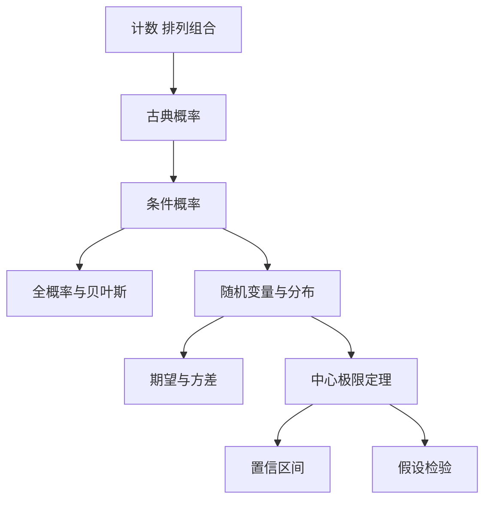

# 第 8 章：概率论与数理统计

- **难度**：★★☆ | **预估学时**：3.5 小时 | **前置**：第 2 章（函数）、第 6 章（积分）
- **对应原书**：第 16 章「概率论与数理统计」§16.1—§16.4（原书 p1082—1145）

## 学习目标

学完本章，你能：

1. 用排列组合算古典概率，区分"有序"与"无序"两种计数。
2. 写出条件概率与全概率公式，用贝叶斯公式把先验更新成后验。
3. 认出二项、泊松、正态、指数、均匀五种分布的形式与适用场景。
4. 算样本均值与样本方差，说清置信区间的含义，理解假设检验的两类错误。

## 一句话核心

概率把"不确定"变成可计算的量：先给每种结果一个权重，再用条件概率处理信息更新，最后用统计把样本推回总体。

## 零基础讲解

### 概念：组合计数（难度：基础）

**排列**关注顺序：`P(n,k) = n!/(n−k)!`。**组合**不关注顺序：`C(n,k) = n!/(k!(n−k)!)`。

区分办法：问"交换两个元素算不算新结果"。算新结果用排列，不算用组合。

**实例**：从 10 人中选 3 人组成小组，是 `C(10,3)=120` 种；选 3 人分别担任组长、副组长、记录员，是 `P(10,3)=720` 种。

### 概念：概率的基本公式（难度：基础）

- 古典概率：`P(A) = 有利结果数/总结果数`，前提是每个结果等可能。
- 加法：`P(A∪B) = P(A)+P(B)−P(A∩B)`。
- 条件概率：`P(A|B) = P(A∩B)/P(B)`。
- 全概率：`P(A) = ΣP(A|Bᵢ)P(Bᵢ)`，Bᵢ 构成完备事件组。
- 贝叶斯：`P(Bᵢ|A) = P(A|Bᵢ)P(Bᵢ)/P(A)`。

**实例**：某病患病率 1%，检测灵敏度 99%，特异度 95%。一个人检测阳性，患病概率是多少？

`P(病|阳) = 0.99×0.01/(0.99×0.01 + 0.05×0.99) = 0.0099/(0.0099+0.0495) ≈ 0.167`

也就是说，阳性者真正患病的概率只有约 16.7%。这个结果反直觉，原因在于基础患病率太低，假阳性的人数远多于真阳性。

### 概念：随机变量与常见分布（难度：进阶）

**随机变量**把结果映射成数。分布用分布函数 `F(x)=P(X≤x)` 或密度函数 `f(x)` 描述。

| 分布 | 形式 | 期望 | 方差 | 场景 |
|---|---|---|---|---|
| 二项 B(n,p) | `C(n,k)p^k(1−p)^(n−k)` | np | np(1−p) | n 次独立试验的成功次数 |
| 泊松 P(λ) | `λ^k e^(−λ)/k!` | λ | λ | 单位时间的事件数 |
| 正态 N(μ,σ²) | `(1/√(2π)σ)e^(−(x−μ)²/(2σ²))` | μ | σ² | 大量独立因素叠加 |
| 指数 E(λ) | `λe^(−λx)` | 1/λ | 1/λ² | 等待时间 |
| 均匀 U(a,b) | `1/(b−a)` | (a+b)/2 | (b−a)²/12 | 等可能的连续取值 |

**泊松是二项的极限**：n 很大、p 很小时，二项分布近似泊松，参数 `λ=np`。

**正态为什么到处出现**：中心极限定理说，大量独立同分布随机变量之和近似正态，不管原来是什么分布。这条定理是统计能用的根本原因。

### 概念：数理统计（难度：进阶）

**样本均值** `x̄ = (1/n)Σxᵢ` 是总体均值 μ 的无偏估计。**样本方差** `s² = (1/(n−1))Σ(xᵢ−x̄)²` 分母是 n−1 而不是 n，这样才是无偏的（自由度扣掉一个）。

**置信区间**：`x̄ ± z·σ/√n`（大样本）或 `x̄ ± t·s/√n`（小样本）。95% 置信区间的意思是：反复抽样构造的区间里，约 95% 会包含真值。它不是说"真值有 95% 概率落在这个区间里"。

**假设检验**：先设原假设 H₀，算检验统计量，看它落在拒绝域与否。两类错误：H₀ 为真却拒绝（第一类，概率 α），H₀ 为假却不拒绝（第二类，概率 β）。减小 α 会让 β 增大，两者此消彼长。

**类比**：置信区间像撒网捕鱼。网的大小固定，鱼在哪不知道；说"95% 的网能罩住鱼"是在说网的质量，不是在说这一网一定罩住。失效边界：这个类比只说明频率解释，贝叶斯学派对"概率"的理解不同，会给出后验区间。

## 图示

看图说明：左边是"怎么算一个事件的概率"，右边是"怎么用分布描述整体"，最下面两条是统计推断的两件工具，它们都靠中心极限定理站住。

## 类比与实例

**类比**：贝叶斯像改判。先有一个初始判断（先验），来了新证据（检测结果），按证据的可靠程度调整判断（后验）。失效边界：改判的幅度依赖先验，先验错了，后验也会偏；这一点常被忽略。

**实例**：抛一枚均匀硬币 10 次，恰好 6 次正面的概率。用二项分布：`C(10,6)(0.5)^6(0.5)^4 = 210 × 0.5^10 = 210/1024 ≈ 0.205`。

**第二个实例**：某灯泡寿命服从指数分布，平均寿命 1000 小时，求用满 500 小时还能再用 500 小时的概率。指数分布无记忆性，`P(X>1000|X>500) = P(X>500) = e^(−0.5) ≈ 0.607`。

## 常见误解

- **别以为小概率事件不会发生**——概率小只是频率低，样本足够多时它总会出现。生日悖论里 23 人就有超过 50% 的概率撞生日。
- **别以为置信区间是"真值落在其中的概率"**——真值是一个固定的数，要么在里面要么不在；95% 说的是构造方法的覆盖率。
- **别以为 p 值小就说明原假设为假**——p 值只是"在原假设成立时出现这么极端结果的概率"，它不直接给出原假设为假的概率。
- **别以为样本方差分母用 n 更好**——用 n 会系统性低估总体方差，n−1 才是无偏。

## 自测题（答案）

1. **单选**：从 5 人中选 2 人，不考虑顺序，有多少种选法？（　）
   - A. 20
   - B. 10
   - C. 5
   - D. 25

   **答案：B**。解析：`C(5,2)=5×4/2=10`。

2. **填空**：泊松分布的期望与方差都等于（　）。

   **答案：λ**。解析：泊松分布 P(λ) 的期望和方差都是 λ，这是它区别于二项分布的特征。

3. **简答**：为什么检测阳性后患病概率可能远低于检测灵敏度？

   **答案要点**：检测灵敏度是"患病者被测出阳性"的概率，而"阳性者患病"是反过来的条件概率。当基础患病率很低时，健康人数量远多于患者，即使特异度很高，假阳性的绝对数量也会超过真阳性。贝叶斯公式把这两个方向区分开。

## 复习锚点

- 计数先判断是否讲顺序，排列与组合的分界就在这里。
- 贝叶斯公式处理"由证据反推原因"，结果强烈依赖先验。
- 置信区间的 95% 说的是方法的覆盖率，不是单个区间的概率。
