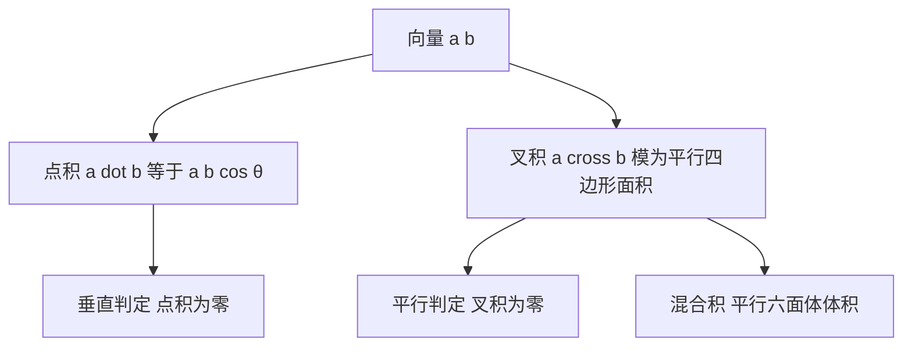

# 向量与坐标系

- **难度**：基础 | **涉及章节**：第 3 章

## 一句话定义

向量是有方向和大小的量，点积管夹角，叉积管面积与方向，坐标是把向量写成一组分量。

## 为什么重要

它把几何问题翻译成代数运算。判定垂直、求面积、算体积、解平面方程，都能用点积和叉积一次完成，不需要画辅助线。

## 图示

看图说明：左边两个运算各自管一类问题，右边三条判据是它们的直接用途。叉积的方向按右手定则，顺序不能反。

## 详解

**点积** `a·b=|a||b|cosθ`，结果是一个数。它可以算投影：`a` 在 `b` 方向上的投影长度是 `a·b/|b|`。

**叉积** `a×b` 是向量，方向垂直两者，模等于两者张成的平行四边形面积。三维才有叉积，四维以上要用外积。

**混合积** `(a×b)·c` 等于三向量张成的平行六面体体积，为零说明三向量共面。

**类比**：点积像问"你们朝同一个方向走了多少"，叉积像问"你们围出的面积有多大"。失效边界：叉积只在三维有直观的"垂直方向"，更高维要靠行列式或外积。

**实例**：`a=(1,2,3)`，`b=(4,5,6)`，点积 `1×4+2×5+3×6=32`，叉积 `(2×6−3×5, 3×4−1×6, 1×5−2×4)=(−3,6,−3)`。

## 常见误解

- **别以为叉积满足交换律**——`a×b=−b×a`，方向相反。
- **别以为点积为零就说明两向量无关**——它只说明垂直，垂直的向量在二维里也线性无关，但在更高维不一定。
- **别以为坐标系是绝对的**——换基以后分量会变，向量本身不变。

## 在书中出现的脉络

| 章节 | 语境 | 关键结论 |
|---|---|---|
| 第 3 章 §3.5 | 向量代数与解析几何 | 点积、叉积、直线与平面方程 |
| 第 3 章 §3.6 | 微分几何 | 切向量、法向量、曲率 |

## 相关概念

- 前置：三角函数（第 2 章）
- 后续：矩阵与线性变换（第 4 章）、曲率与挠率（第 3 章）
