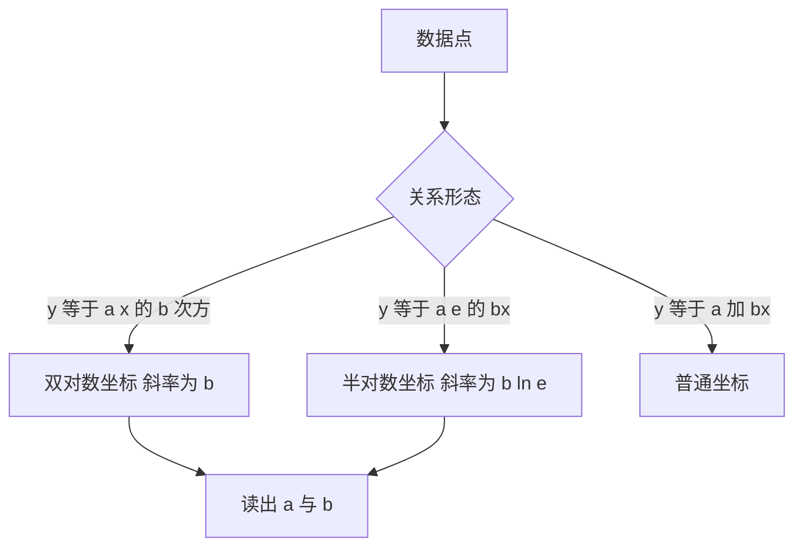

# 坐标变换与数据拟合

- **难度**：进阶 | **涉及章节**：第 2 章、第 5 章

## 一句话定义

把数据画到合适的坐标系里，让原本弯曲的关系变成直线，再用直线的斜率读出参数。

## 为什么重要

实验数据不会自带方程。要靠有限的点判断规律，最省力的办法是换坐标把曲线拉直。手册专门讲了标度与坐标纸，正是为了这件事。

## 图示

看图说明：中间三个分支对应三种常见规律，右边统一落到"读参数"。判断形态的方法是先看数据在普通坐标下是直线、幂律还是指数律。

## 详解

**幂律** `y = axᵇ`。两边取对数：`lg y = lg a + b lg x`，对 `lg x` 是线性的，斜率就是 b，截距给出 a。

**指数律** `y = ae^(bx)`。取对数：`lg y = lg a + (b lg e)x`，对 x 是线性的。

**线性** `y = a + bx`，普通坐标即可。

**判别的实用办法**：先画普通坐标，如果明显弯曲，再画半对数；半对数还是弯，就试双对数。哪张图最直，就是哪个规律。

**类比**：换坐标像换尺子。用同一把尺子量不同单位的东西，读数会乱；换成对应的尺子，数字就整齐。失效边界：拉直只适用于这两类规律，其他形式（比如 `y = a + b/x`）需要别的变换。

**实例**：某实验测得 (1, 3.0)、(2, 12.0)、(3, 27.0)、(4, 48.0)。在双对数纸上作图，斜率约为 2，截距约为 3，判断规律为 `y = 3x²`。代入 x=5 得 75，可作为预测。

## 常见误解

- **别以为直线拟合只能用于线性关系**——换坐标后任何幂律或指数律都能变成直线。
- **别以为 `lg` 和 `ln` 混用没关系**——斜率读数的含义依赖底数，混用会让参数差一个常数因子。
- **别以为拟合出的参数一定可靠**——数据点少或噪声大时，斜率估计会有很大误差。

## 在书中出现的脉络

| 章节 | 语境 | 关键结论 |
|---|---|---|
| 第 2 章 §2.16 | 经验曲线的确定 | 用换坐标判断幂律与指数律 |
| 第 2 章 §2.17 | 标度与坐标纸 | 对数纸、概率纸的用法 |
| 第 5 章 §5.1 | 函数图像 | 图像变换与伸缩 |

## 相关概念

- 前置：幂函数、指数函数、对数函数（第 2 章）
- 后续：最小二乘拟合（第 18 章优化）、回归分析（第 16 章统计）
