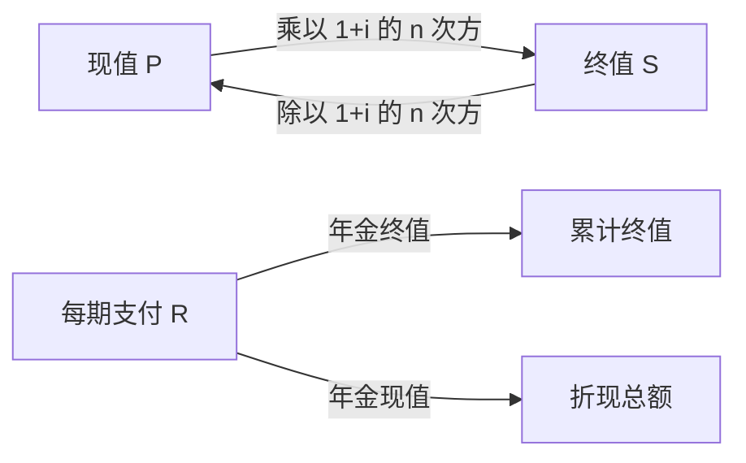

# 复利与年金模型

- **难度**：基础 | **涉及章节**：第 1 章

## 一句话定义

一笔钱按固定利率增长时，终值等于本金乘以 `(1+i)ⁿ`；反过来，未来的一笔钱折到今天要除以同一个因子。

## 为什么重要

它是手册里少数直接对应现实决策的公式。贷款、存款、养老金、设备折旧，全都落在这四个式子上。理解现值与终值的关系，才能把不同时间点的钱放到同一个尺度上比较。

## 图示

看图说明：上面的往返是单笔钱的复利与折现，下面两端是分期的聚合。所有公式都由这两条基本箭头推出。

## 详解

**复利终值** `S = P(1+i)ⁿ`。与单利 `S = P(1+in)` 的差别在于利息是否生息。期数越多，差别越大。

**复利现值** `P = S/(1+i)ⁿ`。这是把未来的钱折回今天的标准动作，贴现率越高，未来同样一笔钱今天越不值钱。

**年金终值** `S = R[(1+i)ⁿ−1]/i`，是每期支付 R、共 n 期的累计。它等于把每期支付的复利终值加总。

**年金现值** `P = R[1−(1+i)⁻ⁿ]/i`，是 n 期支付的折现总和。房贷月供就是用这条公式反解出来的。

**类比**：复利像滚雪球。雪球越大，粘上的雪越多。失效边界：真实世界的利率会变、通胀会侵蚀购买力，固定利率公式只是理想化模型。

**实例**：贷款 100 万，年利率 6%，30 年等额本息。月利率 0.005，期数 360。月供 `R = P·i/[1−(1+i)⁻ⁿ] = 1000000×0.005/[1−1.005⁻³⁶⁰] ≈ 5995.5 元`。总还款约 215.8 万，利息约 115.8 万。

## 常见误解

- **别以为单利与复利的差别很小**——30 年 6% 的差距接近一倍本金。
- **别以为利率翻倍月供就翻倍**——月供与利率不是线性关系，因为分母也在变。
- **别以为折现率可以随便取**——它反映资金的机会成本与风险，取错会让整个评估失真。

## 在书中出现的脉络

| 章节 | 语境 | 关键结论 |
|---|---|---|
| 第 1 章 §1.3 | 商业数学 | 利息、复利、分期付款、年金、折旧五组公式 |
| 第 8 章 §7.2 | 微分方程与复利 | 连续复利对应 `y'=ky` 的解 `y=Ce^(kt)` |

## 相关概念

- 前置：等比级数求和（第 1 章 §1.2）
- 后续：指数增长与微分方程（第 7 章）、连续复利（第 8 章）
