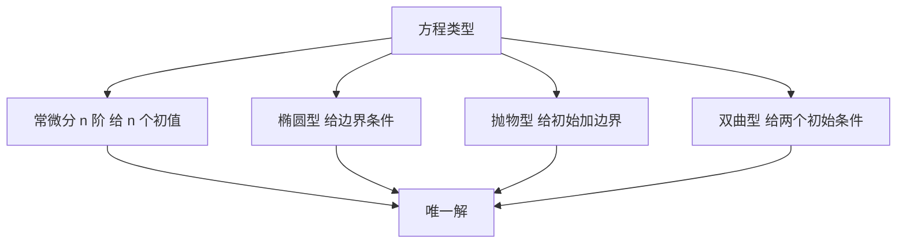

# 定解条件与方程类型

- **难度**：高难 | **涉及章节**：第 7 章

## 一句话定义

微分方程给出变化规律，定解条件从无穷多个解里挑出那一个；条件的给法由方程类型决定。

## 为什么重要

同一个方程配不同的初始条件，解完全不同。物理上这对应"同样的物理定律，不同的初始状态"。给错条件的类型，解可能不存在、不唯一或不稳定。

## 图示

看图说明：四条分支对应四类方程，右边统一到"唯一解"。判断类型是给条件之前必须做的一步。

## 详解

**常微分方程**的阶数决定初值个数。一阶给一个，二阶给两个（通常是函数值与导数）。少给一个，解里留一个自由常数。

**椭圆型**（拉普拉斯方程）描述稳态，没有时间方向，只需边界条件。

**抛物型**（热传导）描述扩散，需要初始分布加边界条件。

**双曲型**（波动）描述传播，需要初始位移与初始速度两个条件。

**类比**：方程像考试规则，定解条件像考生的答卷。规则相同，答卷不同，成绩不同。失效边界：考试总有人批改，微分方程的解要靠定理保证存在唯一，不是理所当然。

**实例**：`y''+y=0` 的通解是 `C₁cos x + C₂sin x`。给 `y(0)=0`、`y'(0)=0` 得 `y≡0`；给 `y(0)=1`、`y'(0)=0` 得 `y=cos x`。同一个方程，两个不同的物理过程。

## 常见误解

- **别以为初值条件可以随便加**——个数不对，解不唯一；位置不对，可能无解。
- **别以为 PDE 都需要初始条件**——椭圆型没有时间变量，只给边界条件。
- **别以为解一定存在唯一**——存在唯一性要由定理保证，非线性方程尤其要小心。

## 在书中出现的脉络

| 章节 | 语境 | 关键结论 |
|---|---|---|
| 第 7 章 §9.1 | 常微分方程 | 一阶与二阶方程的解法与初值 |
| 第 7 章 §9.2 | 偏微分方程 | 三类方程与分离变量 |

## 相关概念

- 前置：二阶常系数方程（第 7 章）、傅里叶级数（第 6 章）
- 后续：数值解法（第 19 章）
