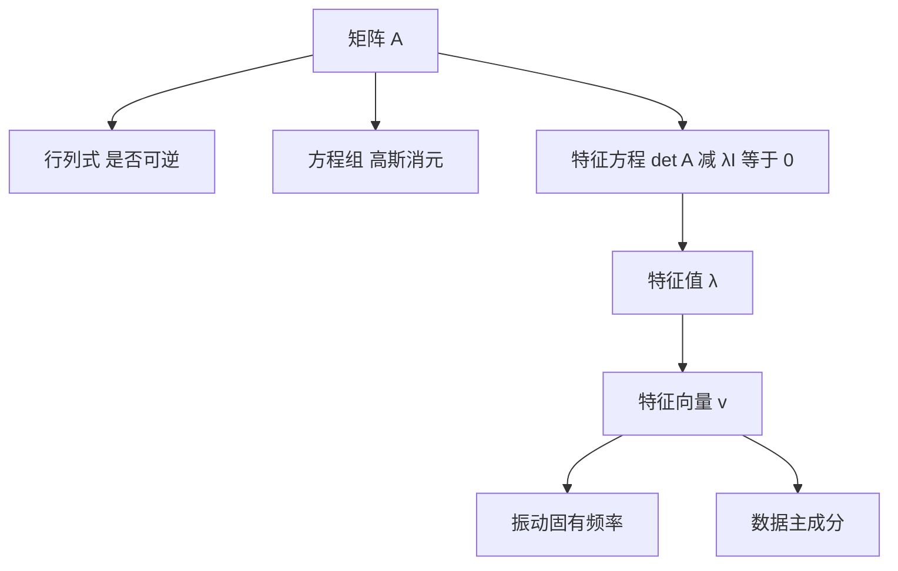

# 矩阵与特征值

- **难度**：进阶 | **涉及章节**：第 4 章

## 一句话定义

矩阵是线性变换的表格表示，特征值是这个变换在特定方向上只拉伸不转向时的拉伸倍数。

## 为什么重要

它是解线性方程组的工具，也是描述振动、旋转、数据主方向的通用语言。从结构力学到机器学习，凡是要处理多变量线性关系的地方，最后都落到特征值上。

## 图示

看图说明：左边是"能不能解"，右边是"变换的主方向"。两条线都由同一个矩阵出发，服务的却是不同问题。

## 详解

**行列式**衡量变换对体积的缩放。为零意味着维度塌缩，矩阵不可逆。

**特征值**由 `det(A−λI)=0` 求出，代回解 `(A−λI)v=0` 得特征向量。特征向量的方向在变换后不变，只改变长度。

**实对称矩阵**的特征值全是实数，特征向量互相正交，可以正交对角化。这一条让它在物理与统计里特别好用。

**类比**：矩阵像一张拉伸网。多数方向会被拉偏，只有几条特殊方向保持原方向，那几条就是特征向量，伸长倍数就是特征值。失效边界：旋转型变换（如平面转 90°）没有实特征向量，特征值是复数。

**实例**：`A=[[2,1],[1,2]]`，特征值 3 与 1，特征向量 (1,1) 与 (1,−1)。这两个方向互相垂直，符合实对称矩阵的结论。

## 常见误解

- **别以为特征值一定是实数**——旋转矩阵的特征值是复数。
- **别以为特征向量唯一**——同一特征值的特征向量可以任意缩放，通常取单位向量。
- **别以为行列式为零就没有解**——可能无解，也可能无穷多解，要看秩。

## 在书中出现的脉络

| 章节 | 语境 | 关键结论 |
|---|---|---|
| 第 4 章 §4.1—§4.2 | 矩阵与行列式 | 运算规则与可逆判据 |
| 第 4 章 §4.5 | 线性方程组 | 高斯消元与秩的关系 |
| 第 4 章 §4.6 | 矩阵特征值问题 | 特征方程与对角化 |

## 相关概念

- 前置：向量与点积（第 3 章）
- 后续：二次型与正定性（第 18 章优化）、主成分分析（第 16 章统计）
