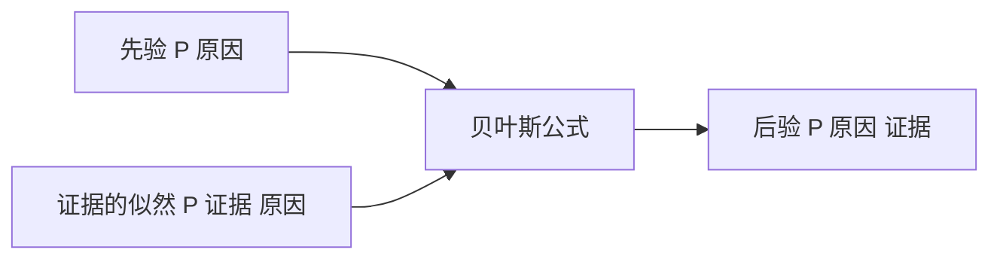

# 贝叶斯更新

- **难度**：进阶 | **涉及章节**：第 8 章

## 一句话定义

先有一个初始判断，来了新证据，按证据的可靠程度调整，得到更新后的判断。

## 为什么重要

它处理的是"由结果反推原因"这类问题，医学检测、垃圾邮件过滤、故障诊断都靠它。不理解贝叶斯，就很容易把"检测准确率"和"检测阳性后的患病概率"混为一谈。

## 图示

看图说明：左边两个输入合成右边的输出。先验变了，后验跟着变，这一点是贝叶斯与频率方法最大的不同。

## 详解

公式 `P(B|A) = P(A|B)P(B)/P(A)`。分母 `P(A)` 通常用全概率公式展开。

**关键在区分两个方向**：`P(阳性|患病)` 是灵敏度，`P(患病|阳性)` 才是患者关心的问题，两者不能互换。

**基础患病率的影响**：患病率低时，假阳性的绝对数量会超过真阳性，后验概率被压低。这就是为什么筛查通常只用于高风险人群。

**类比**：侦探查案。先有嫌疑人名单（先验），找到新物证（证据），按物证的可靠性调整怀疑程度（后验）。失效边界：现实中的证据可能相关，公式假设条件独立。

**实例**：患病率 1%，灵敏度 99%，特异度 95%。`P(病|阳) = 0.0099/(0.0099+0.0495) ≈ 16.7%`。若患病率升到 10%，同样检测下 `P(病|阳) = 0.099/(0.099+0.045) ≈ 68.8%`，相差四倍。

## 常见误解

- **别以为灵敏度就是阳性者患病的概率**——方向反了，两者差得很远。
- **别以为检测准确率高就可以放心**——基础率低时，阳性结果的可信度仍然不高。
- **别以为先验可以随便设**——先验偏差会直接带到后验，需要数据或经验支撑。

## 在书中出现的脉络

| 章节 | 语境 | 关键结论 |
|---|---|---|
| 第 8 章 §16.2 | 概率论 | 条件概率、全概率、贝叶斯公式 |
| 第 8 章 §16.3 | 数理统计 | 参数估计与后验推断 |

## 相关概念

- 前置：条件概率、全概率公式（第 8 章）
- 后续：假设检验（第 8 章）、朴素贝叶斯分类（普林斯顿 VII.5）
