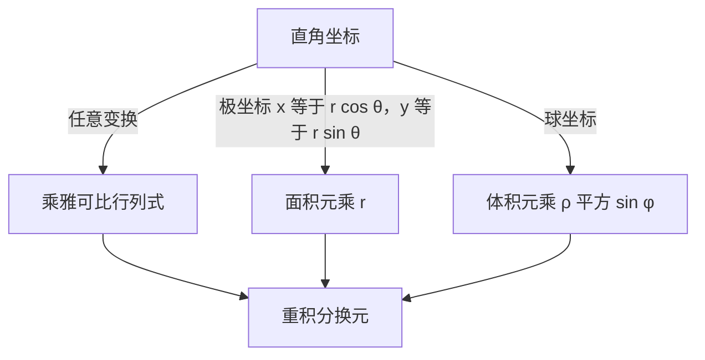

# 雅可比行列式与坐标变换

- **难度**：进阶 | **涉及章节**：第 6 章

## 一句话定义

换坐标时，面积或体积元素要乘以一个缩放因子，这个因子就是变换的雅可比行列式。

## 为什么重要

重积分算错，多半错在这里。极坐标漏了 r 会得到 2π 而不是 π；球坐标漏了 ρ²sinφ，体积会差一大截。它也是概率密度变换、连续介质力学里的基本工具。

## 图示

看图说明：三种坐标变换各自给出一个因子，右边统一成重积分的换元规则。因子的来源是"小块面积/体积被拉伸了多少倍"。

## 详解

**雅可比行列式**由变换的偏导数组成：

`J = ∂(x,y)/∂(u,v) = det[[x_u, x_v],[y_u, y_v]]`

它的绝对值就是小区域面积的缩放倍数。换元公式 `∬f dxdy = ∬f|J|dudv` 就来自这里。

**极坐标**：`x=r cosθ`，`y=r sinθ`，`J=r`，所以 `dxdy = r dr dθ`。

**球坐标**：`x=ρ sinφ cosθ`，`y=ρ sinφ sinθ`，`z=ρ cosφ`，`J=ρ²sinφ`。

**类比**：把一张橡皮膜从小格子拉伸成大格子，每个小格的面积按同一个比例放大。雅可比就是这个比例。失效边界：如果变换在不同点缩放比例不同（一般情形都是这样），要逐点取 J，不能用一个常数。

**实例**：单位圆面积 `∬dxdy = ∫₀^(2π)∫₀¹ r dr dθ = 2π·(1/2) = π`。漏掉 r 会得到 `2π×1 = 2π`，正好差一倍。

## 常见误解

- **别以为换元只要替换变量**——必须同时乘雅可比，否则面积或体积算错。
- **别以为雅可比总是正的**——它可以为负，取绝对值才对。
- **别以为所有变换的雅可比都是常数**——只有线性变换才是常数。

## 在书中出现的脉络

| 章节 | 语境 | 关键结论 |
|---|---|---|
| 第 6 章 §8.4 | 多重积分 | 二重、三重积分的坐标变换 |
| 第 6 章 §8.5 | 曲面积分 | 曲面参数化的面积元 |
| 第 5 章 §6.2 | 多元微分 | 雅可比矩阵与隐函数存在性 |

## 相关概念

- 前置：偏导数与行列式（第 4、5 章）
- 后续：曲面积分与高斯公式（第 6 章）、概率密度变换（第 8 章）
