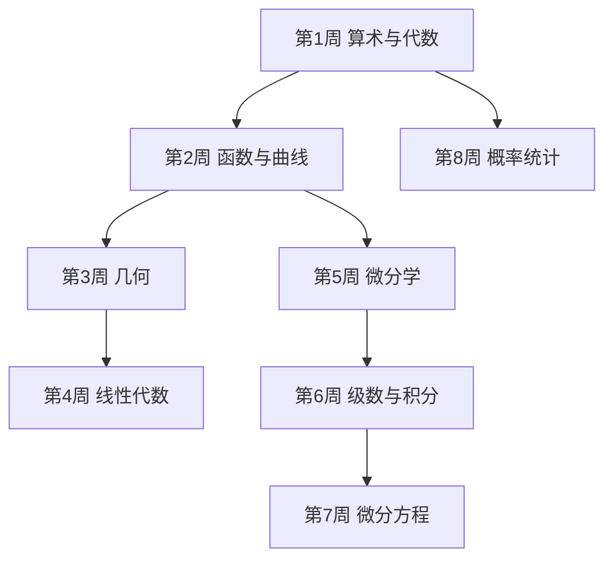

# 学习路径：把手册用起来

面向需要"临时查公式"的读者，也面向想把手册读成体系的人。终点能力：遇到一个计算问题，能在 30 秒内判断该翻哪一章、用哪条公式、套用时要注意什么。

## 路径总览

## 步骤 1：算术与初等代数

**目标**：能算复利、年金与折旧，能用不等式与求根公式解方程。
**阅读**：`chapters/ch01-算术与初等代数.md`
**检查点**：ch01 自测全对。
**复习**：卡片标签 `代数`

## 步骤 2：函数与初等函数

**目标**：能按图像认出函数族，能用坐标纸判断数据规律。
**阅读**：`chapters/ch02-函数与初等函数.md`
**检查点**：能在一组数据上判断是幂律还是指数律。
**复习**：卡片标签 `函数`

## 步骤 3：几何学

**目标**：能在平面、空间、球面三种场景里选对定理。
**阅读**：`chapters/ch03-几何学.md`
**检查点**：能写出球面余弦定理并说明它和平面版本的差别。
**复习**：卡片标签 `几何`

## 步骤 4：线性代数

**目标**：能解线性方程组，能求特征值与特征向量。
**阅读**：`chapters/ch04-线性代数.md`
**检查点**：能判断一个方程组是唯一解、无解还是无穷多解。
**复习**：卡片标签 `矩阵`

## 步骤 5：微分学

**目标**：能算偏导、梯度与方向导数，能写出泰勒展开。
**阅读**：`chapters/ch05-微分学.md`
**检查点**：能算出给定点的梯度并求最大变化率。
**复习**：卡片标签 `微分`

## 步骤 6：级数与积分

**目标**：能判断级数收敛，能用换元与分部算积分，能处理重积分的坐标变换。
**阅读**：`chapters/ch06-级数与积分学.md`
**检查点**：能用极坐标算出单位圆面积，说明 r 从哪来。
**复习**：卡片标签 `积分`

## 步骤 7：微分方程

**目标**：能解一阶方程与二阶常系数方程，能说出三类 PDE 的定解条件。
**阅读**：`chapters/ch07-微分方程.md`
**检查点**：能解 `y''−3y'+2y=0` 并代入初值。
**复习**：卡片标签 `方程`

## 步骤 8：概率与统计

**目标**：能用贝叶斯公式更新概率，能读出置信区间与假设检验的结论。
**阅读**：`chapters/ch08-概率与统计.md`
**检查点**：能算出检测阳性后的患病概率。
**复习**：卡片标签 `概率`

## 学完全程后

- 你能：拿到一个工程计算问题，先判断它属于哪一类（初等、几何、微积分、方程、统计），再定位到具体公式。
- 你能：看出公式的适用条件，知道什么时候查手册、什么时候要回原始推导。
- 综合检验：给自己出一道"混合题"，比如用积分算一个旋转体体积并用微分方程描述它的冷却过程，检验两条线能不能接上。
