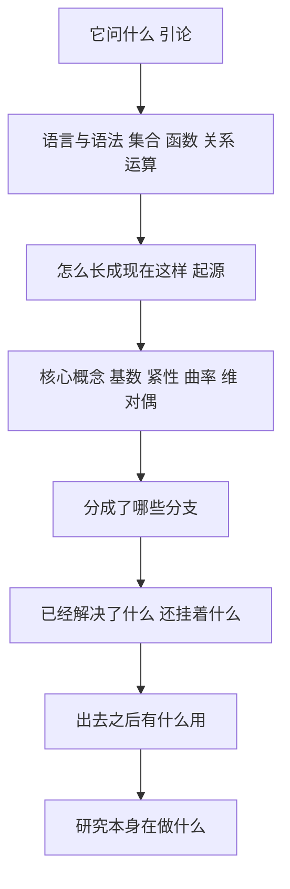

# 《普林斯顿数学指南》点化学习系统

## 这本书在讲什么

高尔斯主编的这本指南不定义数学，它用一百多个条目把数学的概念、分支、定理、人物和影响摊开，让读者自己看出这门学科在做什么。全书八部分：引论、现代数学的起源、概念、分支、定理与问题、数学家传记、数学的影响、卷末杂谈。

三卷本合起来 1685 页，条目之间靠编号交叉引用。它不适合从头读到尾，适合当"地图 + 词典"用：先看地图知道有哪些地方，需要时再翻对应条目。

本学习系统选了八条主线，每章对应原书一部分，把条目之间的引用关系显式写出来，让读者不必自己在几百个编号里找路。

## 全书心智模型

看图说明：这是一条从"元问题"到"应用"再到"元问题"的闭环。第 8 章又回到"数学研究是什么"，与第 1 章首尾相接。

## 学习路径（推荐顺序）

| 步骤 | 章节 | 主题 | 前置 | 检查点 |
|---|---|---|---|---|
| 01 | ch01 | 数学是做什么的 | 无 | 能用三分法给一个分支归类 |
| 02 | ch02 | 数学的语言与语法 | ch01 | 能正确否定一个带量词的命题 |
| 03 | ch03 | 现代数学的起源 | ch02 | 能讲出数系四次扩张各自的代价 |
| 04 | ch04 | 概念的词典 | ch03 | 能说出基数、维、亏格各量什么 |
| 05 | ch05 | 数学的各个分支 | ch04 | 能判断两个分支的借用关系 |
| 06 | ch06 | 定理与未解问题 | ch05 | 能分清已解决与独立与开放 |
| 07 | ch07 | 数学在外面的用处 | ch05 | 能举四个领域的具体贡献 |
| 08 | ch08 | 数学研究在做什么 | ch06 | 能说出五种问题类型 |

## 章节索引

- 第 1 章 数学是做什么的（难度 ★☆☆）→ `chapters/ch01-数学是做什么的.md`
- 第 2 章 数学的语言与语法（难度 ★★☆）→ `chapters/ch02-数学的语言与语法.md`
- 第 3 章 现代数学的起源（难度 ★★☆）→ `chapters/ch03-现代数学的起源.md`
- 第 4 章 概念的词典（难度 ★★★）→ `chapters/ch04-概念的词典.md`
- 第 5 章 数学的各个分支（难度 ★★☆）→ `chapters/ch05-数学的各个分支.md`
- 第 6 章 定理与未解问题（难度 ★★☆）→ `chapters/ch06-定理与未解问题.md`
- 第 7 章 数学在外面的用处（难度 ★★☆）→ `chapters/ch07-数学的影响.md`
- 第 8 章 数学研究在做什么（难度 ★★☆）→ `chapters/ch08-数学研究在做什么.md`

## 前置知识（零基础缺口补讲）

| 缺口 | 对应补讲位置 | 学完标志 |
|---|---|---|
| 不熟悉集合与映射的记号 | ch02「集合」「函数」 | 能判断单射、满射、双射 |
| 没见过群、环、域的定义 | ch02「二元运算」 | 能背出群的四条公理 |
| 不知道无穷可以比较大小 | ch04「基数」 | 能证明偶数与自然数一样多 |
| 没听过非欧几何 | ch03「几何的三次转向」 | 能说出平行公设改掉后会怎样 |
| 不知道哥德尔定理讲什么 | ch06「哥德尔不完备定理」 | 能说明它限制了什么、没限制什么 |

## 术语表 / 模式库 / 速查表 入口

- 术语表：`glossary.md`
- 模式与框架：`patterns.md`
- 速查表：`cheatsheet.md`
- 测验：`quiz.md`
- 抽认卡：`flashcards.md`
- 学习路径：`paths/learn.md`
