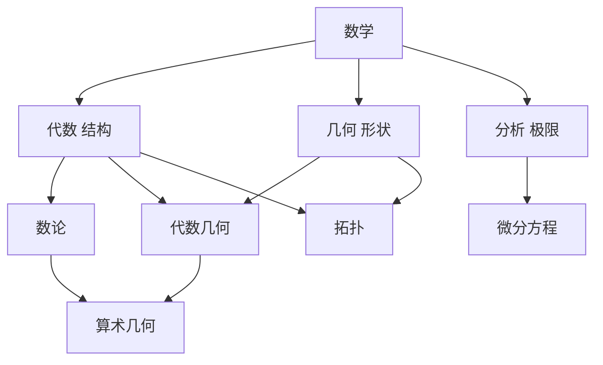

# 第 1 章：数学是做什么的

- **难度**：★☆☆ | **预估学时**：2 小时 | **前置**：无
- **对应原书**：第 I 部分 I.1「数学是做什么的」（原书 p42—50），另可参看 I.4「数学研究的一般目的」

## 学习目标

学完本章，你能：

1. 说出本书回答"什么是数学"的办法，以及它为什么不给定义。
2. 用代数、几何、分析三分法给一个陌生命题归类，并说明这个分法的局限。
3. 说出至少六个主要分支各自关心什么，以及它们之间的交叉关系。

## 一句话核心

这本书不定义数学，它用一组条目把数学的概念、定理和应用摊开，让你自己看出这门学科在做什么。

## 零基础讲解

### 概念：条目式写作（难度：基础）

《普林斯顿数学指南》的组织方式和教科书完全不同。它由一百多个独立条目组成，条目之间用编号互相引用，比如「见代数数 [IV.1]」表示去第 IV 部分第 1 条。全书分八部分：引论、历史起源、概念、分支、定理与问题、数学家传记、数学的影响、卷末杂谈。

这种写法有个好处：你可以从任何一个入口进入，不必按顺序读。代价是它不给你一条现成的主线，主线要自己拼。

**类比**：像一座城市的地图册。每个街区有自己的图，街区之间有索引。想系统走一遍要自己规划路线，想查某个地址则翻一页就够。失效边界：地图册至少还有总图，本书的总图就是这一章和 I.4。

### 概念：三分法（难度：基础）

全书开篇给了一个粗略但有用的分类：数学分成**代数**、**几何**、**分析**三块。

- 代数关心结构：数系、多项式、群、环、域、向量空间。它问"这类对象服从什么规律"。
- 几何关心形状与空间：点、线、面、流形、度量、曲率。它问"这些形状有什么关系"。
- 分析关心极限与连续：函数、导数、积分、微分方程、无穷维空间。它问"过程如何变化"。

书里立刻加了限定：这个分法是按**主题**分的，但同一门学问也可以按**问题类型**分。两个领域主题材料差很远，考察的问题却可能很像，这种情况不少见。

**实例**：代数几何同时是代数的和几何的。它研究多项式方程组的解集，对象是几何的（比如球面可以写成 `x²+y²+z²=1` 的解集），方法是代数的。

### 概念：主要分支的一览（难度：基础）

I.1 第 2 节列了十个分支，每个一两段。这份名单值得记住，因为后面第 5 章会展开：

| 分支 | 关心什么 |
|---|---|
| 代数 | 群、环、域、模等结构与它们的表示 |
| 数论 | 整数的加法与乘法结构，素数分布，丢番图方程 |
| 几何 | 空间、度量、曲率、对称 |
| 代数几何 | 多项式方程组的解集，奇点，与数论和物理的联系 |
| 分析 | 极限、连续、微分方程、无穷维空间 |
| 逻辑 | 形式系统、可证性、模型 |
| 组合学 | 计数、排列、图与网络 |
| 理论计算机科学 | 算法、复杂性、可计算性 |
| 概率论 | 随机现象、分布、极限定理 |
| 数学物理 | 用数学描述自然规律，反哺数学 |

书里特别指出：这些分支之间不是并列关系，而是互相借用。代数拓扑的名字里就同时有三个词，它用代数工具研究拓扑对象，而那些对象的性质又来自分析。

### 概念：按问题类型分类（难度：进阶）

除了按主题分，还可以按"数学家爱想什么问题"分。同一个工具会在很多领域出现：找不变量、构造反例、分类、证明不存在、估计增长速度。I.4 那一篇就是从这里切入的，末尾还讨论了数学论文的构成（定义、定理、证明、例子、猜想各承担什么角色）。

**类比**：按主题分类像按部门分办公室，按问题分类像按工作方式分。后者更能看出数学的统一性。失效边界：问题类型没有公认的完整清单，只能举例说明。

## 图示

看图说明：三条主线各有独立分支，交叉处生出新领域。代数几何、拓扑、算术几何都坐在两条线之间，这正是书里反复强调的"交织"。

## 类比与实例

**类比**：三分法像把一座城市分成居住区、商业区、工业区。分区有用，但很多建筑同时属于两类，硬分反而看不清。失效边界：城市分区是行政划分，数学分支是研究传统的划分，边界本来就在移动。

**实例**：判断"证明五次方程不能用根式解"属于哪一块。它用的是群论（代数），讨论的对象是方程的解（代数），但结论是关于"能不能用某种运算表达"的，带一点逻辑味道。书里把它放在代数条目下，同时标注它依赖对称群的结构。这说明分类是粗线条的，一个命题可以同时落在几处。

## 常见误解

- **别以为这本书是百科全书的替代品**——序里明确说"这不是一部百科全书"，它选的是有代表性的条目，不追求全。
- **别以为三分法是严格分类**——书里自己说这只是最初的近似，后面要加各种修饰。
- **别以为读这本书要从头读到尾**——条目式结构允许跳读，但跳读需要自己补主线，这一章就是补主线的起点。
- **别以为分支名单是固定的**——数学在长，名单也在变，比如理论计算机科学进入主流视野只是近几十年的事。

## 自测题（答案）

1. **单选**：本书回答"什么是数学"的办法是（　）。
   - A. 给出严格定义
   - B. 描述主要概念、定理和应用
   - C. 只讲历史
   - D. 只讲分支名单

   **答案：B**。解析：序言明确说不试图定义数学，而是通过描述概念、定理和应用给出看法。

2. **填空**：全书把数学粗略分成代数、几何和（　）三块。

   **答案：分析**。解析：这是 I.1 第 1 节给出的最初近似分类。

3. **简答**：为什么说代数几何同时是代数的和几何的？

   **答案要点**：它研究的对象是多项式方程组的解集，这是几何对象（例如球面是二次方程的解集）；它使用的方法是多项式与交换代数，这是代数工具。对象属几何，方法属代数，两者在奇点理论、与数论和物理的联系上交织。

## 复习锚点

- 这本书是条目式结构，靠交叉编号连接，主线要自己拼。
- 三分法（代数、几何、分析）是按主题的粗分，按问题类型分是另一条路。
- 主要分支互相借用工具，交叉处正是新领域生长的地方。
