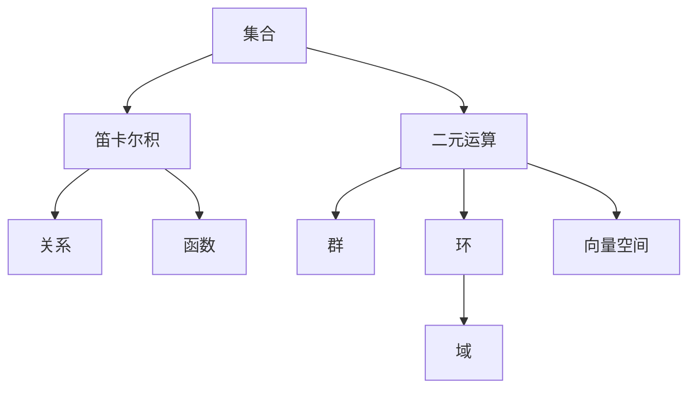

# 第 2 章：数学的语言与语法

- **难度**：★★☆ | **预估学时**：3 小时 | **前置**：第 1 章
- **对应原书**：第 I 部分 I.2「数学的语言和语法」、I.3「一些基本的数学定义」（原书 p51—80）

## 学习目标

学完本章，你能：

1. 用集合、函数、关系、二元运算四个概念描述一个数学结构。
2. 看懂 `∀`、`∃`、`¬`、`∧`、`∨` 这几个符号，能正确否定一个带量词的命题。
3. 说出群、域、向量空间、环各自由哪几条公理定义。

## 一句话核心

数学的语法只有四件东西：集合装对象，函数连对象，关系说对象之间如何，运算在对象上做组合。

## 零基础讲解

### 概念：集合（难度：基础）

**集合**是一堆对象。写法 `{1,2,3}`、`{x : x 是素数}`。基本运算：并 `∪`、交 `∩`、差 `\`、补。

关键区别：`∈`（属于）和 `⊂`（包含于）不是一回事。`1 ∈ {1,2}`，`{1} ⊂ {1,2}`。

集合描述的对象可以是任何东西：数、函数、曲线、其他集合。这一点让集合成为统一语言。

### 概念：函数（难度：基础）

**函数**是从一个集合到另一个集合的规则，每个输入对应唯一输出。记号 `f: A → B`。

三类特殊函数：**单射**（不同输入给不同输出）、**满射**（每个输出都有输入对应）、**双射**（两者都满足）。双射才有反函数。

**类比**：函数像自动售货机。投一个币，出一个确定的东西。单射是"不同币出不同货"，满射是"货架上的货都能买到"，双射是两者兼备。失效边界：售货机可能卡货（对应关系不成立），数学函数不允许。

### 概念：关系（难度：基础）

**关系**是有序对的集合，`R ⊂ A × B`。等价关系要满足三条：自反（`aRa`）、对称（`aRb` 则 `bRa`）、传递（`aRb` 且 `bRc` 则 `aRc`）。

等价关系的作用是把集合切成互不相交的类。整数的同余 `mod 5` 就是等价关系，把整数分成五类。

**序关系**是另一类，满足自反、反对称、传递。它不分类，它排序。

### 概念：二元运算（难度：基础）

**二元运算**是 `A × A → A` 的映射，比如加法、乘法。它要满足的公理定义了各种代数结构：

| 结构 | 公理要点 |
|---|---|
| 群 | 封闭、结合、有单位元、每元有逆 |
| 环 | 加法成群，乘法结合，分配律 |
| 域 | 环且非零元对乘法成群（可除） |
| 向量空间 | 加法成群，标量乘法满足分配与结合 |

**实例**：整数对加法成群（`(Z,+)`），对乘法不成群（2 没有整数逆元）。去掉 0 的有理数对乘法成群（`(Q\{0},·)`）。

### 概念：逻辑与量词（难度：进阶）

`∀`（对所有）、`∃`（存在）、`¬`（非）、`∧`（且）、`∨`（或）、`→`（蕴含）。

**否定一个量词命题**是最容易出错的地方。规则是：

`¬(∀x, P(x))` 等价于 `∃x, ¬P(x)`
`¬(∃x, P(x))` 等价于 `∀x, ¬P(x)`

也就是说，否定时量词翻转，谓词取反。

**实例**："所有天鹅都是白的"的否定不是"所有天鹅都不是白的"，而是"存在一只天鹅不是白的"。这两句话的强度差别很大。

**自由变项与约束变项**：被量词管住的变量是约束的，换了名字不影响命题；没被管住的是自由的，取值不同命题真假不同。

## 图示

看图说明：所有结构都从集合出发，经笛卡尔积分出两条路：一条通向关系与函数，一条通向运算与代数结构。

## 类比与实例

**类比**：这四个概念像语法里的名词、动词、介词、连词。集合是名词，函数是动词，关系是介词，运算是构词规则。失效边界：自然语言允许歧义，数学语法不允许，每个符号只有一个意思。

**实例**：判断 `(Z₅, +)` 是不是群，其中 Z₅ 是模 5 的剩余类。

封闭：两数相加仍是剩余类，成立。结合：继承整数的结合律。单位元：0。逆元：`−a ≡ 5−a`。四条都满足，是群。它还是交换群，因为加法可交换。

## 常见误解

- **别以为 `∈` 和 `⊂` 可以互换**——元素与集合、集合与集合，是两层关系。
- **别以为否定命题就是把"是"改成"不是"**——量词必须翻转，否则强度会错。
- **别以为群必须可交换**——交换群是特殊情形，一般群不要求交换（矩阵乘法就是反例）。
- **别以为关系只有大小关系**——等价关系、偏序关系、函数关系都是关系，各有各的公理。

## 自测题（答案）

1. **单选**："所有实数都有平方根"的否定是（　）。
   - A. 所有实数都没有平方根
   - B. 存在一个实数没有平方根
   - C. 存在一个实数有平方根
   - D. 没有实数有平方根

   **答案：B**。解析：否定全称命题得到存在命题，谓词取反，即"存在实数没有平方根"，负数就是这样的实数。

2. **填空**：只满足封闭、结合、有单位元、每元有逆这四条的结构叫（　）。

   **答案：群**。解析：这正是群的四条公理。

3. **简答**：为什么"同余 mod 5"是一个等价关系？

   **答案要点**：自反：`a ≡ a`，因为 a−a=0 能被 5 整除。对称：若 `a−b` 能被 5 整除，则 `b−a` 也能。传递：若 `a−b` 与 `b−c` 都能被 5 整除，则 `a−c=(a−b)+(b−c)` 也能。三条满足，所以是等价关系，它把整数分成五个等价类。

## 复习锚点

- 集合、函数、关系、运算四个概念足以搭出全部代数结构。
- 否定带量词的命题时，量词翻转、谓词取反，这是最容易错的一步。
- 群、环、域、向量空间的差别只在公理的取舍，看公理清单最快。

## 相关条目

- 群与域：[I.3 §2.1—§2.2]
- 集合与基数：[III.7]、[III.11]
- 逻辑与模型：[IV.23]
