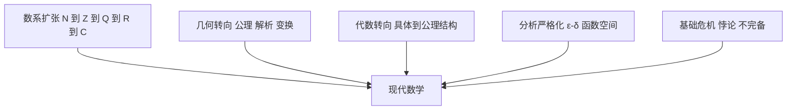

# 第 3 章：现代数学的起源

- **难度**：★★☆ | **预估学时**：3.5 小时 | **前置**：第 1、2 章
- **对应原书**：第 II 部分「现代数学的起源」（原书 p156—276），重点看 II.1 数、II.2 几何、II.3 抽象代数、II.4 算法、II.6 分析的严格化、II.7 证明的概念

## 学习目标

学完本章，你能：

1. 讲出数系从自然数扩张到复数、四元数的每一步，以及每一步解决了什么问题。
2. 说出几何经历的三次转向：公理化、解析化、非欧化。
3. 解释分析为什么要严格化，魏尔斯特拉斯和柯西各自解决了什么。
4. 说出证明概念在 20 世纪发生了什么变化。

## 一句话核心

现代数学的形态不是一次设计出来的，是四场连续的"补漏"——补数系的洞、补几何的假设、补分析的漏洞、补证明的根基——累积出来的。

## 零基础讲解

### 概念：数系的四次扩张（难度：基础）

数系的每一步都是"旧系统里有做不了的运算"，于是造一个新系统让它可做。

| 扩张 | 解决的运算 | 代价 |
|---|---|---|
| 自然数 → 整数 | 减法 `3−5` | 引入负数，失去"良序" |
| 整数 → 有理数 | 除法 `2÷3` | 引入分数，稠密但有空隙 |
| 有理数 → 实数 | 开方、极限 | 要用戴德金分割或柯西序列定义，失去可数性 |
| 实数 → 复数 | `x²+1=0` | 失去序关系，得到代数闭域 |

复数之后还有四元数，代价更大：乘法不再交换。每一步都是拿一条性质换一条能力，这个模式在数学里反复出现。

**实例**：`x²+1=0` 在实数里无解，引入 `i` 后有两个解 `±i`。高斯证明复数域是代数闭的：任何多项式在复数里都能分解成一次因子之积。这就是"拿序换完备"的收益。

**类比**：像修房子时不断加层。每加一层能住更多人，但结构必须重新验算。失效边界：数学的扩张不涉及物理限制，可以一直加下去（四元数、八元数），但每加一层要放弃一条运算律。

### 概念：几何的三次转向（难度：进阶）

**第一次：公理化。** 欧几里得把几何建立在五条公设上。十九世纪发现第五公设（平行公设）不能由前四条推出，于是有了非欧几何。

**第二次：解析化。** 笛卡尔把点对应到坐标，几何问题变成方程问题。这一步让几何能用代数算。

**第三次：变换化与拓扑化。** 克莱因的埃尔朗根纲领说：几何就是研究在某个变换群下不变的性质。欧氏几何研究刚体变换下的不变量（距离、角度），射影几何研究射影变换下的不变量（交比），拓扑研究连续形变下的不变量（连通性、亏格）。

这三步之后，几何不再只是"研究图形的形状"，而是"研究某类变换下的不变量"。

### 概念：抽象代数的诞生（难度：进阶）

十九世纪解方程的努力催生了群论。伽罗瓦发现：一个多项式能不能用根式解，取决于它的根之间的对称群是否可解。这个结论把"解方程"变成了"研究群的结构"。

随后，群、环、域、模被一条条公理定义出来，代数从"算具体对象"变成"研究满足公理的所有对象"。这个转向的收益是：证一次定理，对所有满足公理的对象都成立。

**实例**：`x⁵−x−1=0` 不能用根式解，因为它的伽罗瓦群是 S₅，而 S₅ 不可解（唯一正规子群链里有 A₅，A₅ 是单群且非交换）。这个结论不是靠试算得出的，是靠群的结构。

### 概念：分析的严格化（难度：进阶）

牛顿和莱布尼茨的微积分用的是"无穷小"，这个说法在逻辑上站不住。柯西把极限定义成"ε-δ"语言，魏尔斯特拉斯造出处处连续但处处不可导的函数，逼着大家承认"直觉不可靠"。

严格化的结果：极限、连续、收敛都有了精确定义，分析从"图形直觉"变成"不等式估计"。二十世纪又把函数空间抽象成巴拿赫空间、希尔伯特空间，分析的对象从函数变成空间。

### 概念：证明概念的变化（难度：高难）

十九世纪末，康托尔的集合论被发现含悖论（罗素悖论：`R = {x : x ∉ x}`，问 `R ∈ R` 是否成立，两个答案都矛盾）。这引发了对数学根基的重新审查。

三个主要方案：逻辑主义（把数学归约到逻辑）、直觉主义（拒绝排中律，只承认可构造的对象）、形式主义（把数学看成符号游戏，用希尔伯特纲领证明其一致性）。哥德尔 1931 年的不完备定理终结了最乐观的版本：任何足够强的形式系统里，都存在既不能证明也不能否证的真命题。

这不代表数学垮了，而是说"证明"这件事本身有边界。

## 图示

看图说明：四条线各自解决一类问题，最后汇到"现代数学"这个形态。最下面那条不是建设性的，它是审查性的，作用是给前三条划线。

## 类比与实例

**类比**：现代数学的形成像城市改造。老城区有历史遗留的窄巷（无穷小的模糊），有地基问题（集合论悖论），有新城规划（公理化）。改造不是推倒重来，是一块块补。失效边界：城市改造有完工日，数学没有，新领域还在长。

**实例**：证明 `√2` 不是有理数。设 `√2 = p/q`，p、q 互素。平方得 `2q² = p²`，故 p 为偶数，设 `p=2k`，代回得 `q²=2k²`，q 也为偶数，与互素矛盾。这个证明只用整数性质，不需要实数理论，是"扩张前"的典型论证。

## 常见误解

- **别以为非欧几何是"错的几何"**——它只是换了一条公设，在球面或双曲面上照样成立，而且有物理应用（广义相对论的时空几何）。
- **别以为数系扩张只是"加新数"**——每次扩张都要放弃旧性质（负数失去良序，复数失去序），是有代价的。
- **别以为哥德尔定理说明数学不可靠**——它限制的是形式系统的完备性，不是说已证的定理错了。
- **别以为分析严格化是数学家吹毛求疵**——处处不可导的连续函数、病态的反例，都是严格化逼出来的真实对象。

## 自测题（答案）

1. **单选**：克莱因的埃尔朗根纲领说几何研究的是（　）。
   - A. 图形的形状
   - B. 某变换群下的不变量
   - C. 坐标系的选择
   - D. 公理的数目

   **答案：B**。解析：纲领的核心是"几何等于变换群下的不变量理论"，不同几何对应不同变换群。

2. **填空**：任何次数大于等于 1 的多项式在复数域内都能分解成一次因子之积，这个性质叫代数（　）。

   **答案：闭**。解析：这就是代数闭域的定义，高斯-达朗贝尔定理保证复数域满足它。

3. **简答**：为什么 `x⁵−x−1=0` 不能用根式解？

   **答案要点**：伽罗瓦理论把"能否根式解"翻译成"伽罗瓦群是否可解"。这个方程的伽罗瓦群是 S₅，S₅ 的唯一正规子群链中含 A₅，而 A₅ 是非交换单群，所以 S₅ 不可解。因此方程不能用根式解。这个结论是结构性的，不依赖具体系数。

## 复习锚点

- 数系每扩张一步，都用一条性质换一条能力。
- 几何的核心问题从"形状"变成"变换下的不变量"。
- 哥德尔不完备定理重新划定了"证明"能走多远。

## 相关条目

- 数：[II.1]
- 几何：[II.2]、[III.26]（几何学）
- 抽象代数：[II.3]、[IV.2]（群论）
- 算法：[II.4]、[IV.20]（计算复杂性）
- 分析的严格化：[II.6]
- 证明的概念：[II.7]、[V.15]（哥德尔定理）
