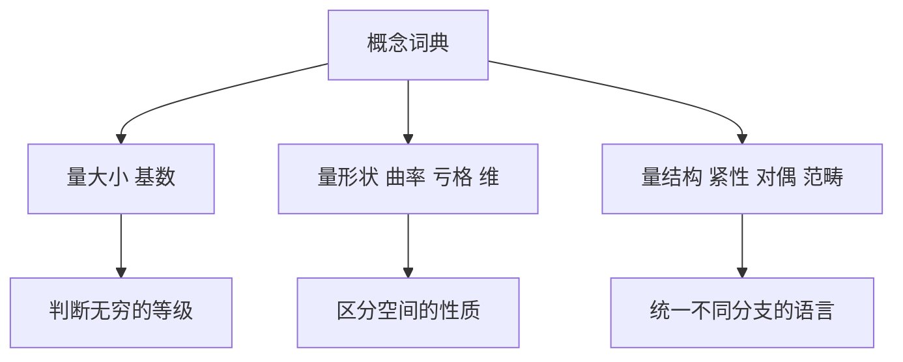

# 第 4 章：概念的词典

- **难度**：★★★ | **预估学时**：4 小时 | **前置**：第 2、3 章
- **对应原书**：第 III 部分「数学的概念」（原书 p277—544），本章只选八条最常用的概念

## 学习目标

学完本章，你能：

1. 说清基数、维、亏格这三个"数"各自量的是什么。
2. 说明紧性、对偶性、范畴三件事为什么在多个分支里反复出现。
3. 用傅里叶变换的视角解释"换一组基去看同一个对象"这个动作。

## 一句话核心

这一部分给的是概念词典：每一个词在数学各处反复出现，理解它的准确含义，比记住它在某一章的定义更有用。

## 零基础讲解

### 概念：基数（难度：基础）

**基数**量的是集合的大小，但"大小"要按一一对应来比，不按数个数。两个集合基数相同，当且仅当存在双射。

有限集合的基数就是元素个数。无限集合就不一样了：自然数与偶数基数相同（`n ↔ 2n` 是双射），尽管偶数只是自然数的一部分。这说明"部分可以和整体一样大"，无限集合的这个特征正是它的定义性特征。

**可数**：能与自然数一一对应。有理数可数，实数不可数（康托尔对角线论证）。

**类比**：点人数时不用数,让每个人找一个座位，坐满了且没空座，人数就和座位一样。失效边界：无限集合的"座位"需要显式构造双射，不能靠直观。

### 概念：紧性（难度：进阶）

**紧空间**的定义：任何开覆盖都有有限子覆盖。直观上它排除了"跑到无穷去"和"越靠近边界越挤"这两种情况。

实数里的等价说法：有界闭区间 `[a,b]` 是紧的。这个性质的价值在于：紧集上的连续函数一定取到最大值和最小值。这就是极值定理成立的原因。

**为什么重要**：分析里大量"存在性"结论都要靠紧性。想证明某个东西存在，常用套路是构造一个序列，用紧性抽出收敛子列，再证明极限就是所要的东西。

### 概念：曲率（难度：进阶）

曲线在一点的**曲率**是切线转角对弧长的变化率，`κ = dθ/ds`。圆的曲率是 `1/R`，直线是 0。

曲面有两个**主曲率** `κ₁`、`κ₂`，对应两个主方向。**高斯曲率** `K = κ₁κ₂`。球面 `K = 1/R² > 0`，平面和圆柱 `K = 0`，马鞍面 `K < 0`。

高斯绝妙定理说：高斯曲率是**内蕴**的，只靠曲面上的测量就能定出，不需要看它在三维空间里怎么弯。这条定理是微分几何的转折点。它还有个推论：曲率不为零的曲面不能等距摊平到平面，地图必然变形。

### 概念：维（难度：进阶）

日常的维是"需要几个坐标定位一个点"。数学里的维有好几种定义，彼此不一定等价：拓扑维（覆盖的精细化）、豪斯多夫维（测度随尺度变化的指数）、代数维（独立参数个数）。

它们给出不同答案的例子：分形曲线按拓扑维是 1，按豪斯多夫维可能介于 1 与 2 之间。这说明"维"不是一个绝对的东西，要看用什么尺子量。

**实例**：康托尔集去掉中间三分之一反复进行，豪斯多夫维是 `log 2 / log 3 ≈ 0.63`，比 0 大比 1 小。

### 概念：对偶性（难度：高难）

**对偶**是"同一个对象的两套描述，互相翻译"。向量空间与它的对偶空间（线性泛函构成的空间）是最基本的例子。有限维时它们同构，但同构不自然，没有典范的对应。

对偶的价值在于：把难的问题搬到对偶那边可能变简单。傅里叶变换是一种对偶（位置与频率），庞加莱对偶把同调群的高低维接起来，射影几何的对偶把点与线互换而定理仍然成立。

### 概念：范畴（难度：高难）

**范畴**由对象和对象之间的态射组成。函子是范畴之间的映射，自然变换是函子之间的映射。

它的作用是把"结构保持的映射"这件事本身对象化。群同态、连续映射、线性映射，在范畴语言里都是态射，很多定理可以统一陈述。

**类比**：范畴像把"翻译"这件事本身当作研究对象。不是研究两种语言，而是研究"什么样的翻译算合格"。失效边界：范畴论抽象层次高，入门阶段容易只见形式不见内容，先有具体例子再学它更稳。

### 概念：亏格与傅里叶变换（难度：进阶）

**亏格**是曲面上"洞的个数"。球面 0，环面 1。它是拓扑不变量，连续形变不改变它。欧拉示性数 `χ = V−E+F` 与亏格的关系是 `χ = 2−2g`。

**傅里叶变换**把函数拆成不同频率的成分。`f̂(ξ)=∫f(x)e^(−2πixξ)dx`。它的意义是换一组基：原来按位置描述，现在按频率描述。卷积在频率域变成乘法，微分变成乘以 `iξ`，很多难题因此变简单。

## 图示

看图说明：八个词按"量什么"分成三组。左组管大小，中组管形状，右组管结构。每一组都能在多个分支里找到用例。

## 类比与实例

**类比**：概念词典像工具箱里的量具。卡尺量长度，量角器量角度，万用表量电路。用错量具不是工具坏了，是问题没看清。失效边界：数学概念比量具灵活，同一个词在不同分支可能有不同定义（比如"维"），要先确认语境。

**实例**：判断环面与球面是否同胚。看亏格：球面 0，环面 1，亏格是拓扑不变量，所以不同胚。这个判断不需要构造任何映射，只看一个数。

## 常见误解

- **别以为"部分不能等于整体"**——无限集合里这经常发生，这正是无限的定义性特征。
- **别以为曲率必须看三维嵌入**——高斯曲率是内蕴的，曲面上的生物也能测出来。
- **别以为维只有一个定义**——拓扑维、豪斯多夫维、代数维可以给出不同数值。
- **别以为对偶是"另一个对象"**——对偶是同一個对象的另一套描述，翻译过去再翻回来应当无损。

## 自测题（答案）

1. **单选**：自然数集与偶数集的基数关系是（　）。
   - A. 前者更大
   - B. 后者更大
   - C. 相同
   - D. 无法比较

   **答案：C**。解析：`n ↔ 2n` 构成双射，两者基数相同，都是可数无穷。

2. **填空**：球面的亏格是（　）。（填数字）

   **答案：0**。解析：球面没有洞，亏格为 0，欧拉示性数为 2。

3. **简答**：为什么紧性对"存在性"证明特别有用？

   **答案要点**：紧性保证任何序列都有收敛子列（在度量空间里等价于序列紧），于是可以"先构造一个逼近序列，再从中抽出收敛的那一支，极限就是所求对象"。极值定理、常微分方程解的存在性、变分问题的最小元，都走这条路。

## 复习锚点

- 基数按一一对应比，不按数个数；无限集合的部分可以与整体等大。
- 高斯曲率是内蕴量，曲率非零则无法等距摊平。
- 对偶、范畴、紧性都是"跨分支通用"的概念，看到一个分支里用了，别处多半也有对应。

## 相关条目

- 基数：[III.1]
- 范畴论：[III.2]、[IV.24]
- 紧性：[III.3]
- 曲率：[III.4]、[IV.4]
- 维：[III.5]
- 对偶：[III.6]
- 亏格：[III.13]
- 傅里叶变换：[III.10]、[IV.11]
