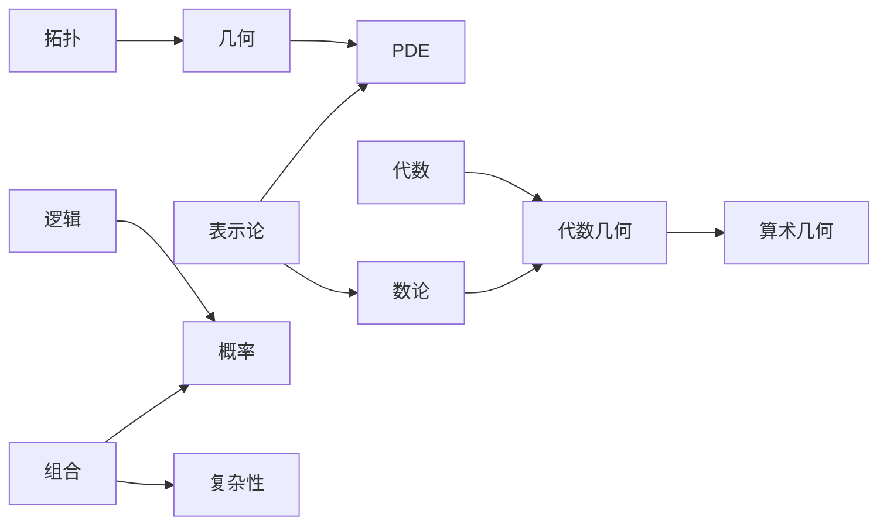

# 第 5 章：数学的各个分支

- **难度**：★★☆ | **预估学时**：4 小时 | **前置**：第 3、4 章
- **对应原书**：第 IV 部分「数学的各个分支」（原书 p545—1138），本章选八个分支各给一段定位

## 学习目标

学完本章，你能：

1. 说出每个主要分支研究的核心对象和典型问题。
2. 判断两个分支之间的借用关系，比如表示论为什么服务于数论。
3. 拿到一个新术语，能大致判断它属于哪个分支。

## 一句话核心

分支的差别不在对象，而在"它问什么样的问题"；同一个对象被不同分支问，就长出不同的学问。

## 零基础讲解

### 分支：数论（难度：进阶）

研究整数的加法与乘法结构。核心问题：素数怎么分布、丢番图方程有没有解、同余式的解怎么数。

方法从初等（欧几里得算法、二次互反律）到解析（黎曼 ζ 函数）到代数（代数数域、模形式）。二十世纪最大的进展是把数论与几何、表示论接起来，怀尔斯证费马大定理用的就是这条路。

**典型命题**：素数有无穷多个（欧几里得证明：假设有限，乘起来加一，得到新素数或矛盾）。

### 分支：代数几何（难度：高难）

研究多项式方程组的解集。核心对象是代数簇，工具是交换代数与层论。它同时是代数的（对象由多项式定义）和几何的（解集是空间）。

二十年来的主线之一是把"奇点"搞清楚：解集大多数地方像流形，少数点例外。锥面的顶点就是奇点。

### 分支：几何与拓扑（难度：进阶）

**几何**研究带度量或结构的空间：欧氏、射影、双曲、黎曼、辛。核心问题是分类与不变量。

**拓扑**研究连续形变下不变的性质。基本群、同调群、同伦群是主要工具。它有一个反直觉的特点：允许任意拉伸挤压，只要不撕开不粘合。

两者关系：几何问"度量是什么"，拓扑问"形状的骨架是什么"。庞加莱猜想就是拓扑问题（三维流形是否同胚于球面），用的工具却来自几何（黎奇流）。

### 分支：表示论（难度：高难）

把抽象群"表示"成矩阵群，也就是让每个群元素对应一个可逆矩阵，乘法保持。好处是抽象结构变成可以计算的对象。

它服务的对象很广：量子力学里的对称性、数论里的伽罗瓦表示、组合学里的对称函数。有限群的表示理论是十九世纪末到二十世纪的重要成果，特征标理论是它的核心工具。

### 分支：偏微分方程（难度：高难）

研究含多个变量偏导数的方程。三类基本方程各管一类物理：椭圆（稳态）、抛物（扩散）、双曲（波动）。

核心问题：解存不存在、唯不唯一、稳不稳定。这三件事合称"适定性"。方法从分离变量、傅里叶分析到变分法、弱解理论。

### 分支：组合学（难度：进阶）

研究离散结构的计数与构造：排列、图、网络、划分。它和概率、计算机科学关系密切，算法分析里到处都是组合估计。

**典型结果**：拉姆齐定理说，足够大的完全图染色后必然出现单色三角形。这类"大到一定程度必然出现某种结构"的结论是组合学的特色。

### 分支：逻辑与集合论（难度：高难）

逻辑研究形式系统：语言、公理、推理规则、模型。集合论研究无穷集合的层级与公理系统（ZFC）。

核心结果：哥德尔不完备定理（足够强的系统必有不可判定的命题）、连续统假设与 ZFC 独立（科恩的力迫法证明）。

这两个分支的特殊之处：它们研究数学本身，是"关于数学的数学"。

### 分支：计算复杂性（难度：进阶）

研究问题的计算难度：需要多少时间、多少空间。P 与 NP 是否相等是最大的开放问题。

它和组合学、逻辑都有交叉。它的价值不只是理论：密码学的安全假设就建立在"某些问题难算"之上，一旦 P=NP，现有公钥体系全部崩塌。

## 图示

看图说明：这张图不是分类，是"谁借谁的力"。表示论同时喂数论与物理，代数几何坐在代数与几何之间，组合学同时供概率与复杂性。

## 类比与实例

**类比**：分支像医院里的科室。内科外科看的是同一个人的不同问题，工具不同，会诊时互通。失效边界：科室边界是行政划的，数学分支的边界是研究传统自然形成的，经常移动。

**实例**：判断"证明任意 6 人中必有 3 人互相认识或 3 人互相不认识"属于哪个分支。它是拉姆齐数 R(3,3)=6 的经典结论，属组合学。证明方式是抽屉原理，不需要微积分。

## 常见误解

- **别以为拓扑是"橡皮几何"所以没内容**——允许连续形变后，剩下的不变量反而更难算，同伦群至今算不清楚。
- **别以为数论是"纯算术"**——现代数论大量使用代数几何、表示论、解析方法。
- **别以为复杂性只关心计算机**——它给"什么算难"一个数学定义，密码学的安全性就靠它。
- **别以为逻辑分支离应用很远**——程序验证、类型论、数据库查询语言都从逻辑里长出来。

## 自测题（答案）

1. **单选**：研究"连续形变下不变的性质"的分支是（　）。
   - A. 代数几何
   - B. 拓扑
   - C. 表示论
   - D. 组合学

   **答案：B**。解析：拓扑的核心就是连续形变下的不变量，如连通性、亏格、基本群。

2. **填空**：把抽象群对应成矩阵群的分支叫（　）论。

   **答案：表示**。解析：表示论把群元素映成可逆矩阵，使抽象结构可以计算。

3. **简答**：为什么 P 与 NP 是否相等会影响密码学？

   **答案要点**：现有公钥密码的安全性假设是"某些问题（如大整数分解、离散对数）难算"。若 P=NP，这些问题的多项式算法就存在，破解成本骤降，整套体系失效。所以这个理论问题有直接的安全后果。

## 复习锚点

- 分支的分界在"问什么问题"，不在"用什么对象"。
- 表示论、代数几何、组合学都是"服务型"分支，同时供给多个领域。
- 复杂性理论与现实安全直接挂钩，不是纯理论游戏。

## 相关条目

- 数论：[IV.1]、[IV.2]
- 代数几何：[IV.3]、[IV.5]
- 几何与拓扑：[IV.4]、[IV.6]、[IV.8]
- 表示论：[IV.9]
- 偏微分方程：[IV.10]、[V.12]
- 组合学：[IV.17]、[IV.19]
- 逻辑与集合论：[IV.22]、[IV.23]
- 计算复杂性：[IV.20]
