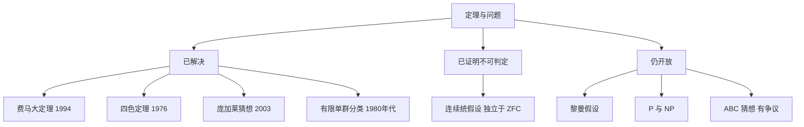

# 第 6 章：定理与未解问题

- **难度**：★★☆ | **预估学时**：3 小时 | **前置**：第 5 章
- **对应原书**：第 V 部分「定理与问题」（原书 p1139—1224），本章选九个最有代表性的

## 学习目标

学完本章，你能：

1. 说出费马大定理、四色定理、庞加莱猜想各是什么问题，以及它们在什么年代被解决。
2. 说明"独立性"是什么意思，连续统假设为什么既不能证也不能否。
3. 分清哪些问题已解决、哪些还开放，以及开放问题为什么难。

## 一句话核心

这一部分给的是数学的"里程碑清单"：有些问题耗了几百年才破，有些证明了"永远破不了"，有些还挂着。

## 零基础讲解

### 定理：费马大定理（难度：基础）

`xⁿ+yⁿ=zⁿ` 在 n≥3 时没有正整数解。费马在《算术》书页边上写下这个断言，说"空白太小写不下证明"。

1637 年提出，1994 年由怀尔斯（Andrew Wiles）证明，用了椭圆曲线与模形式的联系（谷山-志村猜想的一个情形）。证明长达 100 多页，中间曾出现漏洞，与泰勒合作修补后于 1995 年正式发表。

**为什么难**：它不是孤立问题。证明过程逼出了一个大学科（算术几何）的成熟，这也是它价值远超问题本身的原因。

### 定理：四色定理（难度：基础）

任何平面地图用四种颜色就能染，相邻区域不同色。

1852 年提出，1976 年由阿佩尔与哈肯证明，第一次大规模依赖计算机穷举。这一点当时引起争议：算不算证明？后来 2005 年贡蒂埃用 Coq 完成了形式化验证，争议基本平息。

**为什么值得记**：它是"计算机参与证明"的分界点，此后数学证明的形态开始变化。

### 定理：有限单群的分类（难度：高难）

所有有限单群都被列出来了。结果是四大类：素数阶循环群、交错群、李型群、26 个散在单群。

这项工作由上百位数学家从 1955 年做到 1980 年代，论文加起来数万页。中间出现过缺口，2004 年由阿斯赫巴赫尔与史密斯补上。

**意义**：单群是有限群的"原子"。分类完成，等于说"有限群的构成元件已经全部知道"。

### 定理：哥德尔不完备定理（难度：高难）

任何足够强、可递归公理化的形式系统，都存在一个命题，既不证明也不否证；而且系统不能在自身内部证明自己的一致性。

1931 年发表。它终结了希尔伯特纲领的最强版本，但没有终结数学：它说的是形式系统有边界，不是说已证的结论错了。

### 问题：连续统假设（难度：高难）

连续统假设（CH）：实数集的基数等于最小的不可数基数，即 `2^ℵ₀ = ℵ₁`。

哥德尔 1938 年证明 CH 与 ZFC 不矛盾（构造可构成宇宙 L），科恩 1963 年证明 CH 的否定也不矛盾（力迫法）。两者合起来说明 CH 独立于 ZFC：在标准公理系统里既不能证也不能否。

**这意味着什么**：集合论的公理不足以决定实数有多少。想要答案，必须加新公理，而加哪条是数学界的争论。

### 问题：P 与 NP（难度：进阶）

P 是多项式时间可解的问题类，NP 是多项式时间可验证解的问题类。P=NP 吗？

这是千禧年大奖难题之一，仍未解决。多数人猜 P≠NP，但没有证明。它的实际意义极大：若 P=NP，公钥密码体系失效。

### 问题：庞加莱猜想（难度：高难）

三维球面是单连通的，任何没有洞的三维闭流形都同胚于三维球面。

1904 年提出，2002—2003 年由佩雷尔曼用黎奇流解决。他拒绝菲尔兹奖与千禧年奖金，2010 年千禧年奖正式授予。

### 问题：黎曼假设（难度：高难）

黎曼 ζ 函数的非平凡零点都在临界线 `Re(s)=1/2` 上。1859 年提出，至今未解。

它的重要性在于：素数的分布规律几乎完全取决于它。素数定理（1896 年由阿达马与德拉瓦莱普桑独立证明）是它的弱形式，已经解决；完整版本还挂着。

### 问题：ABC 猜想（难度：高难）

对互素的 `a+b=c`，`c` 大致不超过 `rad(abc)` 的 `1+ε` 次方，`rad` 是各素因子只取一次的乘积。

1985 年由马瑟与奥斯特莱提出。它蕴含大量数论结论，包括费马大定理的渐近版本。2012 年望月新一宣称用他自创的 IUTT 理论证明，至今未获广泛接受，争议仍在。

## 图示

看图说明：三个分支对应三种状态。已解决的不一定是"有答案"，有些是"证明了没有答案"，这一类比另外两类更微妙。

## 类比与实例

**类比**：这些问题是数学的高峰。爬上去的路往往修出了新工具，工具比登顶本身更常用。失效边界：不是所有难题都产出工具，有些问题只是难，解决后没什么副产品。

**实例**：用 ABC 猜想推费马大定理的思路。设 `a=xⁿ`、`b=yⁿ`、`c=zⁿ` 互素。若 `n>4`，取 `ε=1/6`，则 ABC 给出 `c < K rad(abc)^(7/6)`，而 `rad(abc) ≤ abc < c³`，于是 `c < K c^(3×7/6) = K c^(3.5)`，取足够大的 c 就矛盾。所以 n>4 时解只有有限多个。这是"猜想蕴含定理"的典型用法。

## 常见误解

- **别以为"独立于 ZFC"等于"没有真假"**——它在某个具体的模型里可以为真，在另一个里为假，是公理不够，不是命题无意义。
- **别以为计算机证明不算证明**——只要验证过程可复核，逻辑上就成立；争议在"人能不能读懂"，不在"对不对"。
- **别以为黎曼假设只关系素数**——它在密码、随机矩阵、量子混沌里都有影子，是整个数学的连接点。
- **别以为望月新一的证明被否定了**——是"未被广泛接受"，争议点在 IUTT 的可检验性与推理链，不是已判定为错。

## 自测题（答案）

1. **单选**：连续统假设的地位是（　）。
   - A. 已被证明为真
   - B. 已被证明为假
   - C. 独立于 ZFC，既不能证也不能否
   - D. 尚未有人研究

   **答案：C**。解析：哥德尔与科恩分别证明它与 ZFC 及其否定都不矛盾，所以独立。

2. **填空**：庞加莱猜想由佩雷尔曼用（　）流方法解决。

   **答案：黎奇**。解析：黎奇流是汉密尔顿提出、佩雷尔曼完成关键估计的方法。

3. **简答**：为什么四色定理的证明方式引起过争议？

   **答案要点**：它第一次大规模依赖计算机穷举，人工无法逐步复核。争议的核心是"可验证性"：如果没人能读完证明，它还算证明吗？后来的形式化验证（Coq）缓解了这个问题，因为机器可以独立检查每一步。

## 复习锚点

- 已解决的定理分两种：给出答案的，和证明"没有答案"的。
- 独立于 ZFC 意味着公理不足，需要加新公理才能定论。
- 开放问题中最有名的几个：黎曼假设、P 与 NP、ABC 猜想。

## 相关条目

- ABC 猜想：[V.1]
- 费马大定理：[V.10]
- 有限单群的分类：[V.7]
- 哥德尔定理：[V.15]
- 连续统假设：[IV.22]、[V.18]
- 千禧年大奖难题：[V.22] 附近的条目群
