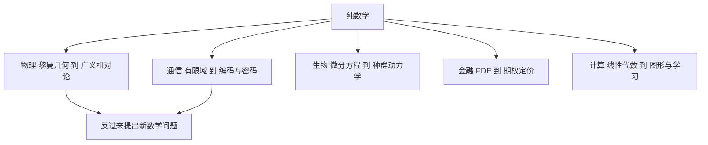

# 第 7 章：数学在外面的用处

- **难度**：★★☆ | **预估学时**：3 小时 | **前置**：第 5 章
- **对应原书**：第 VII 部分「数学的影响」（原书 p1383—1583）

## 学习目标

学完本章，你能：

1. 举出数学在物理、生物、通信、金融四个领域各一个具体贡献，说清用的是哪部分数学。
2. 解释"数学不是先有用才发展，而是发展了才被用上"这个模式，并举两例。
3. 说出公钥密码与编码理论各自依赖什么数学结构。

## 一句话核心

数学的应用大多不是"被设计出来用"的，而是"先长出来，几十年后才被认领"。

## 零基础讲解

### 应用：物理（难度：进阶）

牛顿的微积分是为力学造的，这是少见的"需求驱动"案例。但二十世纪之后就反过来了：黎曼几何在 1915 年被爱因斯坦拿来写广义相对论，而黎曼发明它是在 1854 年，隔了六十多年。

量子力学的数学基础是希尔伯特空间与算子理论，冯·诺依曼在 1930 年代把这些工具整理成型。规范场论用的纤维丛理论，也是先有数学后有物理。

**模式**：物理学界找现成工具，数学界提供"当年看起来没用"的东西。

### 应用：生物与医学（难度：进阶）

种群动力学用微分方程（洛特卡-沃尔泰拉模型描述捕食者与被捕食者的振荡）。基因测序用组合算法与字符串匹配。流行病学用网络模型与统计推断。

医学统计是更直接的一条：临床试验的样本量计算、置信区间、假设检验，全靠第 8 章那套工具。设计不当的试验即使结论"显著"，也可能是假阳性。

### 应用：通信与密码（难度：进阶）

**编码理论**解决"传输会出错怎么办"。汉明码、里德-所罗门码用有限域上的代数结构加冗余，能纠正一定数量的错误。光盘、卫星通信、二维码都在用。

**公钥密码**建立在"难算"的问题上。RSA 靠大整数分解难，椭圆曲线密码靠离散对数难。这两者的安全性都不是"证明安全"，而是"目前没人算得动"。量子计算机一旦成熟，这两条都会受威胁，于是有了后量子密码的研究。

### 应用：算法与计算（难度：进阶）

线性代数支撑图形渲染与机器学习，组合优化支撑物流与排程，数值分析支撑仿真。Strassen 算法把矩阵乘法的复杂度从 n³ 降到约 n^2.81，这类改进看似只影响常数，实际决定了大规模计算的可行性。

**注意**：算法的价值不只看渐近复杂度，还要看常数与实现。理论上的最优算法在小规模上常常输给朴素算法。

### 应用：经济与金融（难度：进阶）

期权定价的布莱克-斯科尔斯公式本质是一个偏微分方程的解（热传导方程经变量替换）。投资组合优化用二次规划。风险管理用极值理论估计尾部概率。

金融数学有个教训值得记：模型假设（如对数正态、独立同分布）在极端行情下失效，2008 年危机里"二十个标准差事件"频繁出现，说明模型的风险被低估了。

### 应用：艺术与音乐（难度：基础）

透视法用射影几何，埃舍尔的镶嵌画用双曲几何，巴赫的赋格结构被音乐理论家用群论描述。音阶的频率比是数学关系，十二平均律是把 `2^(1/12)` 作为比率。

这些例子说明：数学与艺术的联系不只在"用了公式"，更在"结构上的同构"。

## 图示

看图说明：左边是源头，中间是应用，最下面那条箭头表示反哺：应用提出的问题常常催生新数学。这条回路是数学活力的来源之一。

## 类比与实例

**类比**：数学像工具箱，很多工具造出来时不知道干什么用。几十年后有人打开箱子发现正好有一把。失效边界：不是每个工具都会被用上，很多纯数学研究确实一直没找到应用，这也不减损它的价值。

**实例**：CDMA 通信用的扩频码基于伪随机序列与有限域，这套理论在 1940 年代是数论里的纯理论，几十年后才变成手机通信的基础。类似的还有数论里的椭圆曲线：1985 年还被认为是最"没用"的分支之一，现在它同时支撑着比特币与 TLS 握手。

## 常见误解

- **别以为应用数学就是"简单的数学"**——工业里的问题常常比纯数学更难，因为没有现成框架。
- **别以为模型能预测就一定可靠**——金融与气象模型在极端情形下失效，这是模型的边界，不是bug。
- **别以为密码学的安全性被证明了**——它建立在"没人算得动"的假设上，是经验性的。
- **别以为数学的应用都是线性的**——从理论到产品常常隔几十年，中间还有大量工程转化。

## 自测题（答案）

1. **单选**：广义相对论用到的几何是（　）。
   - A. 欧氏几何
   - B. 射影几何
   - C. 黎曼几何
   - D. 双曲几何

   **答案：C**。解析：爱因斯坦用黎曼几何描述弯曲时空，黎曼在 1854 年就建立了这套几何。

2. **填空**：RSA 的安全性建立在（　）分解困难这个假设上。

   **答案：大整数**。解析：RSA 靠的是"大整数分解目前没有多项式算法"这一经验事实。

3. **简答**：为什么说数学的应用常常滞后几十年？

   **答案要点**：纯数学研究按内部逻辑推进，不为即时应用服务；应用领域要等自己的技术发展到需要某种结构的阶段，才会回头找工具。黎曼几何等了六十年，椭圆曲线等了上百年。这个滞后不是浪费，它保证了工具在被需要时已经成熟。

## 复习锚点

- 数学的应用是"先有工具后被认领"，不是"按需求造工具"。
- 密码与编码靠有限域、数论与代数结构，安全性是经验假设。
- 模型都有失效边界，极端情形下的表现才是关键检验。

## 相关条目

- 数学物理：[VII.1]、[IV.13]
- 生物学：[VII.2]
- 算法设计：[VII.5]
- 密码学：[VII.7]
- 经济与金融：[VII.10]、[VII.11]
- 音乐：[VII.13]
- 艺术：[VII.14]
