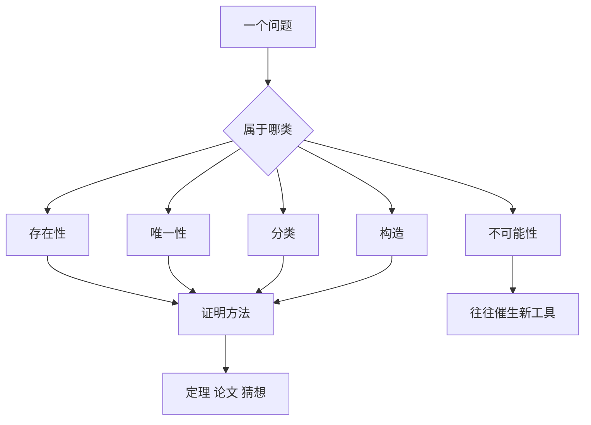

# 第 8 章：数学研究在做什么

- **难度**：★★☆ | **预估学时**：2.5 小时 | **前置**：第 1、6 章
- **对应原书**：I.4「数学研究的一般目的」（原书 p42—50 附近）与第 VIII 部分「卷末杂谈」（p1584—1685）

## 学习目标

学完本章，你能：

1. 说出数学问题的五种基本类型，并给每种举一例。
2. 看懂一篇数学论文的常见结构，知道定义、引理、定理、例子各起什么作用。
3. 说明"好问题"与"坏问题"的判断标准，以及猜想在其中的位置。

## 一句话核心

数学研究的产出不只是定理，还有定义、例子、反例、猜想和证明方法；这些东西合起来才构成一门学科。

## 零基础讲解

### 概念：五种问题类型（难度：基础）

**存在性问题**：这样的对象存在吗？例：任意连续函数在闭区间上一定取到最大值吗（是，紧性保证）。

**唯一性问题**：如果存在，只有一个吗？例：微分方程给定初值后有唯一解吗（在一定条件下是）。

**分类问题**：所有这类对象能列全吗？例：有限单群分类，二次曲线按判别式分三类。

**构造问题**：能不能造一个满足条件的对象？例：用尺规作出正十七边形（高斯证明可以）。

**不可能性问题**：为什么某件事做不到？例：三等分任意角、化圆为方、五次方程根式解。这类问题往往催生新工具，因为"证明不可能"需要先想清楚"什么算可能"。

### 概念：论文的构成（难度：进阶）

一篇典型论文包含：**定义**（引入新对象）、**例子**（说明定义不空）、**引理**（为定理铺路的技术性结论）、**定理**（主要结论）、**证明**（推理链）、**猜想**（未证但有理据的断言）、**注记**（与已有结果的关系）。

I.4 末尾专门讨论了这件事，要点是：这些成分不是装饰，各有功能。定义决定研究对象的边界，例子防止定义空转，引理把长证明切成可复核的段，猜想指明下一步方向。

**类比**：论文像建筑。定义是地基，例子是样板间，引理是承重墙，定理是屋顶，猜想是下一期的规划。失效边界：不是每篇论文都齐全，短论文可能只有一个定理加证明。

### 概念：好问题的标准（难度：进阶）

一个数学问题值得做，通常满足几条：有明确表述、与已有结构相连、解决后能带出新方法、有可检验的特殊情形。

反例：纯粹为了难而难的问题，解决后没有附带成果。高斯当年就说过费马大定理"过于孤立"，这个判断后来被证明错了——它其实连着整个算术几何。这说明"孤立与否"很难在事前判断。

### 概念：猜想的作用（难度：进阶）

猜想是"有强证据但未证明的命题"。它的作用不是等证明，而是**组织研究方向**。黎曼假设挂了一百六十多年，围绕它长出了整个解析数论；ABC 猜想挂了几十年，长出了算术几何的一大片。

**证据的层次**：数值验证（算到很大范围都成立）、特殊情形（若干情形已证）、类比（与另一领域已知结论相似）、理论支持（从更强假设推出）。这些都不是证明，但足以支撑研究。

### 概念：数学的美学判断（难度：进阶）

数学家说一个证明"漂亮"，通常指：短、意外、揭示隐藏联系、可推广。这些不是主观偏好，它们有实际后果——漂亮的证明往往能推广到别的领域，丑陋的证明往往只能用一次。

外尔说过一句常被引用的话：我的工作总是尽力把美与真统一起来，但当两者冲突时，我通常选择美。这句话的意思不是"美优先于真"，而是"在真已确定的前提下，美的证明更有生命力"。

## 图示

看图说明：五类问题各有解法套路，最右边那条单独指出"不可能性"的特殊价值：它逼着人重新定义"可能"。

## 类比与实例

**类比**：数学研究像探险。有人画地图（分类），有人找路（构造），有人证明某条路走不通（不可能性）。走不通的证明往往比走通更有价值，因为它划定了边界。失效边界：探险有终点，数学没有，一个问题解决常带出三个新问题。

**实例**：三等分角的不可解性。用尺规只能作圆与直线，对应坐标只能做加减乘除与开平方。三等分 60° 需要解 `x³−3x−1=0`，它的根不能用平方根表达（伽罗瓦群是 S₃，不可解），所以尺规做不到。这个证明把"几何作图"翻译成"域扩张"，开创了代数方法处理几何问题的路子。

## 常见误解

- **别以为数学研究就是"证定理"**——定义、例子、反例、猜想同样是产出，有时比定理更影响深远。
- **别以为"孤立的问题"不值得做**——高斯的判断错了，费马大定理后来成了整个领域的枢纽。
- **别以为数值验证够了**——算到一亿个情形都成立，也不等于证明，ABC 猜想的相关数值证据极强，仍未被接受为证明。
- **别以为"美"是主观的**——在数学里，美的判断通常对应"可推广、揭示联系"，有实际后果。

## 自测题（答案）

1. **单选**：证明"三等分任意角不可能"属于哪类问题？（　）
   - A. 存在性
   - B. 分类
   - C. 不可能性
   - D. 构造

   **答案：C**。解析：它证明的是用尺规这种工具做不到，属于不可能性问题。

2. **填空**：数学论文里为定理铺路的技术性结论通常叫（　）。

   **答案：引理**。解析：引理是辅助性命题，本身不一定重要，作用是把长证明切成可复核的段。

3. **简答**：猜想在数学研究中起什么作用？

   **答案要点**：猜想组织研究方向。它给出一个明确的目标，围绕它会长出方法、特例、相关结构。黎曼假设与 ABC 猜想都证明了这一点：即使未证，它们已经改变了整个领域的形态。

## 复习锚点

- 数学问题分五类：存在、唯一、分类、构造、不可能。
- 论文的成分各有功能，定义与例子防止研究空转。
- 猜想的价值在于组织研究，不在等待证明。

## 相关条目

- 数学研究的一般目的：[I.4]
- 证明的概念：[II.7]
- 数学家传记：[VI]
- 卷末杂谈：[VIII]
