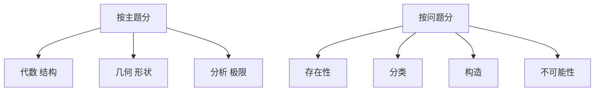

# 三分法与其他分法

- **难度**：基础 | **涉及章节**：第 1 章

## 一句话定义

把数学按主题分成代数、几何、分析三块，是最初的近似；按"问什么样的问题"分，是另一条更有统摄力的路。

## 为什么重要

它是这本书的入口分类。不懂这三分法，读条目时会觉得分支之间毫无关系；懂了它，就知道为什么代数几何、代数拓扑这类名字里要拼两个词。

## 图示

看图说明：上半是按对象分，下半是按问法分。同一个分支可以落在上半的某一格，同时散在下半的几格。

## 详解

**三分法的内容**：代数研究结构与运算（群、环、域、模）；几何研究空间与形状（度量、曲率、流形）；分析研究极限与连续（函数、微分方程、无穷维空间）。

**三分法的局限**：书里自己说这只是最初近似。真实的学科边界是移动的：代数几何同时属两块，代数拓扑的名字里就有三块。

**按问题分的好处**：两个主题完全不同的领域，可能在问同一类问题。比如数论要"分类所有素数的分布规律"，拓扑要"分类所有三维流形"，动机不同，方法却互相借用。

**类比**：三分法像按楼层分办公室，按问题分像按工作方式分。前者方便找地方，后者方便找人。失效边界：问题类型没有公认的完整清单，只能举例。

## 常见误解

- **别以为三分法是严格划分**——它是粗线条，书里明说了要加修饰。
- **别以为一个分支只能落在一块**——名字里带两个词的领域越来越多。

## 在书中出现的脉络

| 章节 | 语境 | 关键结论 |
|---|---|---|
| 第 1 章 | I.1 开篇 | 给出三分法并说明局限 |
| 第 5 章 | 各分支介绍 | 每个分支明确归属与交叉关系 |

## 相关概念

- 后续：变换群与不变量（第 3、5 章）、分支的交叉（第 5 章）
