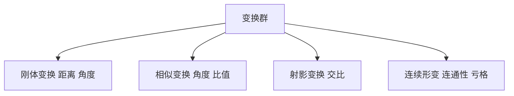

# 变换群与不变量

- **难度**：进阶 | **涉及章节**：第 3 章、第 5 章

## 一句话定义

一类几何，就是"某个变换群下不变的性质的集合"。

## 为什么重要

它把几何从"画图"变成"找不变量"。认清变换群，就知道哪些量该保留、哪些可以改。这也是判断"两个图形是否等价"的唯一可靠办法。

## 图示

看图说明：从上到下变换越松，保留的不变量越少。最下面是拓扑，只剩骨架性质。

## 详解

**克莱因纲领**：给定一个变换群 G，几何就是研究在 G 作用下不变的性质。欧氏几何对应刚体变换群，射影几何对应射影变换群，拓扑对应同胚群。

**不变量举例**：刚体变换保距离与角度；相似变换保角度、保长度比值；射影变换保交比；同胚保连通性、亏格、欧拉示性数。

**判断等价的办法**：找一个在该变换群下不变、但两个对象取值不同的量。找到就证明不等价；找不到不代表等价，可能只是没找对量。

**类比**：像判两个人的身份。外貌会变（变换），指纹不变（不变量）。找对了不变量就能判定。失效边界：不变量是必要条件，不是充分条件，除非它构成完全不变量组。

## 常见误解

- **别以为不变量越少越没用**——拓扑的不变量最少，恰恰因为它管用范围最广。
- **别以为找到一个不变量就能判定等价**——单个不变量通常只够否定，不够肯定。
- **别以为变换群只是分类工具**——它同时决定了"什么问题有意义"，在群外问距离是否不变是无意义的。

## 在书中出现的脉络

| 章节 | 语境 | 关键结论 |
|---|---|---|
| 第 3 章 | II.2 几何 | 几何的三次转向，埃尔朗根纲领 |
| 第 4 章 | III.13 亏格 | 亏格是拓扑不变量 |
| 第 5 章 | IV.4 几何、IV.8 拓扑 | 各几何对应各变换群 |

## 相关概念

- 前置：群的定义（第 2 章）
- 后续：亏格与欧拉示性数（第 4 章）、庞加莱猜想（第 6 章）
