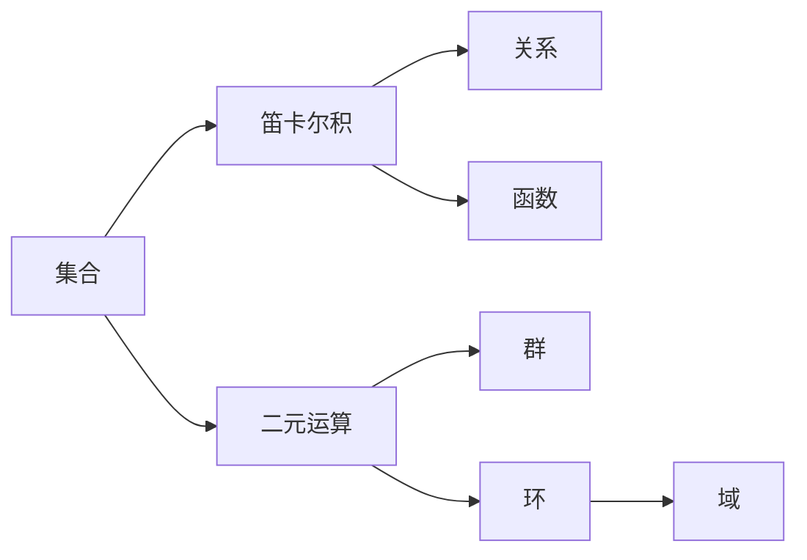

# 集合、函数、关系、运算

- **难度**：基础 | **涉及章节**：第 2 章

## 一句话定义

数学的四件基本语法：集合装对象，函数连对象，关系说对象之间如何，运算在对象上做组合。

## 为什么重要

所有代数结构（群、环、域、向量空间）都由这四件搭出来。看懂公理在说什么，前提是知道这四件各是什么。

## 图示

看图说明：一条路通向关系与函数，一条路通向运算与代数结构。两条都从集合出发。

## 详解

**集合**：一堆对象。运算有并、交、差。`∈` 是元素与集合的关系，`⊂` 是集合与集合的关系，别混。

**函数**：`f: A→B`，每输入一个值给唯一输出。单射、满射、双射是三种性质，只有双射有反函数。

**关系**：有序对的集合。等价关系（自反、对称、传递）用来分类；序关系（自反、反对称、传递）用来排序。

**二元运算**：`A×A→A`。它满足哪些公理，就决定它构成什么结构。群要四条（封闭、结合、单位元、逆元），加上交换律就是交换群。

**类比**：四件套像搭积木的四种接口。凸接口接凹接口，不同结构就是不同的拼接方式。失效边界：积木只能拼有限次，数学结构可以无限层地套（比如"所有群的集合"本身又是一个对象）。

## 常见误解

- **别以为函数必须是公式**——规则就行，表格、图像、分段定义都是函数。
- **别以为关系只有"大于小于"**——等价关系、函数关系都是关系。
- **别以为群必须可交换**——矩阵乘法就是不可交换的例子。

## 在书中出现的脉络

| 章节 | 语境 | 关键结论 |
|---|---|---|
| 第 2 章 | I.3 基本定义 | 四件套与代数结构的公理 |
| 第 4 章 | 概念词典 | 范畴把态射对象化 |

## 相关概念

- 后续：群与域（第 3 章）、范畴（第 4 章）
