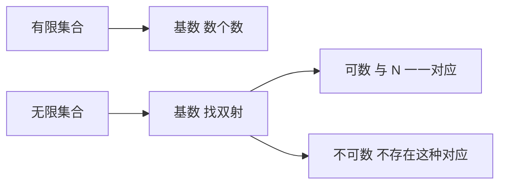

# 基数与可数性

- **难度**：进阶 | **涉及章节**：第 4 章

## 一句话定义

两个集合"一样大"，当且仅当它们之间能建立一一对应；无限集合可以与自己的真子集一样大。

## 为什么重要

它给出了比较无穷的尺子。没有它，"无穷多"只是一个模糊的词；有了它，可以分出可数无穷与不可数无穷，实数比自然数"多得多"这件事才有了意义。

## 图示

看图说明：有限时可以直接数，无限时必须靠映射。右边两条是可数与不可数的分界。

## 详解

**基数的定义**：`|A|=|B|` 当且仅当存在双射 `A→B`。这个定义在有限集合上与"数个数"一致，在无限集合上取代了它。

**可数**：能与自然数一一对应。`Z`、`Q`、代数数都可数。**不可数**：`R`、`C`、`R` 的任意区间都不可数。

**对角线论证**：假设 `(0,1)` 内的实数可数，排成 `0.a₁₁a₁₂…`、`0.a₂₁a₂₂…`，构造新数 `b`，其第 n 位取 `aₙₙ` 的相反值，则 b 不在表里，矛盾。所以无法枚举。

**连续统假设**：`2^ℵ₀=ℵ₁`？这个问题独立于 ZFC。

**类比**：数人数时不用数，让每个人找一个座位。座位坐满且没空座，人数就等于座位数。失效边界：无限情形下"座位表"必须显式构造，不能靠直观。

## 常见误解

- **别以为"部分小于整体"总是成立**——在无限集合里它常常不成立。
- **别以为有理数比整数多**——两者都只是可数无穷，基数相同。
- **别以为不可数就没有结构**——实数的结构比自然数多得多，但基数比较只看"能否配对"。

## 在书中出现的脉络

| 章节 | 语境 | 关键结论 |
|---|---|---|
| 第 4 章 | III.1 基数 | 双射定义、可数与不可数 |
| 第 6 章 | V.18 连续统假设 | CH 独立于 ZFC |

## 相关概念

- 前置：函数与双射（第 2 章）
- 后续：连续统假设（第 6 章）、测度与积分（第 4 章）
