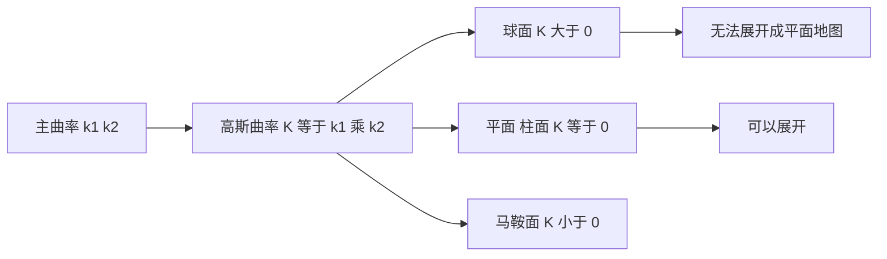

# 曲率与内蕴几何

- **难度**：进阶 | **涉及章节**：第 4 章、第 5 章

## 一句话定义

曲率衡量"弯得多厉害"；高斯曲率是内蕴的，住在曲面上的人自己就能测出来，不需要看外面。

## 为什么重要

它决定了曲面能不能摊平。高斯曲率为零的曲面（柱面、锥面）能展成平面做地图，非零的（球面）不能，地图必然变形。

## 图示

看图说明：三个例子对应三种符号。能否摊平只看 K 是否为零，不看它弯成什么样。

## 详解

**曲线曲率** `κ=dθ/ds`，圆的曲率是 `1/R`，直线是 0。

**曲面主曲率** `κ₁`、`κ₂` 是两个主方向上的弯曲程度。**高斯曲率** `K=κ₁κ₂`，**平均曲率** `H=(κ₁+κ₂)/2`。

**高斯绝妙定理**：K 是内蕴量。曲面上的生物只靠测量距离与角度就能算出 K，不需要嵌入三维空间。

**意义**：等距变形保 K。这解释了为什么球面不能展平，也解释了地图投影必然有变形（只能选保留什么、放弃什么）。

**类比**：像一张纸上画三角形，量内角和。平面是 180°，球面大于 180°，马鞍面小于 180°。这个偏差就是曲率的痕迹。失效边界：类比只在小尺度上直观，大范围要积分。

## 常见误解

- **别以为曲率必须从三维看**——它是内蕴量，这是高斯定理的核心。
- **别以为柱面"弯"所以不能摊平**——柱面 K=0，能摊平，弯的是外在形状。
- **别以为 K=0 就一定是平面**——柱面、锥面都 K=0，它们局部与平面等距。

## 在书中出现的脉络

| 章节 | 语境 | 关键结论 |
|---|---|---|
| 第 4 章 | III.4 曲率 | 主曲率、高斯曲率、绝妙定理 |
| 第 5 章 | IV.4 几何 | 黎曼曲率张量、爱因斯坦方程 |
| 第 7 章 | VII.1 数学物理 | 广义相对论的时空几何 |

## 相关概念

- 前置：微积分与偏导数（第 3 章）
- 后续：黎曼几何（第 5 章）、广义相对论（第 7 章）
