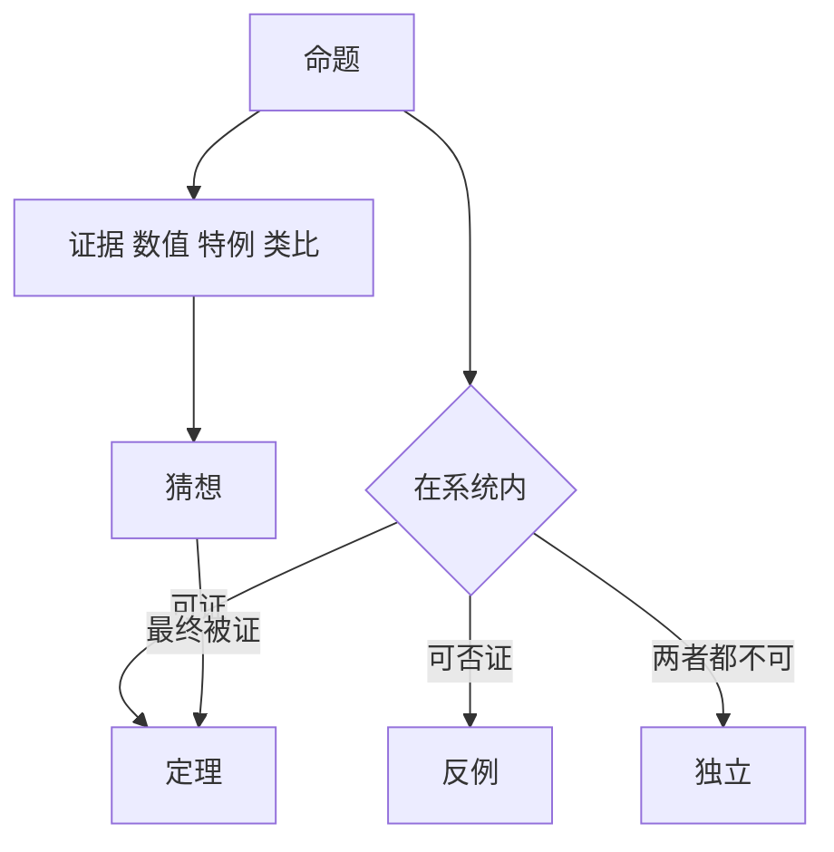

# 猜想、独立性与证明的边界

- **难度**：高难 | **涉及章节**：第 6 章、第 8 章

## 一句话定义

猜想是有强证据但未证明的命题；独立于公理系统是说"这个命题在系统里既不能证也不能否"；两者合起来划出了证明能走多远。

## 为什么重要

它回答了"数学是不是总有一天能解决所有问题"。哥德尔说不；科恩与哥德尔合起来给出了一个具体的例子（连续统假设）。同时它也说明了猜想为什么值得长期投入。

## 图示

看图说明：上面三条是命题在系统里的三种地位，下面那条是"证据推动猜想走向定理"的路。

## 详解

**猜想的证据层次**：数值验证（算到很大范围）、特殊情形已证、与已知结论的类比、从更强假设推出。四者都不是证明。

**独立性**：CH 独立于 ZFC，由哥德尔（1938，可构成宇宙）与科恩（1963，力迫法）两边合起来证明。意思是标准公理不足以决定它。

**哥德尔不完备**：任何足够强、可递归公理化的系统，都有不可判定命题，且不能在内部证明自身一致。

**类比**：公理系统像一套法律。有些案子法律有明文（定理），有些违法（反例），有些法律没规定（独立）。没规定不代表没是非，只是这套法律管不到。失效边界：法律可以修订，数学加公理也会改变结论，这正是集合论争论的焦点。

## 常见误解

- **别以为独立等于"无意义"**——它在不同模型里有不同真值，是公理不足。
- **别以为不完备说明数学不可靠**——它限制的是形式系统的完备性，已证定理不受影响。
- **别以为猜想只是"等着被证"**——它组织研究方向，本身就在产出方法。

## 在书中出现的脉络

| 章节 | 语境 | 关键结论 |
|---|---|---|
| 第 6 章 | V.15 哥德尔、V.18 连续统 | 不完备与独立性 |
| 第 8 章 | I.4 研究的目的 | 猜想如何组织研究 |

## 相关概念

- 前置：形式系统与量词（第 2 章）
- 后续：力迫法与模型论（第 5 章）
